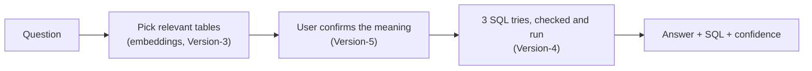
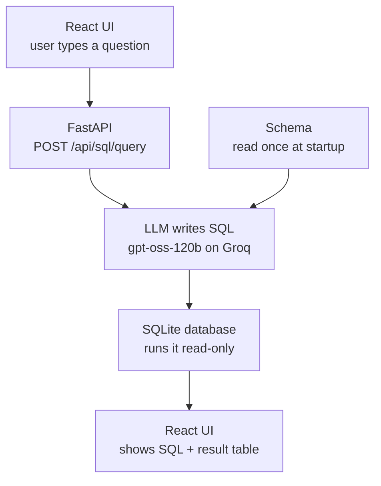
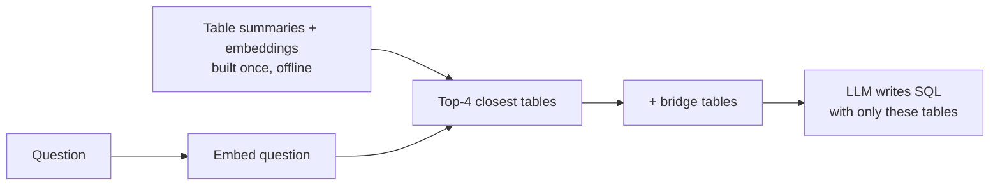

# Rexie

*Ask your documents and your data in plain English.* (Formerly "Retrieval and Reasoning Engine".)

Rexie answers questions **only from our own data**. It's one app with two products:

| Product | Answers from | How | Status |
|---|---|---|---|
| **Product-1: Rexie Scribe** (RAG, Retrieval-Augmented Generation) | Your documents (PDF, Word, Markdown, text) | Finds the relevant passages in the documents you pick, writes an answer and cites them | Complete, **hidden for now** |
| **Product-2: Rexie Scout** (Text-to-SQL) | SQLite databases | Confirms what you mean, writes SQL, checks it, runs it and shows the result | In progress |

**Scribe is hidden for now:** the app shows **Scout**, **Dashboard** and **Architecture**, and opens on Scout. Its code and API are unchanged; set `SHOW_SCRIBE = true` in `frontend/src/App.jsx` to bring the tab back. The Dashboard's question list no longer shows a Scout / Scribe tag on each row.

**Architecture tab:** how Scout is built, in the app itself: a block diagram of today's design (UI, API, the six pipeline stages, the services and data they use, the issues and the Failure Analyst), each block tagged with the version that added it; a Version-1 diagram for contrast; then every version as *Problem → What we thought → What we added*, with its measured result, and what's still open. Static content in `frontend/src/tabs/ArchitectureTab.jsx`.

## Contents

- [Goal](#goal)
- [Project Structure](#project-structure)
- [Getting Started](#getting-started)
- [Product-1: Rexie Scribe (RAG)](#product-1-rexie-scribe-rag)
  - [Version-1: RAG Engine](#version-1-what-we-built)
  - [Version-2: Your Sources](#version-2-your-sources)
- [Product-2: Rexie Scout (Text-to-SQL)](#product-2-rexie-scout-text-to-sql)
  - [Version-1: Baseline](#version-1-baseline)
  - [Version-2: Database Descriptions](#version-2-database-descriptions)
  - [Version-3: Scaling to Large Databases](#version-3-scaling-to-large-databases)
  - [Version-4: Trustworthy SQL](#version-4-trustworthy-sql)
  - [Version-5: Confirm the Meaning First](#version-5-confirm-the-meaning-first)
  - [Version-6: Know Your Tables](#version-6-know-your-tables)
  - [Version-7: Safety (Read-Only)](#version-7-safety-read-only)
  - [Version-8: Performance (Heavy Queries)](#version-8-performance-heavy-queries)
  - [Version-9: Error Book (Learning from SQL Errors)](#version-9-error-book-learning-from-sql-errors)
  - [Version-10: Check the Steps, Rate the Answer](#version-10-check-the-steps-rate-the-answer)
  - [Version-11: Failure Analyst (an AI Agent)](#version-11-failure-analyst-an-ai-agent)
  - [Version-12: Reuse Recent Answers](#version-12-reuse-recent-answers)
- [The App (UI)](#the-app-ui)
- [Dashboard (LLM Usage and Cost)](#dashboard-llm-usage-and-cost)
- [Fixes](#fixes)
- [Known Issues](#known-issues)
- [Models](#models)

## Goal

Build a personal, ChatGPT-like assistant that answers questions **only from the data we give it**: it finds the most relevant pieces of our data, reasons over them with an LLM, and shows what it used, so answers stay grounded instead of made up.

- **Rexie Scribe** (RAG) does this over documents: it retrieves passages and cites them.
- **Rexie Scout** (Text-to-SQL) does this over databases: it writes SQL, runs it, and shows the query and the result table.

---

## Project Structure

```
multimodal-retrieval-engine/
├── backend/
│   ├── main.py              # one FastAPI server for both products + serves the React app (+ optional password)
│   ├── config.py            # all API keys (read from .env), model names and limits
│   ├── llm.py               # the one LLM client: time limit + retries; chat() records every call
│   ├── usage.py             # Dashboard: every LLM call per question (tokens, time, cost) in SQLite
│   ├── dashboard_api.py     #   /api/usage/... (summary, timeline, questions)
│   ├── issues_api.py        #   Version-11: /api/issues/... (issues, start the agent, approve / reject)
│   ├── agent/               # Version-11: the Failure Analyst (an AI agent)
│   │   ├── tools.py         #   its read-only tools (tables, column values, test queries, error book)
│   │   ├── analyst.py       #   the agent loop: LLM → tool → result → ... → report
│   │   └── fixes.py         #   code tests the suggested fix, and applies it once approved
│   ├── rag/                 # Rexie Scribe (RAG)
│   │   ├── api.py           #   /api/rag/... (query, feedback, documents)
│   │   ├── documents.py     #   Version-2: list and upload documents (.txt .md .pdf .docx)
│   │   ├── pipeline.py      #   encode → search → re-rank → answer
│   │   ├── encoders/        #   text embeddings (all-mpnet-base-v2)
│   │   ├── retrieval/       #   vector index + re-ranker
│   │   ├── reasoning/       #   LLM answer with citations
│   │   └── feedback/        #   thumbs up/down logger
│   └── text_to_sql/         # Rexie Scout (Text-to-SQL)
│       ├── api.py           #   /api/sql/... (interpret, query, tables)
│       ├── pipeline.py      #   question → tables → meaning → SQL → checks → result
│       ├── sql_generator.py #   LLM writes the SQL
│       ├── database.py      #   loads .sqlite files, runs SQL read-only
│       ├── descriptions.py  #   Version-2: reads database descriptions, adds them to the schema
│       ├── schema_index.py  #   Version-3: finds relevant tables with embeddings
│       ├── table_summaries.py # Version-3: LLM-written table summaries; Version-6: rewrites from corrections
│       ├── checks.py        #   Version-4: deterministic checks before and after running SQL
│       ├── interpreter.py   #   Version-5: up to 3 meanings of the question for the user to pick
│       ├── planner.py       #   Version-10: the steps the user checks (re-run from their comments)
│       ├── wording.py       #   Version-10: everyday words in what the user reads
│       ├── safety.py        #   Version-7: blocks anything that could change a database
│       ├── results.py       #   Version-8: recent results kept for paging (LRU cache)
│       ├── answer_cache.py  #   Version-12: recent answers, reused for the same question in other words
│       ├── sql_errors.py    #   Version-9: the error book (known SQLite errors, hints, log)
│       └── catalog.py       #   Version-6: table list (10 per page), adding a .sqlite database
├── frontend/                # React app (Vite)
│   └── src/
│       ├── tabs/            #   ScribeTab = RagTab (Ask) + SourcesTab (Sources); ScoutTab = SqlTab (Ask) + TablesTab (Tables); DashboardTab = Usage + IssuesView (Issues); ArchitectureTab = design diagrams + every version
│       ├── components/ui.jsx #  icons, loading, alerts, SQL highlighting, pager, data table
│       └── styles.css       #   design tokens (light + dark), layout
├── data/
│   ├── rag/                 # Scribe: documents (raw_docs), built index, eval set
│   └── text_to_sql/         # Scout: one folder per database
│       ├── retail_store/    #   practice DB, descriptions, 20 questions + answers
│       ├── sql_errors.json  #   Version-9: known SQLite errors and their fixes (edit by hand)
│       └── logs/            #   Version-9: SQL error log (git-ignored)
├── tests/                   # pytest: the deterministic rules, no API key or LLM calls
├── scripts/
│   ├── rag/                 # build the index, retrieval eval, RAGAS metrics
│   └── text_to_sql/         # evaluate.py: execution accuracy on question sets
├── .env.example             # template for API keys (copy to .env)
└── requirements.txt
```

---

## Getting Started

### 1. Python environment (first time only)

```bash
python3 -m venv .venv
source .venv/bin/activate
pip install -r requirements.txt
```

In every new terminal after that, just run `source .venv/bin/activate`.

### 2. API keys

All keys live in one file. Copy the template and fill it in:

```bash
cp .env.example .env
```

| Key | Used by | Required? |
|---|---|---|
| `GROQ_API_KEY` | Scribe answers and Scout | Yes ([get one](https://console.groq.com/keys)) |
| `HF_TOKEN` | Scribe's RAGAS evaluation scripts | Optional |

`.env` is git-ignored, so keys never reach GitHub.

### 3. Build the UI (first time, and after UI changes)

```bash
cd frontend && npm install && npm run build && cd ..
```

### 4. Run

```bash
uvicorn backend.main:app --reload
```

Open **http://localhost:8000** and pick a product: **Scribe** (views: **Ask**, **Sources**) or **Scout** (views: **Ask**, **Tables**).

> **Editing the UI?** Run `npm run dev` inside `frontend/` and open http://localhost:5173 for instant reload (the backend must also be running).

### Useful commands

| Task | Command |
|---|---|
| Rebuild Scribe's whole index (after editing or deleting files by hand) | `python -m scripts.rag.build_index` |
| Score Text-to-SQL on the practice questions | `python -m scripts.text_to_sql.evaluate` |
| Check table picking only (no LLM calls) | `python -m scripts.text_to_sql.evaluate --retrieval-only` |
| Compare with sending every table | `python -m scripts.text_to_sql.evaluate --full-schema` |
| Summarize new/changed tables (LLM), then embed | `python -m scripts.text_to_sql.build_schema_index` |
| Re-embed only, no LLM calls | `python -m scripts.text_to_sql.build_schema_index --skip-summaries` |
| Run only some questions | `python -m scripts.text_to_sql.evaluate --ids 3,7,8` |
| Run the tests (no API key, ~10 s) | `python -m pytest` |
| Report on SQL errors: what to add to the error book | `python -m scripts.text_to_sql.sql_errors` |
| Score Scout the way the app works (confirm the meaning first) | `python -m scripts.text_to_sql.evaluate --confirm` |
| API docs (auto-generated) | http://localhost:8000/docs |

---

## Product-1: Rexie Scribe (RAG)

### Target

Build a complete, working end-to-end RAG (Retrieval-Augmented Generation) pipeline, from raw documents to a cited answer in a web UI, and measure how well it performs so there's a baseline to improve on.

### Version-1: What We Built

#### Version-1.1: Basic Text Semantic Search + Bullet Summary

We built the basic architecture.

- **Frontend:** takes text as input (like a search bar) and shows the relevant output.
- **Backend:**
  1. Reads the data sources we provide, breaks them into chunks, creates a vector embedding for each chunk and stores them.
  2. Takes the query and compares it with the stored chunks to find the nearest ones.
  3. Computes cosine similarity, sorts by similarity and normalizes scores between 0 and 1.
  4. Keeps the ones above a threshold.
  5. Returns them as bullet points.

#### Version-1.2: LLM-Powered Answering (True RAG)

The pipeline so far only returned the top-k chunks. Now we use an actual LLM to reason over them and write a proper answer.

- Tried `microsoft/Phi-3-mini-4k-instruct` locally: decent reasoning, but very slow.
- For now, we keep showing the relevant top-k chunks alongside the answer.

#### Version-1.3: Smarter Chunking (Token-based + Overlap)

We used to store one line of a paragraph as one chunk. Now we split text into words using a **sliding window**: a chunk length of 80 with an overlap of 40.

- **Chunk length:** too big captures more context but creates fewer, heavier chunks that mix topics; too small is more precise but can miss context.
- **Overlap:** keeps ideas from being cut at chunk boundaries, at the cost of some redundancy.
- **Result:** chunk length 80 with overlap 40 worked best in these early tests.
- **Today:** the index uses **40 words with an overlap of 10** (`CHUNK_WORDS` / `CHUNK_OVERLAP` in `backend/rag/documents.py`, shared by uploads and `build_index`).

#### Version-1.4: Two-Stage Retrieval (Re-Ranking)

- **Stage 1:** embed the query, compute similarity scores and take the top-k chunks.
- **Stage 2:** re-rank those candidates with a more precise matching step.

Options considered for stage 2:

1. **Common-word count (in use now):** store each query word in a map, then check each word of the chunk against it. Time complexity O(n), simple but not very precise.
2. **Word-by-word similarity:** compare every query word with every chunk word. For n chunks of k words and a query of m words, O(n × k × m), which is expensive.
3. **Cross-encoders:** transformer models that read the query and chunk together with self-attention and output a relevance score. Pre-trained ones such as `cross-encoder/ms-marco-MiniLM-L-12-v2` can be plugged in.

#### Version-1.5: Metadata-Aware Search (Filters & Scopes)

Chunk metadata was only:

```json
{"id": "doc1_chunk0", "path": "...", "text": "..."}
```

That isn't enough to filter by document type, group by source, or search only a subset.

Improvements:

1. Added a `source` field to the metadata, so we know where each chunk came from.
2. Added a source filter, which limits the input space the answer can come from.
3. Let the user pick sources in the UI, and show source information with each returned chunk.

#### Version-1.6: Evaluation & Metrics (Text-Only Bench)

The workflow produced results, but we had no metrics to judge them. Added checks for:

1. Whether the correct source was used.
2. Whether the correct snippet is part of the output.

#### Version-1.7: Relevance Feedback Loop (Thumbs-Up/Down)

Current steps to get context chunks:

1. Take the top 10 chunks.
2. Re-rank and keep the top 5.
3. Filter by score threshold.

Questions feedback should answer:

1. Is the threshold too high or too low?
2. Do users want fewer chunks?
3. Are we often retrieving irrelevant items, and how do we improve?

Feedback is collected to help:

1. Tune the threshold.
2. Tune re-ranking and choose the right logic.
3. Understand and fix chunking issues.
4. Provide live performance metrics.
5. Build real training data for future LLM integration.
6. Move toward production readiness.

#### Version-1.8: Multi-Collection / Namespace Support

All sources used to sit in one data dump. As the data grows, we need separate buckets of related files.

- Added **collections**: the user picks a collection first, then the sources inside it, for finer control over the context the model answers from.

#### Version-1.9: Polished UX (Rich Text UI + Citation Viewer)

Improved the UI layout and how answers and citations are displayed.

### Version-1 Summary

**Built a text RAG engine: notes are chunked with overlapping windows and embedded with all-mpnet-base-v2 (768 dimensions); a search (top 20 by cosine similarity, filtered by source and collection) is narrowed to the top 5 by word-overlap re-ranking; Llama-3.1-8B on Groq answers with cited sources; a FastAPI web UI and thumbs up/down feedback logging sit on top; RAGAS evaluation scored 0.57 overall (faithfulness 0.53, relevancy 0.87, context precision 0.44), so improving those scores is the next goal for RAG.**

#### Complete Life-cycle

1. A UI that answers user questions from pre-stored data.
2. Users choose which sources the answer should come from.
3. Each output includes the answer, its reasoning and citations from the sources.

#### Concepts Used

1. Sliding-window chunking (length + overlap), with chunks stored as 768-dimension vectors.
2. Query encoding and cosine similarity, `a @ b / (‖a‖ · ‖b‖)`, to get the top 20 chunks.
3. Term-based re-ranking of those candidates to get the final top 5.
4. Reasoning through an online Groq-hosted model.

#### Evaluation Metrics

Measured with RAGAS on 3 test questions:

| Metric | Score |
|---|---|
| Faithfulness | 0.5333 |
| Relevancy | 0.8713 |
| Context Precision | 0.4444 |
| **Overall RAGAS Score** | **0.5689** |

**Insight:** low faithfulness suggests hallucinations, so the context chunks need checking.

> **Later update:** Groq retired its Llama models, so RAG now answers with `openai/gpt-oss-20b`. The index was also rebuilt with `all-mpnet-base-v2`: the saved one had been built with the older MiniLM model (384 dimensions vs 768), which made every query fail.

### Conclusion

The RAG engine works end to end, but its scores need improving: that's the next goal for Scribe.

---

### Version-2: Your Sources

Version-1 answered only from a few text notes put in a folder by hand, and filtering meant typing source names. Scribe is for asking about **your own documents**, so it now works like Scout's Tables view:

**Sources view**
- **Every document**, 10 per page, with search by name or content. Each shows its file, type tag (Text, Markdown, PDF, Word), number of passages and size.
- Open a document to see **what Scribe searches**: the passages it was split into, 10 per page.
- **Add documents**: upload `.txt`, `.md`, `.pdf` or `.docx` files (several at once). Each is read, split into passages, embedded and **searchable immediately, no restart**. Refused: other file types, a name that already exists, files over 50 MB, and PDFs with no text (scanned images).

**Ask view**
- **Search in:** a picker with **All documents** (default) or any number of chosen documents. Answers and citations come only from the chosen ones; if they don't contain the answer, Scribe says so.

**Fix found along the way:** the LLM was only given the first **60 characters** of each passage (the short preview meant for the UI), so it answered from fragments. It now gets the **whole passage**; the UI preview is 200 characters.

**Tested:** uploaded a Word file and a PDF → 2 and 1 passages; "What does the liver do?" with only the PDF selected → glycogen, bile, toxins, regrowth, cited from the PDF; the same question with only `heart_notes` selected → "the context does not contain any information about the liver". Wrong file type and duplicate name were refused. (The test files were removed afterwards.)

New libraries: `pypdf` (PDF text) and `python-docx` (Word text), both free and local.

---

## Product-2: Rexie Scout (Text-to-SQL)

### Goal

Answer questions over **structured data**: take a question in plain English, write the right SQL query against our `.sqlite` databases, run it, and return the result.

### Target

Make the system as **accurate and efficient** as possible, and verify it on the **BIRD benchmark**, which tests text-to-SQL on large, real-world SQLite databases. BIRD scores:

- **Execution Accuracy (EX):** whether our query returns the same result as the correct query.
- **Valid Efficiency Score (VES):** how fast our correct queries run compared with the reference queries.

### How It Works Today



The UI has two views:

- **Ask:** type a question, pick what you mean, get the answer table (10 rows per page), the SQL, a confidence badge and every attempt.
- **Tables:** every table Rexie can query, what Rexie understands about each one (and a way to fix it), row previews, and **Add database** for new `.sqlite` files.

### How We Built It

Each version fixed a problem the previous one exposed.

| Version | Problem | What we added |
|---|---|---|
| **Version-1:** Baseline | Need a starting point | Full schema + question → LLM → SQL → result |
| **Version-2:** Database descriptions | Data can be read in more than one way | Column meanings next to each column (BIRD format) |
| **Version-3:** Scaling | Real databases have hundreds of tables | Embedding search picks only the relevant tables |
| **Version-4:** Trustworthy SQL | SQL can run and still be wrong | Deterministic checks, 3 tries compared by result, hard stop |
| **Version-5:** Confirm the meaning | The model guessed what the question meant | The user picks from up to 3 meanings first |
| **Version-6:** Know your tables | A wrong table description misleads every question | The user sees, fixes and adds tables |
| **Version-7:** Safety | A question or the LLM's SQL could change the database | Deterministic write checks on the question, the meaning and the SQL |
| **Version-8:** Performance | A heavy query can be slow or return huge results | Size estimate before running, time limit, 200-row limit, paging from a cache |
| **Version-9:** Error book | The model repeats SQL mistakes from other dialects, and retries can't fix them | Known SQLite errors → prompt rules + fix hints; log + report to grow it; early stop; clear failures |
| **Version-10:** Steps and feedback | The user can't see or correct *how* an answer is built, and wrong answers leave no trace | The user checks the steps before the SQL is written; 👍 / 👎 on the answer, 👎 logged as an issue |

---

### Version-1: Baseline



1. **Startup (once):** every `.sqlite` file under `data/text_to_sql/` is attached **read-only**, and its schema is loaded from the best source available: the **database descriptions** (Version-2), else a `schema.sql`, else the plain table definitions.
2. **Question:** the user types a question.
3. **SQL generation:** the LLM gets the schema + the question and writes **one `SELECT` query**.
4. **Execution:** the query runs on the database (only `SELECT`/`WITH` allowed, at most 500 rows).
5. **Output:** the UI shows the SQL that was run and the answer table, or a clear error.

The simplest system that works end to end, to get a starting score:

- **Model:** `openai/gpt-oss-120b` on Groq, temperature 0.
- **Prompt:** the full schema + the question; no examples, no sample values.
- **Safety:** databases are opened read-only, and only `SELECT` queries are allowed.

---

### Version-2: Database Descriptions

**The problem.** The same data can be read in more than one way, and the table definitions alone don't say which is right:

- Is `03/04/2026` March 4th or April 3rd?
- Is `39999` a price of $39,999 or $399.99 (cents)?
- Are `New York`, `NY` and `NYC` the same city?
- Do cancelled orders count as revenue?

Only the people who own the data know the answers, so the answers have to be **written down once** and given to the model with every question.

**Why BIRD does the same.** BIRD faces exactly this problem, so every BIRD database comes with a `database_description/` folder: one CSV per table that explains each column. Systems are expected to read it. We use the **same format**, so the same code will work on our practice database and on BIRD.

**The format** (one CSV per table, e.g. `orders.csv`):

| original_column_name | column_description | data_format | value_description |
|---|---|---|---|
| `order_date` | date the order was placed | text | stored as MM/DD/YYYY, e.g. '03/04/2026' means March 4, 2026 |
| `status` | current status of the order | text | 'cancelled' = … excluded from revenue |

**What we built:**

1. **Attach meanings to columns.** At startup, each description is placed right next to its column in the schema the model sees:
   ```sql
   order_date TEXT,  -- date the order was placed; stored as TEXT in MM/DD/YYYY format, e.g. '03/04/2026' means March 4, 2026
   ```
   The meaning sits exactly where the model is about to use the column.
2. **Check the descriptions against the data** (read-only) and print a warning if they disagree: a value missing from a "one of: …" list, a date not in the stated format, a described column that doesn't exist, or a table with no description.
3. **Fall back gracefully:** no descriptions → `schema.sql` → plain table definitions.

**What descriptions don't solve:** they explain the **data**, not the **question**. If a user types "Q2" or "NYC", the model still has to interpret it, and question-specific choices (does "top customers" mean 5 or 10?) need a per-question hint, which BIRD calls **evidence**. (Version-5 handles this by asking the user.)

#### Practice Database: `retail_store`

Before BIRD, the system is tested on a small practice database in `data/text_to_sql/retail_store/`:

| File | What it is |
|---|---|
| `retail_store.sqlite` | 10 tables (stores, employees, customers, orders, payments, …), 50 rows each |
| `database_description/` | One CSV per table (BIRD format): what each column means, its format and values |
| `schema.sql` | `CREATE TABLE` statements with comments (used only if there are no descriptions) |
| `questions.json` / `.md` | 20 questions (6 easy, 8 medium, 6 hard) with the correct SQL and answers |

Traps built into the data:

- **Messy values:** New York City appears as `New York`, `NY`, `NYC` and `new york`.
- **Hidden date format:** `orders.order_date` is `MM/DD/YYYY`; every other date is `YYYY-MM-DD`.
- **Units:** prices and amounts are stored in **cents**.
- **Cancelled orders:** they must be excluded from revenue.

#### Evaluation

```bash
python -m scripts.text_to_sql.evaluate
```

For each question, the model's SQL and the correct SQL both run on the database and their results are compared (Execution Accuracy, as in BIRD). Wrong answers print the model's SQL, the expected result and the trap it fell into, followed by a score per difficulty.

#### Known Limitations (at this version)

| Limitation | Effect | Possible fix |
|---|---|---|
| Question phrasing isn't normalized | "Q2", "last spring", "NYC" in a question are left to the model | Rewrite dates and known short forms before the LLM sees them |
| No per-question hints | "Top customers": 5 or 10? | Solved in Version-5: the user confirms the meaning |
| No sample values in the prompt | Messy values are only known if someone described them | Add a few distinct values per column |
| One attempt only | A failing query is not corrected | Solved in Version-4: rounds of tries with feedback |
| "List all tables" returns nothing | Tables live in attached databases, not `main` | Partly solved in Version-6: the Tables view |
| Only data questions | "What do these tables mean?" can't be answered with SQL | Partly solved in Version-6: the Tables view shows it |
| Full schema every time | Too large for BIRD's bigger databases | Solved in Version-3: send only relevant tables |
| No conversation memory | Follow-ups like "sort that by city" don't work | Pass previous question + SQL |

---

### Version-3: Scaling to Large Databases

Versions 1–2 send the **whole schema** with every question. Fine for 10 tables, not for real databases with hundreds.

#### Open Questions

**1. What goes wrong if we paste all 500 tables into every prompt?**
The LLM confuses similar tables (`orders` vs `order_items`), the schema can overflow the context window, accuracy drops, and every query gets slower and more expensive.

**2. How do we send only the relevant tables?**
Index tables **once, offline**; then per question, **first pick the top-k tables, then write SQL** with only those.

**3. Can we pick tables without an LLM reading all 500 summaries?**
Yes, with **embeddings** (the same idea as RAG, applied to schemas): compare the question with each table's embedding in milliseconds. An LLM re-pick (20 → 5) can be added later if needed.

**4. Is a list of column names a real summary?**
No. It says what columns exist, not what the table **means**. People ask in business words ("revenue", "spent"), so an LLM writes a real summary per table.

**5. Won't summaries go stale if they mention other tables?**
Yes, so each summary describes **only its own table**. Links between tables come from the live foreign keys.

#### How It Works



- **Offline (`build_schema_index`):** the LLM writes a summary of each table from its schema, descriptions and sample rows: what a row is, what it answers, the words people use. Summaries naming other tables are rejected and rewritten. Only new or changed tables are summarized again. Summaries are saved to an editable `table_summaries.json`, then embedded.
- **Per question:** pick the 4 closest tables, then add **bridge tables** (linked to 2+ picked tables, e.g. `orders` for "revenue by category"). Only those go to the LLM, and the UI shows which ones.

#### Results (practice database, table picking only)

| Setting | Right tables picked | Tables sent |
|---|---|---|
| Top-3 | 19/20 | 3.3 of 10 |
| **Top-4 (default)** | **20/20** | **4.5 of 10** |
| Full schema (versions 1–2) | 20/20 | 10 of 10 |

LLM summaries vs column names: **same picks**, slightly better ranking (needed tables rank 1.74 vs 1.82 on average). 10 tables is too few to show a real difference; re-test on BIRD.

---

### Version-4: Trustworthy SQL

Versions 2–3 decided **what the model reads**. This version focuses on **the SQL it writes**: in a real product there's no answer key, so a query that runs without error can still be wrong. We add every **deterministic** check we can (no LLM judging another LLM).

#### Open Questions

**1. Data can be read in different ways (dates, units, short forms).** Handled by database descriptions (Version-2).

**2. The data is from the past; how does the model know what "last week" means?** Every prompt now includes **today's date and time** and **the date range of the data** (e.g. `orders.order_date: 01/24/2026 to 10/29/2026`).

**3. A query ran and returned a number. How do we know it's right without an answer key?** Cheap, deterministic checks before and after running it, and asking the model more than once.

#### How It Works

| Step | What it does | LLM calls |
|---|---|---|
| **Question check** | Rejects impossible requests ("top -5") | 0 |
| **Round 1** | 3 SQLs written. Each is checked, then run. All agree → **high**; two agree → **medium**. Done | 3 |
| **Round 2** | 3 more, told exactly how round 1 differed. Any two agree → **medium**; else the latest → **low**. Stop | 3 |
| **Hard stop** | A counter refuses any call beyond **6 per question** | — |

Answers are compared by their **results**, not their SQL text, since different SQL can be equally correct.

**Before running** (wrong for sure → rejected): invalid SQL or unknown column (SQLite `EXPLAIN`), `LIMIT` ≤ 0, cents divided by integer `100`, a value a column doesn't have (`status = 'complete'`), a date in the wrong format. Warnings: future dates, numbers outside a column's range (`rating = 7`).

**After running** (warnings): empty result (with the data's date range), every row of a table with no filter, a count larger than the table, negative money, the same record returned twice, many rows for a "which one" question.

**When attempts disagree**, round 2 isn't told a vague "think carefully". It's told exactly where the SQLs differ (filters, tables, joins, grouping, ranking, limit), what each one returned, and the data descriptions of those columns. No LLM call.

The UI shows the confidence, the number of LLM calls, any warnings, and every attempt.

#### Results (real LLM)

| Question | Result | Confidence | LLM calls |
|---|---|---|---|
| #3 most expensive product in dollars (cents trap) | ✅ | high | 2 |
| #7 customers in New York City (spelling trap) | ✅ | high | 2 |
| #8 orders in March 2026 (MM/DD/YYYY trap) | ✅ | high | 2 |
| #19 top revenue category ("not cancelled", not "delivered") | ✅ | high | 3 |
| #20 employee with most orders per store (ties) | ❌ | medium | 6 |

#### Issue: comparing SQL by text matching breaks on real queries

On #20, round 1 gave 3 different answers. The real differences were (a) counting cancelled orders or not, and (b) `RANK` (keeps ties) vs `ROW_NUMBER` (drops ties). But the diff searched the SQL text for words like `WHERE` and `GROUP BY`, which falls apart on multi-step queries (`WITH ... AS (...)`). It compared one step's filter with another step's `rn = 1`, listed step names as tables, and never mentioned the ranking. With the wrong hint, round 2 agreed on a wrong answer, so **agreement isn't proof of correctness**.

**Fix: a SQL parser ([sqlglot](https://github.com/tobymao/sqlglot)).** A parser reads SQL the way a grammar checker reads a sentence: it splits the query into labeled parts (tables, filters, grouping, ranking) in every step, so attempts are compared part by part. It's a free Python library with no model inside, so it's still deterministic and adds no LLM calls. On the #20 queries the feedback now says exactly:

```
They differ in filters:
  - attempt 1: status <> 'cancelled'
  - attempt 3: (none)
They differ in ranking:
  - attempt 1: RANK
  - attempt 2: ROW_NUMBER
  (ROW_NUMBER keeps exactly one row per group and drops ties; RANK and DENSE_RANK keep ties)
```

---

### Version-5: Confirm the Meaning First

Version-4 showed that the hard failures were never SQL syntax. They were about **meaning**: count cancelled orders or not, keep ties or not. The model guessed, and more SQL tries just guessed again. Only the user knows what they meant, so Rexie now **asks before writing any SQL**.

#### How It Works

1. The user asks a question.
2. The model lists **up to 3 meanings** that would give different answers, each with its choices in plain words. A question with one sensible meaning gets one option.
3. The user **picks one**, or picks **None of these** and explains. The explanation goes into the next set of options (max **3 sets**, then "please rephrase").
4. The picked meaning goes to the SQL step (Version-4's rounds, checks and hard stop, unchanged), which must follow it.

```
Which did you mean?
○ Count every order (including cancelled); if employees tie, show all of them
○ Ignore cancelled orders; show all tied employees
○ Only shipped or delivered orders; show all tied employees
○ None of these → [explain what you meant]
```

Cost: **1 LLM call per set of options**.

#### Result: #20 (failed in Version-4)

| | Version-4 | Version-5 |
|---|---|---|
| Result | ❌ (cancelled orders dropped) | ✅ all 16 rows |
| Confidence | low | **high** (all 3 tries agreed) |
| LLM calls | 6 | 1 (options) + 3 (SQL) |

The options named the exact choices Version-4 got wrong. Once the meaning was picked, all 3 SQL tries agreed in round 1.

Tested in the UI too: after **None of these** with *"count cancelled orders too; show everyone tied"*, every new option followed the comment, and the picked one gave all 16 correct rows.

**Open issue:** the options can change between runs, and sometimes add choices the question never raised (e.g. "if tied, pick the employee hired earliest"). The user can still say None of these, but the prompt should offer only choices the question really leaves open.

---

### Version-6: Know Your Tables

Rexie finds tables by their LLM-written descriptions (Version-3). If a description is wrong, every question about that table starts from a wrong idea. Example: the `orders` description said cancelled orders should be left out when counting, which is exactly why #20 failed. So the user can now **see and fix what Rexie understands**, in Scout's **Tables** view.

#### The Tables view

- **Every table**, 10 per page, with search by name or meaning. Each shows its database, rows, columns and a tag: **Reviewed** or **Not reviewed**.
- **What Rexie understands**: the description used for table search.
- **Preview rows**: the table's data, 10 rows per page (read from the database page by page, so large tables are fine).
- **Add database**: upload a `.sqlite` file. Rexie loads it, writes a description per table (1 LLM call each) and embeds them. **No restart needed.** Refused: not a SQLite file, a name that's taken, or table names that already exist (questions use plain table names, so they'd be ambiguous).

The answer table in the Ask view is paged too (10 rows at a time).

#### Fixing a description

```
Looks right ──> tagged "Reviewed"
Needs a fix ──> say what's wrong ──> Rexie rewrites it (1 LLM call)
                                        ├── Save this version ──> saved + re-embedded
                                        └── Still wrong ──> say what's still wrong ──> rewrite again (repeat any number of times)
```

- Every correction is kept and sent with the next rewrite, so fixes add up instead of being forgotten.
- Saved corrections live in `table_summaries.json` (`"feedback"`), and are reused whenever the description is written again (e.g. after a schema change), so they're never lost.
- Saving re-embeds the table right away, so table search uses the new description.

**Tested** on `orders`: correction 1 (cancelled orders still count as orders handled) and correction 2 (03/04/2026 means March 4) gave a description with both. Saved, tagged *Reviewed*, and re-embedded.

---

### Version-7: Safety (Read-Only)

Scout is for **reading** data, never changing it. The LLM is probabilistic, so safety can't depend on it behaving: every check below is a **deterministic rule**, and a request that could write is stopped with *"This could be a potential write … rewrite it as a question"*. Nothing is run.

| Check | When | How | LLM calls |
|---|---|---|---|
| **1. The question** | Before anything | Starts with a write verb ("delete", "update", "add", "set", "rename", "increase"…, after "please / can you / I want to"), or is SQL that the parser reads as a write | 0 |
| **2. The meaning** | After the LLM reads the question | The LLM must describe a write honestly and flag it (`changes_data`); each meaning is also checked with rule 1 | 1 |
| **3. The SQL** | After the SQL is written, before it's run | Read with the **sqlglot** parser. **Allow-list**: only one plain read query (`SELECT`, `WITH … SELECT`, `UNION`) passes. Blocks `INSERT`, `UPDATE`, `DELETE`, `DROP`, `CREATE`, `ALTER`, `REPLACE`, `PRAGMA`, `ATTACH`, `BEGIN`, `VACUUM`, `SELECT … INTO`, `load_extension()`, a second statement after `;`… | 0 |
| **4. The database** | Always | Files are attached **read-only** and the connection refuses writes (`PRAGMA query_only`), so even a missed case can't change data | — |

Unsafe SQL is a **hard stop**: no second round, no more LLM calls. The UI shows an amber **"Scout only reads data"** message.

Why both rule 1 and rule 2: rule 1 is free but only sees the start of the request. "Show me the cancelled orders and then get rid of them" starts with "Show", so it needs the LLM's reading ("…then delete those rows"), which is then checked deterministically.

**Tested** (no LLM for the rules): 17 write SQL statements blocked and 7 read queries passed, including traps like `WHERE status = 'deleted'`, `replace()` as a text function and a column named `update_date`; 12 write requests blocked and 10 read questions passed ("List deleted orders", "Which customers were added in 2026?", "Add up the revenue"). End to end: "Delete all cancelled orders" and `DELETE FROM …` blocked with 0 LLM calls; the "…get rid of them" question blocked after 1 call; an LLM forced to write `DELETE` was stopped after round 1, and `orders` still had all 50 rows.

---

### Version-8: Performance (Heavy Queries)

Version-7 stops queries that could **change** data. This version stops queries that are **too heavy**: they read too much, run too long, or return more rows than anyone can use. Each layer is deterministic, and every limit is in `backend/config.py`.

| Layer | When | How | Limit |
|---|---|---|---|
| **1. Size estimate** | Before running | SQLite's `EXPLAIN QUERY PLAN` gives steps, not row estimates, so the size is worked out from the steps and each table's row count: `SCAN` reads every row, a primary-key `SEARCH` ~1 row per lookup, an index `SEARCH` ~1%; steps at the same level are a join, so they multiply. Aliases (`SCAN o`) are mapped back to tables with sqlglot | 1,000,000 rows read |
| **2. Time limit** | While running | SQLite has no per-query timeout, so a check runs every 10,000 steps of the query and stops it once the time is up. The clock starts when the query gets the connection, not while it waits its turn | 5 seconds |
| **3. Row limit** | After running | Fetch 201 rows: keep 200, and if the 201st exists say *"Showing the first 200 rows; there are more. Narrow the question."* | 200 rows |
| **4. Paging** | In the UI | The answer comes with page 1 (10 rows) and a result id; other pages are loaded when clicked, **without re-running the query** | 10 per page |
| **5. Cache** | On the server | The 10 most recently used results (**LRU**: the least recently used is dropped). If a dropped result is opened again, its SQL is run once more (with the safety and time checks) | 10 results |

If every try in a round is too big or too slow, Scout **stops** (no round 2, no more LLM calls) and the UI shows an amber **"Narrow it down"** message, e.g. *"This query could read about 6,250,000 rows (the limit is 1,000,000), so it wasn't run. Narrow it down, e.g. add a date range, a store or a category."*

**Comparing the 3 tries, now by fingerprint.** Each result is compared as **(row count, fingerprint)**: every row is hashed, the hashes are sorted (so row order doesn't matter) and hashed together with SHA-256. Considered and rejected:
- **Comparing only the top 25 rows:** saves microseconds (running the query is the slow part), but two different answers can share their first 25 rows (a false "agree", the #20 mistake) and two equal answers can order them differently (a false "disagree" costing 3 more LLM calls).
- **A Bloom filter:** it's only certain when it says "different". When it says "same" it can be a false positive, which is the dangerous direction here. Bloom filters (and IBLTs) suit huge sets on different machines, not 200 rows in memory.

**Checked:**
- a 4-table cross join was estimated at 6,250,000 rows and not run
- an endless query was stopped at the time limit, with each of 3 parallel tries getting its full time
- a 2,500-row result was kept as 200 rows plus the "there are more" warning
- page 10 (rows 181–200, with 20 per page at the time) loaded from the cache, and after the result was pushed out of the cache, page 2 was rebuilt once
- the existing evaluation on 5 questions (#3, #7, #8, #19, #20) gave 4/5, the same as before (#20 needs the confirm-the-meaning step, which the script skips)

---

### Version-9: Error Book (Learning from SQL Errors)

[Issue 1](#issue-1-scout-fails-on-sql-from-another-dialect-and-retries-cant-fix-it) showed that a SQL mistake the model learned from another database (MySQL/PostgreSQL) gets repeated on every retry: the retry only saw SQLite's raw error, not how to fix it. Now every SQLite error Scout sees is **looked up, logged and learned from**, deterministically: a person decides what goes in, never the LLM (a wrong hint would be repeated forever).

**Two files**

| File | What | In git? |
|---|---|---|
| `data/text_to_sql/sql_errors.json` | **Known errors**: how to recognise each (`match` on the message, optional `sql_match` on the SQL for vague messages like `near "5": syntax error`), the `hint` for the retry, a one-line `rule` for the prompt, a bad/fixed example | ✅ edited by hand, re-read on change (no restart) |
| `data/text_to_sql/logs/sql_errors.jsonl` | **Error log**: every rejected attempt (question, SQL, error, which entry matched) and how each question ended (answered or not, stopped early) | ❌ git-ignored: holds users' questions |

**How it works**

```
before:  the 10 most-seen errors' rules go into the SQL prompt   → avoided in round 1
SQLite rejects a try → normalise ("no such column: o.statuss" → "no such column: <name>")
         ├── known   → its hint goes into round 2: "How to fix this in SQLite: ..."
         └── unknown → if all 3 round-1 tries hit it: stop, skip round 2 (save 3 LLM calls)
         └── logged either way
fails:   "Scout couldn't build a working query for this question: SQLite rejected all 3 tries for
          the same reason (...). Try simpler wording..."  (raw errors stay in All attempts)
```

**Growing it:** `python -m scripts.text_to_sql.sql_errors` lists **unknown errors** (grouped, counted, with an example question and SQL: write a hint and add them) and, for each **known error**, how often it was seen and how often the question still got an answer afterwards (a hint that rarely helps needs rewriting).

**Starts with 15 entries**, each checked against SQLite's **real** message (not guessed): `GROUP_CONCAT(DISTINCT x, sep)`, MySQL/PostgreSQL date functions (`YEAR()`, `DATE_TRUNC`, `NOW()`, `DATEDIFF`, `TO_CHAR`…), `EXTRACT`, `INTERVAL`, `ILIKE`, `TOP n` / `FETCH FIRST`, aggregates or window functions in `WHERE`, `HAVING` without `GROUP BY`, unknown column / table, keywords used as names, ambiguous columns, multi-column subqueries in `IN`, wrong argument counts. Checking found that SQLite 3.53 **does** support `STRING_AGG` and `CONCAT`, so they got no entry.

**Also:** the meaning step now has to make its **first option the plain, literal reading** and not add columns or filters (see [Version-5](#version-5-confirm-the-meaning-first)'s open issue).

**Tested:**
- 22 new tests (no LLM): every entry matches its real SQLite error; an unrelated error stays unknown; a stand-in LLM making the `GROUP_CONCAT` mistake got the hint in round 2 and answered; an unknown error in all 3 round-1 tries stopped after 3 calls with the plain message; the rules reach the prompt. All 88 tests pass.
- Real LLM, Issue 1's question again: option 1 is now *"every different full name"* (no city); and with the old *"…along with their city"* meaning, all 3 tries **succeeded in 3 calls** (was: 6 failed calls). The prompt rules prevented the mistake. Options 2–3 still added filters ("placed an order", "signed up after 2025"), so the literal-first rule helps but doesn't fully stop invented options.

---

### Version-10: Check the Steps, Rate the Answer

Confirming the meaning fixed *what* is asked. But the user still couldn't see *how* Scout would answer, and when an answer was wrong nothing was kept to fix it. Now the user checks the plan **before** any SQL is written, and rates the answer **after**.

```
Ask → Confirm meaning ──"None of these" + comment → re-runs only the meaning
    → Check steps ─────── comment on any wrong step → "Re-run steps" re-runs only the steps
    → Answer (SQL follows the confirmed steps; the steps are shown with it)
    → 👍 / 👎  ── 👎 + comment → logged as an issue on that question in the Dashboard
```

**The steps** (`planner.py`, 1 LLM call per try): after the meaning is confirmed, the model writes 3–8 numbered plain-English steps: which data to start from, how it's linked, what's kept or left out, how it's grouped and counted, how it's sorted and what's shown. The user clicks any step that isn't right and says why; **Re-run steps** sends the earlier steps plus those comments, and only this step is redone (the meaning stays), up to 5 tries. **Steps look right: answer** sends the confirmed steps to the SQL step, which must do exactly those. The answer shows them under **How this was answered** (this fixes [Issue 3](#issue-3-the-answer-isnt-explained)).

**Feedback:** under every answer, *Is this answer right?* 👍 / 👎. A 👎 needs a short comment and is saved with what the user saw (meaning, steps, SQL, first rows), so the developer can reproduce it. One rating per question (the latest counts). Scribe's 👍 / 👎 now also lands on the Dashboard.

**On the Dashboard:** a **Feedback** tile (👍 / 👎 counts); each question shows its 👍 / 👎; a 👎 question opens to an **Issue reported** box (comment, meaning, steps, SQL, first rows); **👎 Only issues** filters the list to the developer's to-do list. Step re-runs show in *LLM calls per try* (*Steps, try 2*) and count as retries.

**Plain words, guaranteed.** Users don't know the database, so the meaning options and the steps must never show names like `order_date` or `employee_id`. The prompts ask for everyday words, and `wording.py` makes sure of it deterministically: any real table or column name that slips through (snake_case, `table.column` or in backticks) is rewritten (*order_date → order date*, *employee_id → employee ID*); ordinary words and non-database names are left alone.

**Blue name tags (tried, then removed).** For a while, unclear column names (`cust_seg_cd`) and table names were also shown in their exact form as small blue tags in the meaning options and the steps. They are now removed: the options and steps are plain words only. Older Dashboard records that still carry the tag markers are shown as plain text.

**Tables used = the tables the SQL really used.** The answer's *Tables used* used to list every table the search offered the LLM (5 for a one-table question). It now comes from the final SQL, read with the parser (real tables only, not `WITH` step names; subqueries count). *"How many orders placed in March 2026 got cancelled?"* → `orders` only. (The offered tables are still returned, as `tables_offered`.) Real check: two questions likely to pull in names (*average unit price per category*, *orders per employee by order status*): 6 options, their choices and 7 steps, **no database names left**.

**A cleaner Ask view.** "All attempts" (every SQL try and why it was rejected) is gone from Scout's Ask view, for answers and failures alike: it was developer detail. A failure shows only its plain-English message; what each question took (calls per step, retries, cost) is on the Dashboard.

**Safety note:** the steps aren't run through the write-request check, because normal steps read like "Remove cancelled orders from the list" (= leave them out). That's safe: the SQL check still lets only one plain read query run, whatever the steps say.

**Tested:** 10 new tests (database names turned into plain words, brackets left as written; tables used read from the SQL; steps parsed and numbers stripped; comments on wrong steps sent in the re-run; plan then SQL with the steps in its prompt; 5-try limit; feedback counts, latest rating wins, 👎 filter and details; a 👎 without a comment refused; an empty question not recorded); all 102 pass. Real run on #20: meaning confirmed → 7 steps (step 6: *"include ties"*) → flagged step 7 (*"show the store name and the employee's full name, plus how many orders"*) → re-run changed **only step 7**, steps 1–6 kept word for word → answer: **all 16 rows correct, ties kept, high confidence**, columns exactly as step 7 said → 👍. Dashboard: *Meaning, try 1 · Steps, try 1 · Steps, try 2 · SQL, round 1: 3*, 1 retry, $0.003, 👍.

### Version-11: Failure Analyst (an AI Agent)

**Workflow vs agent.** Everything above is a **workflow**: our code decides every step, and the LLM only fills in text (meanings, steps, SQL). An **agent** is different: the LLM decides the steps itself, by calling tools in a loop. Our flow already covers what an agent would do while *answering* (schema, descriptions, checks, error book, size estimate), so an agent doesn't belong there. It does fit *after* a failure, where every case is different and someone has to dig in. Version-11 adds that agent: the **Failure Analyst**.

**What it reads: the logs.** Every Scout failure is now saved as an **issue** on the Dashboard, tagged by where it came from:

| Source | When it's logged | What we know |
|---|---|---|
| `Eval` | `evaluate.py` gets a test question wrong | question, Scout's SQL and rows, **the correct SQL and rows** |
| `User report` | a user clicks **Report issue** and says what's wrong | question, comment, meaning, steps, SQL, first rows |
| `SQL error` | SQLite rejects every SQL try | question, every try and its error |

The same failure again (same source and question) updates its issue instead of adding a copy.

**How it reasons (the agent loop).** The developer clicks **Investigate** (or **Investigate all new**, at most 5 at a time). Then:

```
read the failure → LLM picks a tool → our code runs it (read-only) → LLM reads the result
→ picks the next tool … → submit_report → our code tests the fix
                                           └ failed? sent back to the agent once to look again
```

| Tool | What it does |
|---|---|
| `list_tables` / `describe_table` | the tables, their columns and descriptions |
| `column_values` | a column's most common values (spellings, case, date formats, units) |
| `run_query` | one small read query, to test an idea or a corrected query |
| `known_errors` | the error book's rules |

**Our code keeps control** (the harness, `backend/agent/`):
- **Read-only by design:** no tool can write. `run_query` passes the same checks as Scout's SQL (allow-list, size estimate, 5 s limit, read-only connection), and the agent sees at most 20 rows.
- **A budget:** at most 8 tool calls per issue; after that, only *submit_report* is offered.
- **A required report:** what happened · why · root cause · fix type · fix · **a corrected query** (it must run one first). An incomplete report is sent back.
- **Code tests the fix, not the LLM:** the corrected query runs, and for an eval issue it must give the **same rows as the correct answer**. An error-book entry must be new, a valid pattern, and match the logged SQLite error. A fix that fails the test goes back to the agent **once**.
- **You decide:** every report has a **fix type**, shown as a tag on the issue, and the type decides what **Approve** does. Above the buttons, a *When you approve* box says it in plain words for that issue:

  | Fix type | What Approve does |
  |---|---|
  | **Error book** | Adds the entry to `sql_errors.json`. From the next question its rule goes into the SQL prompt, and its hint is given when SQLite shows that error. |
  | **Table description** | Adds the note to the table's description and re-embeds it. |
  | **Prompt change** / **Code change** | Changes nothing in Scout: marks the issue Approved as a to-do for the developer. |
  | **No fix** | Changes nothing: closes the issue. |

  **Reject** changes nothing and keeps your note. (Pages are now up to 1720px wide, from 1080px, so wide screens have less empty space on the sides.) Every LLM call is priced on the Dashboard (stage `agent`), and per issue.

**Where you see it:** Dashboard → **Issues**. An intro explains the agent; the list filters by source and status (*Not investigated → Investigating… → Report ready → Approved / Rejected*). Each issue shows two tags: its **source** (Eval / User report / SQL error, filled) and, once investigated, its **fix type** (outlined). The report also says **where it broke** (meaning, steps, SQL, data, table description, tables picked). Opening an issue shows **the failure**, **how the agent worked** (its thinking, each tool call and result, live while it runs), **its report** with the test result, and **Approve / Reject** with a note.

**Also:** 👍 / 👎 is now **Correct** / **Report issue** (Scout and Scribe), and the Dashboard shows ✓ / ⚑. Scribe's reports show on the Dashboard but aren't investigated: the agent's tools are for databases.

**Model:** `AGENT_MODEL` in `config.py` (now `openai/gpt-oss-120b`, which supports tool calling). It runs only on failures, so a stronger model can be tried here without raising the cost of normal questions.

**Real run on #20** (*"For each store, which employee handled the most orders?"*; Scout returned 15 rows, the correct answer has 16):
1. First try: the agent found the tie problem (`ROW_NUMBER` drops tied employees) but suggested an **error-book entry**, which only reacts to SQLite errors, and this query ran fine. That's now caught by code: *"No SQLite error was logged, so an error-book entry would never match."*
2. Second try: fix type *prompt*, corrected SQL with `RANK()`, but our test said **15 rows, 16 expected**.
3. With the test sent back, the agent looked again and found the **second cause**: the steps had added *"leave out cancelled orders"*, which the question never asked for (the open issue from Version-5). Its new query matched the correct answer exactly: **16/16 rows, test passed**, in **5 LLM calls, $0.003**.

**Tested:** 11 new tests with a stand-in LLM (no API key): one issue per failure; one investigation at a time and none stuck after a restart; tools refuse writes, multiple statements and unknown tables; the loop records each step, prices each call and tests the fix; only the report is offered once tool calls run out; a failed test goes back once; a broken run is marked *Agent stopped*; error-book fixes are checked and applied (on a copy); a report needs a corrected query; a user report becomes an issue. All 113 pass. Checked in the browser in light, dark and phone sizes.

### Version-12: Reuse Recent Answers

**Problem:** the same question often comes back in other words ("How many orders in March 2026?", then "count the orders from march 2026"). Each time, Scout wrote the steps and the SQL again: 4 to 7 LLM calls and 10 to 20 seconds for an answer it already had.

**What we built:** the 10 most recent answers are saved (question, confirmed meaning, steps, SQL). When a new question is close to a saved one, its meaning is shown as the **first option**; the LLM writes up to 2 other meanings next to it. If the user picks the first option, Scout **runs the saved SQL again** (fresh rows, the usual safety and time checks, **no LLM calls**) and shows the answer with its steps. Picking any other option runs the normal flow. Nothing on screen says the answer was reused; the Dashboard marks the question *answered (reused)*.

**When two questions are "close":** decided by code, and all three must hold:

| Check | Why |
|---|---|
| Embeddings similar (cosine ≥ 0.80) | Same meaning in other words |
| Key words overlap (≥ 50% of the shorter question's words, plurals folded) | Both talk about the same things |
| No clash in numbers, months or scope | "March 2026" vs "April 2026" are **0.99** alike as embeddings, so code compares the numbers and months; "for each store" never matches "overall" |

**What is saved, and for how long:**
- Every answer, unless it's a **follow-up** (it depends on the earlier answer) or about a **moving time** ("today", "last week", "this month"), whose saved SQL would keep yesterday's dates. An answer nobody reports counts as right.
- **Reported answers are removed** at once (also when the report is on a reused answer).
- **Any table change** (description saved, database added or removed) clears everything.
- 10 entries, least recently used dropped first; kept in server memory, so a restart empties it. If a saved answer is gone or its SQL no longer runs, Scout quietly writes the steps as usual.

**No repeated options:** the LLM is told the saved meaning is already option 1, but in a real run it still wrote it again in other words (*"…no matter what its status is"* vs *"…regardless of its status"*). Code now drops any option that only rewords it: the meanings must be very close as embeddings (≥ 0.92) **and** use the same limiting words (*only, not, except, exclude, without*). Embeddings alone can't tell: *"only orders that are not cancelled"* is 0.94 alike yet means something else, and its *only / not* keeps it.

**Feedback is now report-only:** the *Correct* button is gone (an answer nobody reports counts as right); the answer shows *Something wrong with this answer?* with **Report issue**. The Dashboard's tile shows reported answers.

**Tested:** 7 new tests (real embedding model, stand-in LLM): rephrasings match; April, 2025, customers and "overall" don't; moving-time questions aren't saved; 10-entry limit and one copy per meaning; a report removes the saved answer it came from; the saved meaning is the first option with its choices and the LLM is told not to repeat it; reuse answers with 0 LLM calls and the saved steps; a missing entry falls back; a table change clears the cache; follow-ups aren't saved; reporting via the API stops reuse; a reworded repeat of the saved meaning is dropped while a narrower one is kept. All 121 pass.

**Real run (6 LLM calls):** *"How many orders were placed in March 2026?"* → meaning, steps, answer: **3 orders**, high confidence, 5 calls, $0.0019. Then *"count the orders from march 2026"* → the saved meaning was option 1; picking it answered in **0.45 s with 0 SQL calls** (1 call in total, for the meanings), same 3 orders and steps, shown on the Dashboard as *answered (reused)*. That run found the repeated option, fixed above.

---

## The App (UI)

Both products share one React app, designed to look like a finished product instead of a demo:

| Before | After |
|---|---|
| Plain page, browser-default inputs | App header with a product switch (**Scribe** / **Scout**), each with its own views; cards with consistent spacing and type (Inter) |
| Status as plain text | Spinners while working, red/amber alert boxes for errors and warnings |
| — | Empty state with **example questions** you can click |
| Text-to-SQL flow implicit | **Step bar**: Ask → Confirm meaning → Answer |
| Options as plain radio list | Selectable option cards, choices shown as tags |
| One line of stats | Stat strip: rows, **confidence badge**, LLM calls, tables used |
| Plain table | Sticky header, row numbers, numbers right-aligned, NULLs greyed out, 10 rows per page |
| Plain SQL text | Syntax-coloured SQL with a **Copy** button (the list of attempts was later removed from the Ask view, Version-10) |
| RAG citations as one line each | Citation cards with source, chunk id and a score bar; a **Search in** picker for documents |

Also: a **theme switch** in the header (System / Light / Dark, remembered between visits) and a **phone layout** (no sideways scrolling). Checked in the browser in light, dark and phone sizes.

---

## Dashboard (LLM Usage and Cost)

Every question costs LLM calls, and each call costs money by its **tokens**. Scout's retries (meaning re-asks, SQL round 2) multiply that. The **Dashboard** tab shows what each question actually cost, across both products.

**What's recorded, per LLM call** (`backend/usage.py`, SQLite at `data/usage/usage.sqlite`, git-ignored): the question it belongs to, its **job** (`meaning`, `sql`, `answer`, `table_description`) and round, the model, **input / output / reasoning tokens** (the API's own count, not an estimate), its time, whether it failed, and the **price used** (saved with the call, so old costs stay right when prices change). Per question: when, which product, the outcome (answered, waiting for meaning, blocked, too heavy, failed) and the total processing time. Every call goes through one helper (`chat()` in `backend/llm.py`), so nothing is missed.

**Cost of a call** = input tokens × input price + output tokens × output price (per million tokens, `LLM_PRICES` in `config.py`). The gpt-oss models **think before answering**: those reasoning tokens are billed as output but never shown. In a first real Scout question, 1,199 of 1,502 output tokens were reasoning.

| Model | Input $ / 1M tokens | Output $ / 1M tokens |
|---|---|---|
| `openai/gpt-oss-120b` | 0.15 | 0.60 |
| `openai/gpt-oss-20b` | 0.075 | 0.30 |

*Prices as listed by third-party trackers on 2026-11-03 (Groq's own page doesn't show them to scripts); check your Groq console and update `config.py` if they differ.*

**What the Dashboard shows**

1. **Totals**: questions asked, input tokens, output tokens (incl. reasoning), and **total cost** of *all* LLM calls (incl. table-description calls, which aren't tied to a question).
2. **LLM cost over time**, for a period you pick: **Day** (24 hourly bars, 00:00–24:00), **Week** (Mon–Sun), **Month** (every day of the month) or **Year** (12 months), with a date / month / year picker, **‹ ›** to step back and forward, and **Today**. The time axis is fixed for each period, so bars sit at their real time instead of being spread evenly. Hovering a bar shows that hour / day / month: its cost, number of calls, and the questions in it with their own cost. The tooltip is measured and always placed inside the chart. Bar colours checked for contrast in light and dark mode.
3. **Questions**: search, **10 per page** (the pager is always shown); each opens to show when it was asked, **LLM calls per try** (e.g. *Meaning, try 1: 1 · SQL, round 1: 3*), **retries** (meaning re-asks + SQL round-2 calls), total input / output tokens, **LLM latency** (sum of call times; tries run in parallel, so it can exceed the total), **total latency** (time spent processing the question), outcome and **total LLM cost**. The question id is shown once, on the row; hovering it shows the original question.

A question's steps are tied together by a **question id**: Scout's meaning step creates it, and "None of these" and **Confirm** reuse it. A question blocked before any LLM call still counts, with 0 calls and $0.

**Tested:** 5 new tests (cost math; metrics for a question with a meaning re-ask and an SQL round 2: 8 calls, 4 retries, tokens and cost exact; per-period costs: 24 / 7 / 28-31 / 12 fixed slots, weeks starting Monday; a failed call recorded and still raised; 10 per page); all 93 pass. In the app: 3 real questions (Scribe, Scout, a blocked one) gave 5 calls, 5,138 input and 1,972 output tokens (1,579 reasoning), **$0.00178** in total; the Scout question alone was $0.00161 for 4 calls. Checked in light, dark and phone sizes.

**Small fix along the way:** Scribe's question endpoint was `async` while doing slow, blocking work (search + LLM call), which held up every other request; it's now a normal endpoint that runs in the server's thread pool.

---

## Fixes

A review of everything built so far turned up gaps that weren't new features but holes. These are the fixes.

| Gap | Fix | Where |
|---|---|---|
| **No tests**: every check was a one-off script | **66 `pytest` tests** for every deterministic rule: safety (write SQL and write requests blocked, reads passed, the database refusing writes), performance (size estimates, time limit, row limit, connection pool), fingerprints, the LRU cache, document chunking, add/delete (on a temporary folder), prompt-injection detection and the app password. No API key, no LLM calls, ~7 seconds | `tests/` |
| **Evaluation didn't match the app**: it skipped confirming the meaning, so #20 always failed there | `--confirm`: gets the meanings and picks the one closest (embeddings) to what the question intends (its `trap` note), like a user would. On #20 it picked "count every order, keep ties" and Scout wrote the right logic with high confidence. Still scored FAIL because the scoring is strict about columns (extra `store_id`/`employee_id`, split names), as for #16/#17 | `scripts/text_to_sql/evaluate.py` |
| **LLM calls could hang or fail**: no time limit, no retry (a 429 rate limit once wasted a call) | One client for every call: **30 s time limit, 3 retries** with backoff on rate limits, server errors, timeouts and dropped connections | `backend/llm.py`, `config.py` |
| **Data sent to Groq wasn't documented** | `SHARE_ROWS_WITH_LLM` (default on). Off → Scout never sends data rows: no sample rows for table descriptions, only row counts in the disagreement feedback. What's sent: Scout sends the question, schema and descriptions (+ rows when on); Scribe always sends the passages it answers from, since that's how RAG works | `config.py` |
| **Prompt injection**: an uploaded document could steer Scribe's answers | Passages are fenced in `<documents>` and the model is told they're data, never instructions; a passage can't close the fence. Uploads with instruction-like text ("ignore previous instructions", "you are now"…) get a warning. (Scout was already safe: writes are blocked by deterministic rules whatever the model is told) | `llm_reasoner.py`, `documents.py` |
| **Scribe documents couldn't be removed** | **Remove document** (with a confirm): deletes the file and its passages and vectors from the index | Sources view |
| **Scribe's 👍/👎 feedback was lost in the redesign** | Back under every answer, logged to `data/rag/feedback/` (now git-ignored: it contains users' questions) | Ask view |
| **README said 80-word chunks; the code uses 40/10** | README corrected (Version-1.3) | — |
| **Scout databases couldn't be removed** | **Remove database** (with a confirm): deletes its folder (file, descriptions, summaries, embeddings) and reloads. Only a database in its own folder inside `data/text_to_sql/` | Tables view |
| **No follow-up questions** ("now sort that by city") | **Follow up on "…"** toggle after an answer: the earlier question, meaning and SQL go into the context, and help pick the tables | Ask view |
| **One slow query blocked everyone** (one shared connection) | A pool of **4 read-only connections**: two queries stopped at their time limit while two fast ones finished in 0.00 s instead of waiting | `database.py` |
| **No login** | Optional `APP_PASSWORD` in `.env`: the browser asks for it before anything loads (HTTP Basic). Empty = no login, fine on your own machine | `main.py`, `.env.example` |

**Not done (bigger than a fix):** running **BIRD** for Scout and **raising Scribe's RAGAS scores** are the next projects, not gaps.

---

## Known Issues

Logged after diagnosing.

### Issue 1: Scout fails on SQL from another dialect, and retries can't fix it

> **Status: fixed in [Version-9](#version-9-error-book-learning-from-sql-errors)** (error book, prompt rules, fix hints, early stop, plain failure message, literal-first options). Still open: the meaning options can add filters the question didn't ask for.

**What happened.** Question: *"list all unique customer names"*. The option picked in the confirm-the-meaning step was *"list all customers, only unique customer names along with their city"*. Result: *"Could not produce a valid query. Invalid SQL: DISTINCT aggregates must have exactly one argument"*, after **6 LLM calls**, with **all 6 attempts** making the same mistake:

```sql
SELECT MIN(first_name) || ' ' || MIN(last_name) AS full_name,
       GROUP_CONCAT(DISTINCT city, ', ') AS cities
FROM customers
GROUP BY LOWER(first_name), LOWER(last_name)
```

**Causes (stacked):**

1. **The meaning step made the question harder.** "Unique names" alone is `SELECT DISTINCT first_name, last_name` (48 names). The option added *"along with their city"*, and one name (Ananya Kim) lives in two cities, so the model had to merge cities into one row with `GROUP_CONCAT`. (Same open issue as Version-5: options add things the question never asked.)
2. **Wrong dialect.** `GROUP_CONCAT(DISTINCT x, ', ')` (DISTINCT *and* a separator) is fine in MySQL / PostgreSQL (`STRING_AGG`), but SQLite allows only one argument with DISTINCT. Checked on SQLite 3.53:

   | Variant | Result |
   |---|---|
   | `GROUP_CONCAT(DISTINCT city, ', ')` | ❌ this error |
   | `GROUP_CONCAT(DISTINCT city)` | ✅ `San Francisco,NY` |
   | `GROUP_CONCAT(city, ', ')` | ✅ `San Francisco, NY` |

   The prompt says "SQLite", but the model has seen far more MySQL/PostgreSQL and reuses their habits.
3. **The retry had no fix to work with.** `EXPLAIN` correctly rejected the SQL before it ran (no wrong answer shown), but round 2 was only given the raw error, so all 3 retries repeated the same idiom. 6 calls were spent on a failure that was predictable after round 1 (all 3 tries, same error).
4. **The failure looks like an answer.** The user sees a raw database error they can't act on (they never wrote SQL), plus "Rows 0, Confidence —" and the SQL card.

Also seen: 5 tables were sent for a question that only needs `customers`.

**Fix ideas (not done):** a fixed table mapping known SQLite errors to a concrete fix ("use `GROUP_CONCAT(DISTINCT city)` without a separator") for the retry; spotting and translating MySQL/PostgreSQL idioms with sqlglot before running; stopping early when every round-1 try fails with the same error; a plain-English failure message instead of the raw error and empty stats; options that stay within what the question asked.


### Issue 2: No way to start a new question after an answer

> **Status: fixed.**

**What happened.** After an answer (or a blocked / failed question) there was no clear way to start over: the old question, answer and messages stayed on screen.

**Fix.** A **New question** button appears next to **Ask** once there's something on screen, in both Scout and Scribe. It clears the question, the answer, the meaning options and any message, and puts the cursor back in the question box. Scout keeps the last answer available for **Follow up on "…"**; Scribe keeps the chosen documents.

### Issue 3: The answer isn't explained

> **Status: fixed in [Version-10](#version-10-check-the-steps-rate-the-answer)**: the user checks the steps before the SQL is written, and the answer shows them under "How this was answered".

**What happened.** Scout shows the result table and the tables used, but not *why*: how the question was turned into this answer isn't clear to a user.

**Plan.** Add **reasoning**: a short plain-English explanation of how the answer was built (which tables, which filters, how it was grouped and counted), so the user can check it without reading SQL.

### Issue 4: "All attempts" and the stats aren't useful to most users

> **Status: fixed.** The [Dashboard](#dashboard-llm-usage-and-cost) explains each question's LLM calls, retries, tokens, time and cost, and "All attempts" is removed from the Ask view ([Version-10](#version-10-check-the-steps-rate-the-answer)).

**What happened.** Every SQL attempt is listed under the answer. That's detail for developers, not something a user needs while reading the answer; and metrics like confidence and LLM calls aren't explained.

**Plan.** Move the attempts out of the answer into a separate section: a **dashboard** that explains each metric (confidence, LLM calls, rounds, attempts and why each was rejected), keeping the answer view focused on the answer.

---

## Models

| Product | Role | Model | Where |
|---|---|---|---|
| Scribe | Embeddings | `all-mpnet-base-v2` | Local (sentence-transformers) |
| Scribe | Answer writing | `openai/gpt-oss-20b` | Groq |
| Scout | SQL generation (Version-1) | `openai/gpt-oss-120b` | Groq |
| Scout | Table summaries, offline (Version-3) | `openai/gpt-oss-120b` | Groq |
| Scout | Table search embeddings (Version-3) | `all-mpnet-base-v2` (shared with Scribe) | Local (sentence-transformers) |
| Scout | Meanings of the question (Version-5) | `openai/gpt-oss-120b` | Groq |
| Scout | Rewriting a table description from the user's corrections (Version-6) | `openai/gpt-oss-120b` | Groq |

Model names are set in `backend/config.py`. To see which models your Groq key can use, check the [Groq models page](https://console.groq.com/docs/models).
