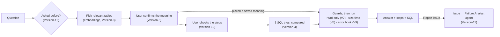
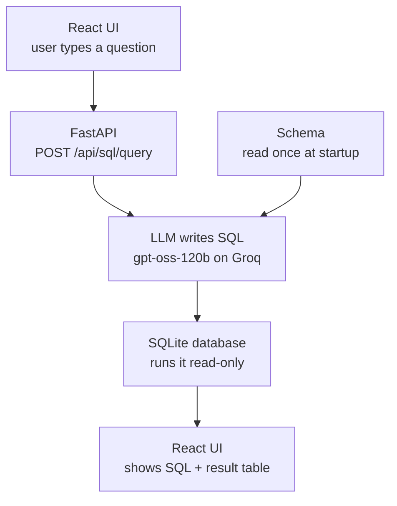
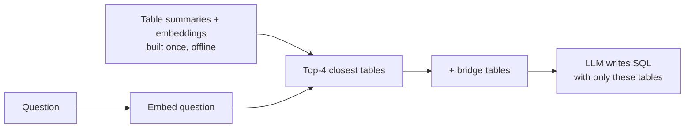
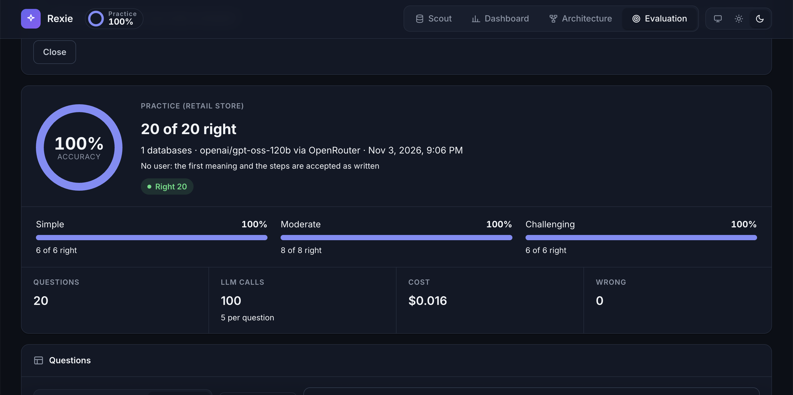
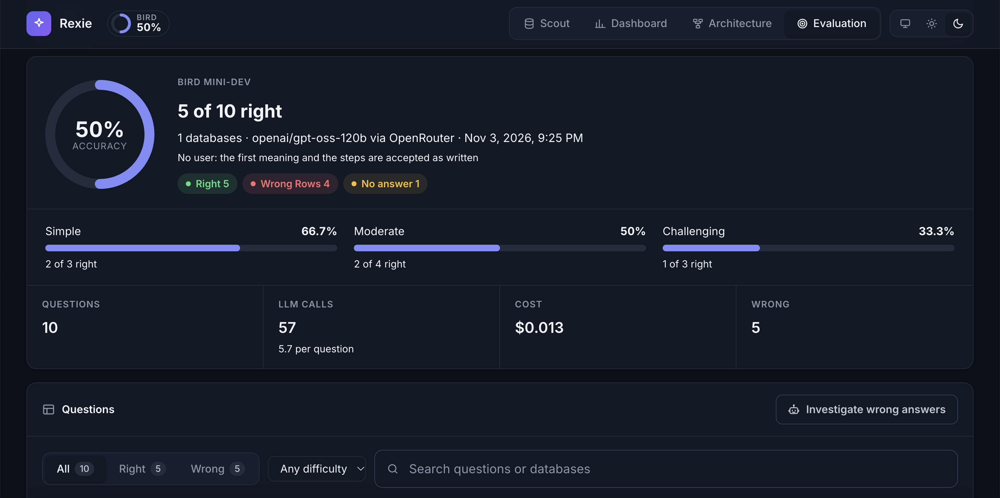
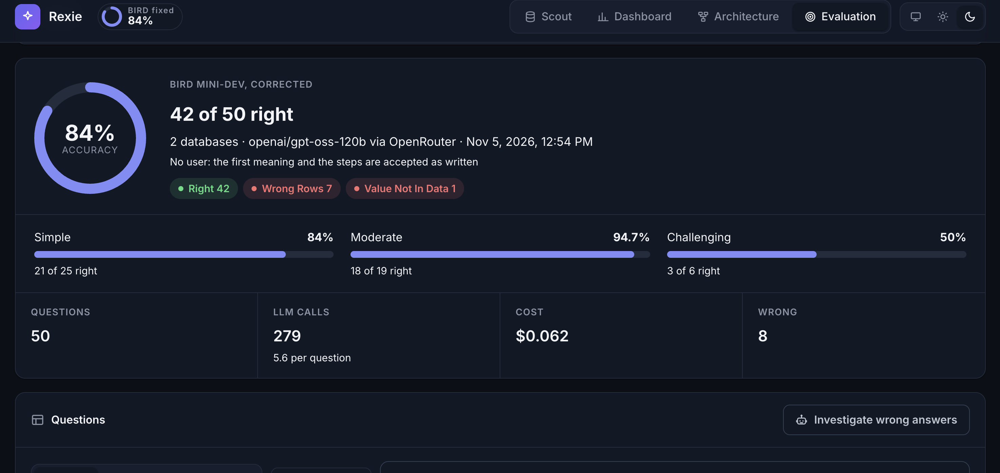
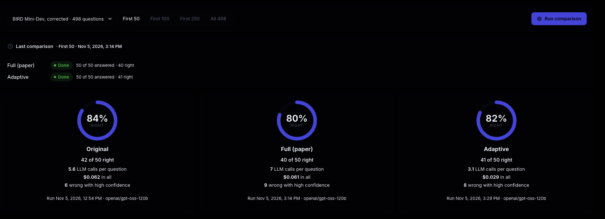

# Rexie

*Ask your documents and your data in plain English.* (Formerly "Retrieval and Reasoning Engine".)

Rexie answers questions **only from our own data**. It's one app with two products:

| Product | Answers from | How | Status |
|---|---|---|---|
| **Product-1: Rexie Scribe** (RAG, Retrieval-Augmented Generation) | Your documents (PDF, Word, Markdown, text) | Finds the relevant passages in the documents you pick, writes an answer and cites them | Complete, **hidden for now** |
| **Product-2: Rexie Scout** (Text-to-SQL) | SQLite databases | Confirms what you mean, writes SQL, checks it, runs it and shows the result | In progress |

**Scribe is hidden for now:** the app shows **Scout**, **Dashboard** and **Architecture**, and opens on Scout. Its code and API are unchanged; set `SHOW_SCRIBE = true` in `frontend/src/App.jsx` to bring the tab back. The Dashboard's question list no longer shows a Scout / Scribe tag on each row.

**Architecture tab:** how Scout is built, in the app itself: a block diagram of today's design (UI, API, the six pipeline stages, the services and data they use, the issues and the Failure Analyst), each block tagged with the version that added it; a Version-1 diagram for contrast; then every version as *Problem → What we thought → What we added*, with its measured result, and what's still open. Static content in `frontend/src/tabs/ArchitectureTab.jsx`.

## Contents

- [Goal](#goal)
- [Roadmap: What's Next](#roadmap-whats-next)
- [Project Structure](#project-structure)
- [Getting Started](#getting-started)
- [Product-1: Rexie Scribe (RAG)](#product-1-rexie-scribe-rag)
  - [Version-1: RAG Engine](#version-1-what-we-built)
  - [Version-2: Your Sources](#version-2-your-sources)
- [Product-2: Rexie Scout (Text-to-SQL)](#product-2-rexie-scout-text-to-sql)
  - [Version-1: Baseline](#version-1-baseline)
  - [Version-2: Database Descriptions](#version-2-database-descriptions)
  - [Version-3: Scaling to Large Databases](#version-3-scaling-to-large-databases)
  - [Version-4: Trustworthy SQL](#version-4-trustworthy-sql)
  - [Version-5: Confirm the Meaning First](#version-5-confirm-the-meaning-first)
  - [Version-6: Know Your Tables](#version-6-know-your-tables)
  - [Version-7: Safety (Read-Only)](#version-7-safety-read-only)
  - [Version-8: Performance (Heavy Queries)](#version-8-performance-heavy-queries)
  - [Version-9: Error Book (Learning from SQL Errors)](#version-9-error-book-learning-from-sql-errors)
  - [Version-10: Check the Steps, Rate the Answer](#version-10-check-the-steps-rate-the-answer)
  - [Version-11: Failure Analyst (an AI Agent)](#version-11-failure-analyst-an-ai-agent)
  - [Version-12: Reuse Recent Answers](#version-12-reuse-recent-answers)
  - [Version-13: Evaluation Tab (sample data for now)](#version-13-evaluation-tab-sample-data-for-now)
  - [Version-14: Run an Evaluation from the App, Live](#version-14-run-an-evaluation-from-the-app-live)
  - [Version-15: Issues by Evaluation Run](#version-15-issues-by-evaluation-run)
  - [Version-16: Choose the LLM Provider (Groq or OpenRouter)](#version-16-choose-the-llm-provider-groq-or-openrouter)
  - [Version-17: BIRD Answer Format and Data-Checked Meanings](#version-17-bird-answer-format-and-data-checked-meanings)
  - [Version-18: BIRD Mini-Dev, Ready to Run](#version-18-bird-mini-dev-ready-to-run)
  - [Version-19: Getting Better on BIRD](#version-19-getting-better-on-bird)
  - [Version-20: Know the Data Before the Question (Schema Catalog)](#version-20-know-the-data-before-the-question-schema-catalog)
  - [Version-21: BIRD Questions 11–30, One by One](#version-21-bird-questions-1130-one-by-one)
  - [Version-22: Comparing Flows (Ask Me Anything)](#version-22-comparing-flows-ask-me-anything)
  - [Version-23: SQLite Refresher](#version-23-sqlite-refresher)
  - [Version-24: Adaptive + English Program](#version-24-adaptive--english-program)
- [The App (UI)](#the-app-ui)
- [Dashboard (LLM Usage and Cost)](#dashboard-llm-usage-and-cost)
- [Fixes](#fixes)
- [Known Issues](#known-issues)
- [Models](#models)

## Goal

Build a personal, ChatGPT-like assistant that answers questions **only from the data we give it**: it finds the most relevant pieces of our data, reasons over them with an LLM, and shows what it used, so answers stay grounded instead of made up.

- **Rexie Scribe** (RAG) does this over documents: it retrieves passages and cites them.
- **Rexie Scout** (Text-to-SQL) does this over databases: it writes SQL, runs it, and shows the query and the result table.

---

## Roadmap: What's Next

The open work, in the order we plan to take it. Nothing here is built yet; each item says what it means today and what's still to decide.

### 1. Run the BIRD benchmark, and show the results in the UI

**Today:** BIRD Mini-Dev (500 questions, 11 real databases) is downloaded and can be run from the Evaluation tab on any range of questions (Version-18), with no user (the first meaning and the steps are accepted). First check: questions 1–10 scored **5 of 10**. The next version focuses on getting better against the benchmark.

**To do:**
- Run Mini-Dev in ranges, then all 500, and score the same answers with BIRD's own scripts too (each run writes BIRD's prediction format).
- Score **Execution Accuracy** (same rows as the correct SQL) and **Valid Efficiency Score** (how fast correct queries run), by difficulty.
- Make the eval run the app's real flow: today it skips the steps check and picks the meaning with a hint a real user wouldn't have. Run with *no user* (accept the first meaning and the steps), and later with a simulated user that only knows BIRD's evidence.
- Score per version (turn features on one at a time) to show what each version added.
- Show it in the UI: a **Benchmarks** page with the score, per-difficulty results, cost and calls per question, and every failure linked to its issue.

**To decide:** how many questions to run (each takes about 5-6 LLM calls), and which model.

**Done so far:** the Evaluation tab and the score ring (Version-13), and running an evaluation from the app with live progress (Version-14), on our practice questions. Left: move to a provider without the 200K-tokens-a-day cap (e.g. OpenRouter), download BIRD Mini-Dev, and add it as a suite.

### 2. Make the tags clear

**Today:** tags and badges appear all over the app, with different shapes, colours and meanings:

| Where | Tags today |
|---|---|
| Scout, Ask | Choices on each meaning option ("Cancelled orders: counted"), *Try 1 of 3*, confidence badge (high / medium / low), *Tables used* |
| Scout, Tables | *Reviewed* / *Not reviewed*, the database name, row and column counts |
| Dashboard, Usage | Outcome badge (*answered*, *answered (reused)*, *waiting for meaning*, *blocked*, *too heavy*, *failed*), counts |
| Dashboard, Issues | Source (Eval / User report / SQL error, filled), fix type (outlined), status, *Broke at*, confidence, test result |
| Architecture | Version tags (V1 to V12) |

**To do:** list every tag and what it tells the reader; drop the ones that don't help; give each kind one look (state, category, count, version) used the same way everywhere; add a hover explanation or a small legend where the meaning isn't obvious.

### 3. Point Rexie at professors and students

**Today:** Rexie is written for a general "ask your data" user, and the practice data is a retail store.

**To do:** reshape the product around teaching and research:
- **Who:** professors (course and research data, grades, survey results) and students (learning to ask questions of data, and learning SQL by seeing the steps and the query).
- **What changes:** example questions, practice data and wording for those users; the steps and the SQL as a learning aid ("how this was answered"); what each role can see and upload.

**To decide:** the main use case first (course data for professors, a SQL learning tool for students, or research datasets), and whether Scribe (documents: papers, notes, syllabi) comes back for it.

### 4. Let users upload their own data in a form they can use

**Today:** the only way in is a `.sqlite` file (up to 200 MB) in the Tables view. Rexie writes a description per table and the user can correct it. A table name that already exists is refused.

**To do:**
- **More formats:** CSV and Excel (each sheet a table), maybe Google Sheets; Rexie infers column types, dates and units, and shows a preview before anything is saved.
- **Make it usable for questions:** suggest column descriptions (dates, units, allowed values) for the owner to confirm, the way BIRD's description files work, since these are what stop the traps in Version-2.
- **Manage what's there:** rename, replace or add rows to a table, remove a table (not only a whole database), see which tables a question used.
- **Whose data:** each user's uploads are their own unless shared (needs item 5).

### 5. Sign in, with a user view and a developer view

**Today:** one shared view for everyone. The only protection is an optional single password (`APP_PASSWORD`, browser login).

**To do:**
- **Sign in** with real accounts (for a university, likely the school's own login).
- **User view:** Ask, their own tables, their uploads, Report issue.
- **Developer view:** everything above plus the Dashboard (usage, cost, issues), the Failure Analyst, Benchmarks and Architecture.
- Questions, costs, issues and saved answers kept per user.

### 6. Tables and databases: one clear place to manage data

**Today:** the Tables view lists every table across every database, 10 per page, with search, previews and descriptions. Databases can be added or removed whole.

**To do (with items 4 and 5):**
- Group tables by database, show where each came from (uploaded file, date, owner) and how it links to other tables.
- Let the owner choose which databases Scout searches for a question.
- Show the descriptions as a clear "data dictionary" the owner can review in one place.
- Show size limits and what Scout will refuse before an upload fails.

### Also open

- **Meanings can add filters** the question never asked for (Version-5's open issue).
- **The eval is strict about columns:** a right answer with extra columns counts as wrong.
- **Scribe's accuracy** (RAGAS 0.57) hasn't been worked on since Version-1.
- **Issues with the same cause** aren't grouped yet, and approving a prompt fix doesn't change the prompt (a batched PR was discussed).

---

## Project Structure

```
multimodal-retrieval-engine/
├── backend/
│   ├── main.py              # one FastAPI server for both products + serves the React app (+ optional password)
│   ├── config.py            # all API keys (read from .env), model names and limits
│   ├── llm.py               # the one LLM client: time limit + retries; chat() records every call
│   ├── usage.py             # Dashboard: every LLM call per question (tokens, time, cost) in SQLite
│   ├── dashboard_api.py     #   /api/usage/... (summary, timeline, questions)
│   ├── eval_api.py          #   Version-13: /api/eval/summary and /results for the Evaluation tab
│   ├── eval_runner.py       #   Version-14: runs an evaluation in the background, one question at a time
│   ├── issues_api.py        #   Version-11: /api/issues/... (issues, start the agent, approve / reject)
│   ├── agent/               # Version-11: the Failure Analyst (an AI agent)
│   │   ├── tools.py         #   its read-only tools (tables, column values, test queries, error book)
│   │   ├── analyst.py       #   the agent loop: LLM → tool → result → ... → report
│   │   └── fixes.py         #   code tests the suggested fix, and applies it once approved
│   ├── rag/                 # Rexie Scribe (RAG)
│   │   ├── api.py           #   /api/rag/... (query, feedback, documents)
│   │   ├── documents.py     #   Version-2: list and upload documents (.txt .md .pdf .docx)
│   │   ├── pipeline.py      #   encode → search → re-rank → answer
│   │   ├── encoders/        #   text embeddings (all-mpnet-base-v2)
│   │   ├── retrieval/       #   vector index + re-ranker
│   │   ├── reasoning/       #   LLM answer with citations
│   │   └── feedback/        #   thumbs up/down logger
│   └── text_to_sql/         # Rexie Scout (Text-to-SQL)
│       ├── api.py           #   /api/sql/... (interpret, query, tables)
│       ├── pipeline.py      #   question → tables → meaning → SQL → checks → result
│       ├── sql_generator.py #   LLM writes the SQL
│       ├── database.py      #   loads .sqlite files, runs SQL read-only
│       ├── descriptions.py  #   Version-2: reads database descriptions, adds them to the schema
│       ├── schema_index.py  #   Version-3: finds relevant tables with embeddings
│       ├── table_summaries.py # Version-3: LLM-written table summaries; Version-6: rewrites from corrections
│       ├── checks.py        #   Version-4: deterministic checks before and after running SQL
│       ├── schema_catalog.py #  Version-20: offline onboarding: each column profiled by kind, links, the schema the LLM sees
│       ├── value_index.py   #   Version-20: every short text value, searchable by the question's words
│       ├── column_notes.py  #   Version-20: optional AI notes for undescribed columns (offline, opt-in)
│       ├── interpreter.py   #   Version-5: up to 3 meanings of the question for the user to pick
│       ├── planner.py       #   Version-10: the steps the user checks (re-run from their comments)
│       ├── wording.py       #   Version-10: everyday words in what the user reads
│       ├── safety.py        #   Version-7: blocks anything that could change a database
│       ├── results.py       #   Version-8: recent results kept for paging (LRU cache)
│       ├── answer_cache.py  #   Version-12: recent answers, reused for the same question in other words
│       ├── sql_errors.py    #   Version-9: the error book (known SQLite errors, hints, log)
│       └── catalog.py       #   Version-6: table list (10 per page), adding a .sqlite database
├── frontend/                # React app (Vite)
│   └── src/
│       ├── tabs/            #   ScribeTab = RagTab (Ask) + SourcesTab (Sources); ScoutTab = SqlTab (Ask) + TablesTab (Tables); DashboardTab = Usage + IssuesView (Issues); ArchitectureTab = design diagrams + every version
│       ├── components/ui.jsx #  icons, loading, alerts, SQL highlighting, pager, data table
│       └── styles.css       #   design tokens (light + dark), layout
├── data/
│   ├── benchmarks/bird/     # Version-18: BIRD Mini-Dev as downloaded (git-ignored; outside text_to_sql/ on purpose)
│   ├── catalogs/            # Version-20: one catalog + value index per database (generated, git-ignored)
│   ├── rag/                 # Scribe: documents (raw_docs), built index, eval seHere's a cleaner version:

**Subject:** Meeting Schedule – Thursday, Nov 12

Hi everyone,

Thanks for sharing your availability. I've booked Room 3675 for Thursday, November 12th. Please arrive with your teammates at the time listed for your team in this email.

**Teams 17 and 22:** To work around your class schedules, your slots are 1:15–1:45 PM and 1:45–2:15 PM. We'll meet at Hello World instead of Room 3675.

Please pass this along to your teammates.

Best,
Yutesh

Your original didn't say which of Teams 17 and 22 gets which slot. If you know, you could write "Team 17: 1:15–1:45 PM, Team 22: 1:45–2:15 PM" so nobody is confused.kt
│   └── text_to_sql/         # Scout: one folder per database
│       ├── retail_store/    #   practice DB, descriptions, 20 questions + answers
│       ├── sql_errors.json  #   Version-9: known SQLite errors and their fixes (edit by hand)
│       └── logs/            #   Version-9: SQL error log (git-ignored)
├── tests/                   # pytest: the deterministic rules, no API key or LLM calls
├── scripts/
│   ├── rag/                 # build the index, retrieval eval, RAGAS metrics
│   └── text_to_sql/         # evaluate.py: execution accuracy on question sets
├── .env.example             # template for API keys (copy to .env)
└── requirements.txt
```

---

## Getting Started

### 1. Python environment (first time only)

```bash
python3 -m venv .venv
source .venv/bin/activate
pip install -r requirements.txt
```

In every new terminal after that, just run `source .venv/bin/activate`.

### 2. API keys

All keys live in one file. Copy the template and fill it in:

```bash
cp .env.example .env
```

| Key | Used by | Required? |
|---|---|---|
| `GROQ_API_KEY` | Scribe answers and Scout | Yes ([get one](https://console.groq.com/keys)) |
| `HF_TOKEN` | Scribe's RAGAS evaluation scripts | Optional |

`.env` is git-ignored, so keys never reach GitHub.

### 3. Build the UI (first time, and after UI changes)

```bash
cd frontend && npm install && npm run build && cd ..
```

### 4. Run

```bash
uvicorn backend.main:app --reload
```

Open **http://localhost:8000** and pick a product: **Scribe** (views: **Ask**, **Sources**) or **Scout** (views: **Ask**, **Tables**).

> **Editing the UI?** Run `npm run dev` inside `frontend/` and open http://localhost:5173 for instant reload (the backend must also be running).

### Useful commands

| Task | Command |
|---|---|
| Rebuild Scribe's whole index (after editing or deleting files by hand) | `python -m scripts.rag.build_index` |
| Score Text-to-SQL on the practice questions | `python -m scripts.text_to_sql.evaluate` |
| Check table picking only (no LLM calls) | `python -m scripts.text_to_sql.evaluate --retrieval-only` |
| Compare with sending every table | `python -m scripts.text_to_sql.evaluate --full-schema` |
| Summarize new/changed tables (LLM), then embed | `python -m scripts.text_to_sql.build_schema_index` |
| Re-embed only, no LLM calls | `python -m scripts.text_to_sql.build_schema_index --skip-summaries` |
| Run only some questions | `python -m scripts.text_to_sql.evaluate --ids 3,7,8` |
| Run the tests (no API key, ~10 s) | `python -m pytest` |
| Report on SQL errors: what to add to the error book | `python -m scripts.text_to_sql.sql_errors` |
| Score Scout the way the app works (confirm the meaning first) | `python -m scripts.text_to_sql.evaluate --confirm` |
| API docs (auto-generated) | http://localhost:8000/docs |

---

## Product-1: Rexie Scribe (RAG)

### Target

Build a complete, working end-to-end RAG (Retrieval-Augmented Generation) pipeline, from raw documents to a cited answer in a web UI, and measure how well it performs so there's a baseline to improve on.

### Version-1: What We Built

#### Version-1.1: Basic Text Semantic Search + Bullet Summary

We built the basic architecture.

- **Frontend:** takes text as input (like a search bar) and shows the relevant output.
- **Backend:**
  1. Reads the data sources we provide, breaks them into chunks, creates a vector embedding for each chunk and stores them.
  2. Takes the query and compares it with the stored chunks to find the nearest ones.
  3. Computes cosine similarity, sorts by similarity and normalizes scores between 0 and 1.
  4. Keeps the ones above a threshold.
  5. Returns them as bullet points.

#### Version-1.2: LLM-Powered Answering (True RAG)

The pipeline so far only returned the top-k chunks. Now we use an actual LLM to reason over them and write a proper answer.

- Tried `microsoft/Phi-3-mini-4k-instruct` locally: decent reasoning, but very slow.
- For now, we keep showing the relevant top-k chunks alongside the answer.

#### Version-1.3: Smarter Chunking (Token-based + Overlap)

We used to store one line of a paragraph as one chunk. Now we split text into words using a **sliding window**: a chunk length of 80 with an overlap of 40.

- **Chunk length:** too big captures more context but creates fewer, heavier chunks that mix topics; too small is more precise but can miss context.
- **Overlap:** keeps ideas from being cut at chunk boundaries, at the cost of some redundancy.
- **Result:** chunk length 80 with overlap 40 worked best in these early tests.
- **Today:** the index uses **40 words with an overlap of 10** (`CHUNK_WORDS` / `CHUNK_OVERLAP` in `backend/rag/documents.py`, shared by uploads and `build_index`).

#### Version-1.4: Two-Stage Retrieval (Re-Ranking)

- **Stage 1:** embed the query, compute similarity scores and take the top-k chunks.
- **Stage 2:** re-rank those candidates with a more precise matching step.

Options considered for stage 2:

1. **Common-word count (in use now):** store each query word in a map, then check each word of the chunk against it. Time complexity O(n), simple but not very precise.
2. **Word-by-word similarity:** compare every query word with every chunk word. For n chunks of k words and a query of m words, O(n × k × m), which is expensive.
3. **Cross-encoders:** transformer models that read the query and chunk together with self-attention and output a relevance score. Pre-trained ones such as `cross-encoder/ms-marco-MiniLM-L-12-v2` can be plugged in.

#### Version-1.5: Metadata-Aware Search (Filters & Scopes)

Chunk metadata was only:

```json
{"id": "doc1_chunk0", "path": "...", "text": "..."}
```

That isn't enough to filter by document type, group by source, or search only a subset.

Improvements:

1. Added a `source` field to the metadata, so we know where each chunk came from.
2. Added a source filter, which limits the input space the answer can come from.
3. Let the user pick sources in the UI, and show source information with each returned chunk.

#### Version-1.6: Evaluation & Metrics (Text-Only Bench)

The workflow produced results, but we had no metrics to judge them. Added checks for:

1. Whether the correct source was used.
2. Whether the correct snippet is part of the output.

#### Version-1.7: Relevance Feedback Loop (Thumbs-Up/Down)

Current steps to get context chunks:

1. Take the top 10 chunks.
2. Re-rank and keep the top 5.
3. Filter by score threshold.

Questions feedback should answer:

1. Is the threshold too high or too low?
2. Do users want fewer chunks?
3. Are we often retrieving irrelevant items, and how do we improve?

Feedback is collected to help:

1. Tune the threshold.
2. Tune re-ranking and choose the right logic.
3. Understand and fix chunking issues.
4. Provide live performance metrics.
5. Build real training data for future LLM integration.
6. Move toward production readiness.

#### Version-1.8: Multi-Collection / Namespace Support

All sources used to sit in one data dump. As the data grows, we need separate buckets of related files.

- Added **collections**: the user picks a collection first, then the sources inside it, for finer control over the context the model answers from.

#### Version-1.9: Polished UX (Rich Text UI + Citation Viewer)

Improved the UI layout and how answers and citations are displayed.

### Version-1 Summary

**Built a text RAG engine: notes are chunked with overlapping windows and embedded with all-mpnet-base-v2 (768 dimensions); a search (top 20 by cosine similarity, filtered by source and collection) is narrowed to the top 5 by word-overlap re-ranking; Llama-3.1-8B on Groq answers with cited sources; a FastAPI web UI and thumbs up/down feedback logging sit on top; RAGAS evaluation scored 0.57 overall (faithfulness 0.53, relevancy 0.87, context precision 0.44), so improving those scores is the next goal for RAG.**

#### Complete Life-cycle

1. A UI that answers user questions from pre-stored data.
2. Users choose which sources the answer should come from.
3. Each output includes the answer, its reasoning and citations from the sources.

#### Concepts Used

1. Sliding-window chunking (length + overlap), with chunks stored as 768-dimension vectors.
2. Query encoding and cosine similarity, `a @ b / (‖a‖ · ‖b‖)`, to get the top 20 chunks.
3. Term-based re-ranking of those candidates to get the final top 5.
4. Reasoning through an online Groq-hosted model.

#### Evaluation Metrics

Measured with RAGAS on 3 test questions:

| Metric | Score |
|---|---|
| Faithfulness | 0.5333 |
| Relevancy | 0.8713 |
| Context Precision | 0.4444 |
| **Overall RAGAS Score** | **0.5689** |

**Insight:** low faithfulness suggests hallucinations, so the context chunks need checking.

> **Later update:** Groq retired its Llama models, so RAG now answers with `openai/gpt-oss-20b`. The index was also rebuilt with `all-mpnet-base-v2`: the saved one had been built with the older MiniLM model (384 dimensions vs 768), which made every query fail.

### Conclusion

The RAG engine works end to end, but its scores need improving: that's the next goal for Scribe.

---

### Version-2: Your Sources

Version-1 answered only from a few text notes put in a folder by hand, and filtering meant typing source names. Scribe is for asking about **your own documents**, so it now works like Scout's Tables view:

**Sources view**
- **Every document**, 10 per page, with search by name or content. Each shows its file, type tag (Text, Markdown, PDF, Word), number of passages and size.
- Open a document to see **what Scribe searches**: the passages it was split into, 10 per page.
- **Add documents**: upload `.txt`, `.md`, `.pdf` or `.docx` files (several at once). Each is read, split into passages, embedded and **searchable immediately, no restart**. Refused: other file types, a name that already exists, files over 50 MB, and PDFs with no text (scanned images).

**Ask view**
- **Search in:** a picker with **All documents** (default) or any number of chosen documents. Answers and citations come only from the chosen ones; if they don't contain the answer, Scribe says so.

**Fix found along the way:** the LLM was only given the first **60 characters** of each passage (the short preview meant for the UI), so it answered from fragments. It now gets the **whole passage**; the UI preview is 200 characters.

**Tested:** uploaded a Word file and a PDF → 2 and 1 passages; "What does the liver do?" with only the PDF selected → glycogen, bile, toxins, regrowth, cited from the PDF; the same question with only `heart_notes` selected → "the context does not contain any information about the liver". Wrong file type and duplicate name were refused. (The test files were removed afterwards.)

New libraries: `pypdf` (PDF text) and `python-docx` (Word text), both free and local.

---

## Product-2: Rexie Scout (Text-to-SQL)

### Goal

Answer questions over **structured data**: take a question in plain English, write the right SQL query against our `.sqlite` databases, run it, and return the result.

### Target

Make the system as **accurate and efficient** as possible, and verify it on the **BIRD benchmark**, which tests text-to-SQL on large, real-world SQLite databases. BIRD scores:

- **Execution Accuracy (EX):** whether our query returns the same result as the correct query.
- **Valid Efficiency Score (VES):** how fast our correct queries run compared with the reference queries.

### How It Works Today



Every stage reads the column descriptions (Version-2) and table descriptions (Version-3, fixable in Version-6). The **Architecture** tab in the app draws the full design, block by block, with the version that added each part.

Scout has two views, and the app has two more pages:

- **Ask:** type a question, pick what you mean, check the steps, then get the answer table (10 rows per page), the steps it followed, the SQL and a confidence badge. **Report issue** if it's wrong.
- **Tables:** every table Rexie can query, what Rexie understands about each one (and a way to fix it), row previews, and **Add database** for new `.sqlite` files.
- **Dashboard:** **Usage** (LLM calls, tokens, time and cost per question) and **Issues** (failures and the Failure Analyst's reports).
- **Architecture:** how Scout is built and what each version changed.

### How We Built It

Each version fixed a problem the previous one exposed.

| Version | Problem | What we added |
|---|---|---|
| **Version-1:** Baseline | Need a starting point | Full schema + question → LLM → SQL → result |
| **Version-2:** Database descriptions | Data can be read in more than one way | Column meanings next to each column (BIRD format) |
| **Version-3:** Scaling | Real databases have hundreds of tables | Embedding search picks only the relevant tables |
| **Version-4:** Trustworthy SQL | SQL can run and still be wrong | Deterministic checks, 3 tries compared by result, hard stop |
| **Version-5:** Confirm the meaning | The model guessed what the question meant | The user picks from up to 3 meanings first |
| **Version-6:** Know your tables | A wrong table description misleads every question | The user sees, fixes and adds tables |
| **Version-7:** Safety | A question or the LLM's SQL could change the database | Deterministic write checks on the question, the meaning and the SQL |
| **Version-8:** Performance | A heavy query can be slow or return huge results | Size estimate before running, time limit, 200-row limit, paging from a cache |
| **Version-9:** Error book | The model repeats SQL mistakes from other dialects, and retries can't fix them | Known SQLite errors → prompt rules + fix hints; log + report to grow it; early stop; clear failures |
| **Version-10:** Steps and feedback | The user can't see or correct *how* an answer is built, and wrong answers leave no trace | The user checks the steps before the SQL is written; a reported answer is logged as an issue |
| **Version-11:** Failure Analyst | Failures sit in logs; each one needs someone to dig in | An AI agent investigates each failure with read-only tools; code tests its fix; the developer approves |
| **Version-12:** Reuse recent answers | The same question in other words repeats every step and LLM call | The last 10 answers are saved; a close question offers the saved meaning first, and picking it re-runs the saved SQL; feedback is report-only |
| **Version-13:** Evaluation tab | Accuracy lived in terminal output; eval failures were mixed with users' | A score ring by the name and an Evaluation tab (accuracy check + eval-only issues); sample data until BIRD is run |
| **Version-14:** Run an evaluation live | Evals ran only in the terminal; long runs couldn't be watched, stopped or resumed | A Run button with an estimate; a live card (progress, accuracy so far, current stage, cost); stop / resume; rate-limit waits |
| **Version-15:** Issues by run | Eval issues from every run were mixed, and a rerun overwrote earlier ones | Each run has an id; Evaluation → Issues picks a run from a dropdown, and the agent works on that run's issues |
| **Version-16:** LLM provider | Groq's free plan allowed ~20 eval questions a day | `LLM_PROVIDER` picks Groq or OpenRouter; OpenRouter calls are pinned to Crusoe then Groq and priced at their real cost |
| **Version-17:** BIRD answer format | 8 of 20 practice answers were marked wrong only for format (joined names, rounding, extra count); one meaning asked for a city spelling the data doesn't have | Practice answers rewritten in BIRD's format, the same rule in Scout's steps and SQL prompts; when the checks find a value the data lacks, the meaning is asked again with the real values (2 meanings at most) |
| **Version-18:** BIRD Mini-Dev | BIRD wasn't downloaded; Scout scans every database in its folder, so BIRD would have leaked into the app | BIRD's files kept as downloaded, outside Scout's folder; each question gets a Scout with only its own database; runs pick questions *from–to*; BIRD's prediction format is written too; fixes from BIRD issues can't be approved. First 10 Mini-Dev questions: **5/10** |
| **Version-19:** Better on BIRD | The 5 misses in BIRD's first 10, one by one | 1. The LLM's wording of a meaning never blocks a question (a warning instead); only the final SQL check blocks. 2. A value the hint defines ("the month is the 5th–6th characters") is returned in that form. 3. BIRD answers we checked by hand and believe are wrong are labelled "BIRD answer doubtful" (still counted as wrong) |
| **Version-20:** Schema catalog | Scout never saw what's in a column (BIRD #1484: `Segment` holds 'Discount', but Scout was told only "chain segment") | Offline onboarding builds one catalog per database (every column profiled by its kind, links declared and inferred) plus a value index; online, the LLM sees each column's meaning and contents, the question's words are matched to stored values, and a value missing from any text column is caught |
| **Version-21:** BIRD 11–30 | BIRD questions 11–30 scored 8/20; the 12 misses, one by one | 1. Answers are scored on every row, not the first 200 the app keeps (#1506 was right but scored wrong). 2. "Is it true…? If so, how many?" returns only the value (#1486). 3. **Run this question again** from its issue or the Accuracy check, to see if a fix worked. 4. **BIRD Mini-Dev, corrected**: a second suite with BIRD's annotation errors fixed (UIUC Kang lab). 5. A broken quote in Scout's SQL no longer stops a run. Corrected BIRD 1–50: **42/50 (84%)** |
| **Version-22:** Comparing flows | Scout's 3 SQL tries come from one prompt, so they copy each other's mistakes (6 of 8 wrong answers had "high" confidence), and a new way of answering needs a fair side-by-side test | Evaluation → **Comparison**: one ring per flow on exactly the same questions (any From–To range), and one click to run them in turn. **Full** follows the Ask Me Anything paper (4 prompt chains, 8 calls, worked examples, majority vote); weak supervision and **Adaptive** are replayed from its saved answers with no LLM calls. Every chain's answer is saved. Apostrophe bug fixed. First comparison, corrected BIRD 1–50, on an earlier 3-route Full: Original 42, Full 40, Adaptive 41 at half the cost |

---

### Version-1: Baseline



1. **Startup (once):** every `.sqlite` file under `data/text_to_sql/` is attached **read-only**, and its schema is loaded from the best source available: the **database descriptions** (Version-2), else a `schema.sql`, else the plain table definitions.
2. **Question:** the user types a question.
3. **SQL generation:** the LLM gets the schema + the question and writes **one `SELECT` query**.
4. **Execution:** the query runs on the database (only `SELECT`/`WITH` allowed, at most 500 rows).
5. **Output:** the UI shows the SQL that was run and the answer table, or a clear error.

The simplest system that works end to end, to get a starting score:

- **Model:** `openai/gpt-oss-120b` on Groq, temperature 0.
- **Prompt:** the full schema + the question; no examples, no sample values.
- **Safety:** databases are opened read-only, and only `SELECT` queries are allowed.

---

### Version-2: Database Descriptions

**The problem.** The same data can be read in more than one way, and the table definitions alone don't say which is right:

- Is `03/04/2026` March 4th or April 3rd?
- Is `39999` a price of $39,999 or $399.99 (cents)?
- Are `New York`, `NY` and `NYC` the same city?
- Do cancelled orders count as revenue?

Only the people who own the data know the answers, so the answers have to be **written down once** and given to the model with every question.

**Why BIRD does the same.** BIRD faces exactly this problem, so every BIRD database comes with a `database_description/` folder: one CSV per table that explains each column. Systems are expected to read it. We use the **same format**, so the same code will work on our practice database and on BIRD.

**The format** (one CSV per table, e.g. `orders.csv`):

| original_column_name | column_description | data_format | value_description |
|---|---|---|---|
| `order_date` | date the order was placed | text | stored as MM/DD/YYYY, e.g. '03/04/2026' means March 4, 2026 |
| `status` | current status of the order | text | 'cancelled' = … excluded from revenue |

**What we built:**

1. **Attach meanings to columns.** At startup, each description is placed right next to its column in the schema the model sees:
   ```sql
   order_date TEXT,  -- date the order was placed; stored as TEXT in MM/DD/YYYY format, e.g. '03/04/2026' means March 4, 2026
   ```
   The meaning sits exactly where the model is about to use the column.
2. **Check the descriptions against the data** (read-only) and print a warning if they disagree: a value missing from a "one of: …" list, a date not in the stated format, a described column that doesn't exist, or a table with no description.
3. **Fall back gracefully:** no descriptions → `schema.sql` → plain table definitions.

**What descriptions don't solve:** they explain the **data**, not the **question**. If a user types "Q2" or "NYC", the model still has to interpret it, and question-specific choices (does "top customers" mean 5 or 10?) need a per-question hint, which BIRD calls **evidence**. (Version-5 handles this by asking the user.)

#### Practice Database: `retail_store`

Before BIRD, the system is tested on a small practice database in `data/text_to_sql/retail_store/`:

| File | What it is |
|---|---|
| `retail_store.sqlite` | 10 tables (stores, employees, customers, orders, payments, …), 50 rows each |
| `database_description/` | One CSV per table (BIRD format): what each column means, its format and values |
| `schema.sql` | `CREATE TABLE` statements with comments (used only if there are no descriptions) |
| `questions.json` / `.md` | 20 questions (6 easy, 8 medium, 6 hard) with the correct SQL and answers |

Traps built into the data:

- **Messy values:** New York City appears as `New York`, `NY`, `NYC` and `new york`.
- **Hidden date format:** `orders.order_date` is `MM/DD/YYYY`; every other date is `YYYY-MM-DD`.
- **Units:** prices and amounts are stored in **cents**.
- **Cancelled orders:** they must be excluded from revenue.

Answers follow **BIRD's format** (Version-17): columns exactly as stored (`first_name`, `last_name`, not one joined name), only what the question asks for (no extra counts or ids), and no rounding unless asked. Questions say what to return ("What is the **name** of the store…"). Scoring stays strict: a result is right only if its rows match exactly. Before this, 8 of Scout's 20 answers were marked wrong only because the expected answers joined names, rounded or added a count column.

#### Evaluation

```bash
python -m scripts.text_to_sql.evaluate
```

For each question, the model's SQL and the correct SQL both run on the database and their results are compared (Execution Accuracy, as in BIRD). Wrong answers print the model's SQL, the expected result and the trap it fell into, followed by a score per difficulty.

#### Known Limitations (at this version)

| Limitation | Effect | Possible fix |
|---|---|---|
| Question phrasing isn't normalized | "Q2", "last spring", "NYC" in a question are left to the model | Rewrite dates and known short forms before the LLM sees them |
| No per-question hints | "Top customers": 5 or 10? | Solved in Version-5: the user confirms the meaning |
| No sample values in the prompt | Messy values are only known if someone described them | Add a few distinct values per column |
| One attempt only | A failing query is not corrected | Solved in Version-4: rounds of tries with feedback |
| "List all tables" returns nothing | Tables live in attached databases, not `main` | Partly solved in Version-6: the Tables view |
| Only data questions | "What do these tables mean?" can't be answered with SQL | Partly solved in Version-6: the Tables view shows it |
| Full schema every time | Too large for BIRD's bigger databases | Solved in Version-3: send only relevant tables |
| No conversation memory | Follow-ups like "sort that by city" don't work | Pass previous question + SQL |

---

### Version-3: Scaling to Large Databases

Versions 1–2 send the **whole schema** with every question. Fine for 10 tables, not for real databases with hundreds.

#### Open Questions

**1. What goes wrong if we paste all 500 tables into every prompt?**
The LLM confuses similar tables (`orders` vs `order_items`), the schema can overflow the context window, accuracy drops, and every query gets slower and more expensive.

**2. How do we send only the relevant tables?**
Index tables **once, offline**; then per question, **first pick the top-k tables, then write SQL** with only those.

**3. Can we pick tables without an LLM reading all 500 summaries?**
Yes, with **embeddings** (the same idea as RAG, applied to schemas): compare the question with each table's embedding in milliseconds. An LLM re-pick (20 → 5) can be added later if needed.

**4. Is a list of column names a real summary?**
No. It says what columns exist, not what the table **means**. People ask in business words ("revenue", "spent"), so an LLM writes a real summary per table.

**5. Won't summaries go stale if they mention other tables?**
Yes, so each summary describes **only its own table**. Links between tables come from the live foreign keys.

#### How It Works



- **Offline (`build_schema_index`):** the LLM writes a summary of each table from its schema, descriptions and sample rows: what a row is, what it answers, the words people use. Summaries naming other tables are rejected and rewritten. Only new or changed tables are summarized again. Summaries are saved to an editable `table_summaries.json`, then embedded.
- **Per question:** pick the 4 closest tables, then add **bridge tables** (linked to 2+ picked tables, e.g. `orders` for "revenue by category"). Only those go to the LLM, and the UI shows which ones.

#### Results (practice database, table picking only)

| Setting | Right tables picked | Tables sent |
|---|---|---|
| Top-3 | 19/20 | 3.3 of 10 |
| **Top-4 (default)** | **20/20** | **4.5 of 10** |
| Full schema (versions 1–2) | 20/20 | 10 of 10 |

LLM summaries vs column names: **same picks**, slightly better ranking (needed tables rank 1.74 vs 1.82 on average). 10 tables is too few to show a real difference; re-test on BIRD.

---

### Version-4: Trustworthy SQL

Versions 2–3 decided **what the model reads**. This version focuses on **the SQL it writes**: in a real product there's no answer key, so a query that runs without error can still be wrong. We add every **deterministic** check we can (no LLM judging another LLM).

#### Open Questions

**1. Data can be read in different ways (dates, units, short forms).** Handled by database descriptions (Version-2).

**2. The data is from the past; how does the model know what "last week" means?** Every prompt now includes **today's date and time** and **the date range of the data** (e.g. `orders.order_date: 01/24/2026 to 10/29/2026`).

**3. A query ran and returned a number. How do we know it's right without an answer key?** Cheap, deterministic checks before and after running it, and asking the model more than once.

#### How It Works

| Step | What it does | LLM calls |
|---|---|---|
| **Question check** | Rejects impossible requests ("top -5") | 0 |
| **Round 1** | 3 SQLs written. Each is checked, then run. All agree → **high**; two agree → **medium**. Done | 3 |
| **Round 2** | 3 more, told exactly how round 1 differed. Any two agree → **medium**; else the latest → **low**. Stop | 3 |
| **Hard stop** | A counter refuses any call beyond **6 per question** | — |

Answers are compared by their **results**, not their SQL text, since different SQL can be equally correct.

**Before running** (wrong for sure → rejected): invalid SQL or unknown column (SQLite `EXPLAIN`), `LIMIT` ≤ 0, cents divided by integer `100`, a value a column doesn't have (`status = 'complete'`), a date in the wrong format. Warnings: future dates, numbers outside a column's range (`rating = 7`).

**After running** (warnings): empty result (with the data's date range), every row of a table with no filter, a count larger than the table, negative money, the same record returned twice, many rows for a "which one" question.

**When attempts disagree**, round 2 isn't told a vague "think carefully". It's told exactly where the SQLs differ (filters, tables, joins, grouping, ranking, limit), what each one returned, and the data descriptions of those columns. No LLM call.

The UI shows the confidence, the number of LLM calls, any warnings, and every attempt.

#### Results (real LLM)

| Question | Result | Confidence | LLM calls |
|---|---|---|---|
| #3 most expensive product in dollars (cents trap) | ✅ | high | 2 |
| #7 customers in New York City (spelling trap) | ✅ | high | 2 |
| #8 orders in March 2026 (MM/DD/YYYY trap) | ✅ | high | 2 |
| #19 top revenue category ("not cancelled", not "delivered") | ✅ | high | 3 |
| #20 employee with most orders per store (ties) | ❌ | medium | 6 |

#### Issue: comparing SQL by text matching breaks on real queries

On #20, round 1 gave 3 different answers. The real differences were (a) counting cancelled orders or not, and (b) `RANK` (keeps ties) vs `ROW_NUMBER` (drops ties). But the diff searched the SQL text for words like `WHERE` and `GROUP BY`, which falls apart on multi-step queries (`WITH ... AS (...)`). It compared one step's filter with another step's `rn = 1`, listed step names as tables, and never mentioned the ranking. With the wrong hint, round 2 agreed on a wrong answer, so **agreement isn't proof of correctness**.

**Fix: a SQL parser ([sqlglot](https://github.com/tobymao/sqlglot)).** A parser reads SQL the way a grammar checker reads a sentence: it splits the query into labeled parts (tables, filters, grouping, ranking) in every step, so attempts are compared part by part. It's a free Python library with no model inside, so it's still deterministic and adds no LLM calls. On the #20 queries the feedback now says exactly:

```
They differ in filters:
  - attempt 1: status <> 'cancelled'
  - attempt 3: (none)
They differ in ranking:
  - attempt 1: RANK
  - attempt 2: ROW_NUMBER
  (ROW_NUMBER keeps exactly one row per group and drops ties; RANK and DENSE_RANK keep ties)
```

---

### Version-5: Confirm the Meaning First

Version-4 showed that the hard failures were never SQL syntax. They were about **meaning**: count cancelled orders or not, keep ties or not. The model guessed, and more SQL tries just guessed again. Only the user knows what they meant, so Rexie now **asks before writing any SQL**.

#### How It Works

1. The user asks a question.
2. The model lists **up to 3 meanings** that would give different answers, each with its choices in plain words. A question with one sensible meaning gets one option.
3. The user **picks one**, or picks **None of these** and explains. The explanation goes into the next set of options (max **3 sets**, then "please rephrase").
4. The picked meaning goes to the SQL step (Version-4's rounds, checks and hard stop, unchanged), which must follow it.

```
Which did you mean?
○ Count every order (including cancelled); if employees tie, show all of them
○ Ignore cancelled orders; show all tied employees
○ Only shipped or delivered orders; show all tied employees
○ None of these → [explain what you meant]
```

Cost: **1 LLM call per set of options**.

#### Result: #20 (failed in Version-4)

| | Version-4 | Version-5 |
|---|---|---|
| Result | ❌ (cancelled orders dropped) | ✅ all 16 rows |
| Confidence | low | **high** (all 3 tries agreed) |
| LLM calls | 6 | 1 (options) + 3 (SQL) |

The options named the exact choices Version-4 got wrong. Once the meaning was picked, all 3 SQL tries agreed in round 1.

Tested in the UI too: after **None of these** with *"count cancelled orders too; show everyone tied"*, every new option followed the comment, and the picked one gave all 16 correct rows.

**Open issue:** the options can change between runs, and sometimes add choices the question never raised (e.g. "if tied, pick the employee hired earliest"). The user can still say None of these, but the prompt should offer only choices the question really leaves open.

---

### Version-6: Know Your Tables

Rexie finds tables by their LLM-written descriptions (Version-3). If a description is wrong, every question about that table starts from a wrong idea. Example: the `orders` description said cancelled orders should be left out when counting, which is exactly why #20 failed. So the user can now **see and fix what Rexie understands**, in Scout's **Tables** view.

#### The Tables view

- **Every table**, 10 per page, with search by name or meaning. Each shows its database, rows, columns and a tag: **Reviewed** or **Not reviewed**.
- **What Rexie understands**: the description used for table search.
- **Preview rows**: the table's data, 10 rows per page (read from the database page by page, so large tables are fine).
- **Add database**: upload a `.sqlite` file. Rexie loads it, writes a description per table (1 LLM call each) and embeds them. **No restart needed.** Refused: not a SQLite file, a name that's taken, or table names that already exist (questions use plain table names, so they'd be ambiguous).

The answer table in the Ask view is paged too (10 rows at a time).

#### Fixing a description

```
Looks right ──> tagged "Reviewed"
Needs a fix ──> say what's wrong ──> Rexie rewrites it (1 LLM call)
                                        ├── Save this version ──> saved + re-embedded
                                        └── Still wrong ──> say what's still wrong ──> rewrite again (repeat any number of times)
```

- Every correction is kept and sent with the next rewrite, so fixes add up instead of being forgotten.
- Saved corrections live in `table_summaries.json` (`"feedback"`), and are reused whenever the description is written again (e.g. after a schema change), so they're never lost.
- Saving re-embeds the table right away, so table search uses the new description.

**Tested** on `orders`: correction 1 (cancelled orders still count as orders handled) and correction 2 (03/04/2026 means March 4) gave a description with both. Saved, tagged *Reviewed*, and re-embedded.

---

### Version-7: Safety (Read-Only)

Scout is for **reading** data, never changing it. The LLM is probabilistic, so safety can't depend on it behaving: every check below is a **deterministic rule**, and a request that could write is stopped with *"This could be a potential write … rewrite it as a question"*. Nothing is run.

| Check | When | How | LLM calls |
|---|---|---|---|
| **1. The question** | Before anything | Starts with a write verb ("delete", "update", "add", "set", "rename", "increase"…, after "please / can you / I want to"), or is SQL that the parser reads as a write | 0 |
| **2. The meaning** | After the LLM reads the question | The LLM must describe a write honestly and flag it (`changes_data`); each meaning is also checked with rule 1 | 1 |
| **3. The SQL** | After the SQL is written, before it's run | Read with the **sqlglot** parser. **Allow-list**: only one plain read query (`SELECT`, `WITH … SELECT`, `UNION`) passes. Blocks `INSERT`, `UPDATE`, `DELETE`, `DROP`, `CREATE`, `ALTER`, `REPLACE`, `PRAGMA`, `ATTACH`, `BEGIN`, `VACUUM`, `SELECT … INTO`, `load_extension()`, a second statement after `;`… | 0 |
| **4. The database** | Always | Files are attached **read-only** and the connection refuses writes (`PRAGMA query_only`), so even a missed case can't change data | — |

Unsafe SQL is a **hard stop**: no second round, no more LLM calls. The UI shows an amber **"Scout only reads data"** message.

Why both rule 1 and rule 2: rule 1 is free but only sees the start of the request. "Show me the cancelled orders and then get rid of them" starts with "Show", so it needs the LLM's reading ("…then delete those rows"), which is then checked deterministically.

**Tested** (no LLM for the rules): 17 write SQL statements blocked and 7 read queries passed, including traps like `WHERE status = 'deleted'`, `replace()` as a text function and a column named `update_date`; 12 write requests blocked and 10 read questions passed ("List deleted orders", "Which customers were added in 2026?", "Add up the revenue"). End to end: "Delete all cancelled orders" and `DELETE FROM …` blocked with 0 LLM calls; the "…get rid of them" question blocked after 1 call; an LLM forced to write `DELETE` was stopped after round 1, and `orders` still had all 50 rows.

---

### Version-8: Performance (Heavy Queries)

Version-7 stops queries that could **change** data. This version stops queries that are **too heavy**: they read too much, run too long, or return more rows than anyone can use. Each layer is deterministic, and every limit is in `backend/config.py`.

| Layer | When | How | Limit |
|---|---|---|---|
| **1. Size estimate** | Before running | SQLite's `EXPLAIN QUERY PLAN` gives steps, not row estimates, so the size is worked out from the steps and each table's row count: `SCAN` reads every row, a primary-key `SEARCH` ~1 row per lookup, an index `SEARCH` ~1%; steps at the same level are a join, so they multiply. Aliases (`SCAN o`) are mapped back to tables with sqlglot | 1,000,000 rows read |
| **2. Time limit** | While running | SQLite has no per-query timeout, so a check runs every 10,000 steps of the query and stops it once the time is up. The clock starts when the query gets the connection, not while it waits its turn | 5 seconds |
| **3. Row limit** | After running | Fetch 201 rows: keep 200, and if the 201st exists say *"Showing the first 200 rows; there are more. Narrow the question."* | 200 rows |
| **4. Paging** | In the UI | The answer comes with page 1 (10 rows) and a result id; other pages are loaded when clicked, **without re-running the query** | 10 per page |
| **5. Cache** | On the server | The 10 most recently used results (**LRU**: the least recently used is dropped). If a dropped result is opened again, its SQL is run once more (with the safety and time checks) | 10 results |

If every try in a round is too big or too slow, Scout **stops** (no round 2, no more LLM calls) and the UI shows an amber **"Narrow it down"** message, e.g. *"This query could read about 6,250,000 rows (the limit is 1,000,000), so it wasn't run. Narrow it down, e.g. add a date range, a store or a category."*

**Comparing the 3 tries, now by fingerprint.** Each result is compared as **(row count, fingerprint)**: every row is hashed, the hashes are sorted (so row order doesn't matter) and hashed together with SHA-256. Considered and rejected:
- **Comparing only the top 25 rows:** saves microseconds (running the query is the slow part), but two different answers can share their first 25 rows (a false "agree", the #20 mistake) and two equal answers can order them differently (a false "disagree" costing 3 more LLM calls).
- **A Bloom filter:** it's only certain when it says "different". When it says "same" it can be a false positive, which is the dangerous direction here. Bloom filters (and IBLTs) suit huge sets on different machines, not 200 rows in memory.

**Checked:**
- a 4-table cross join was estimated at 6,250,000 rows and not run
- an endless query was stopped at the time limit, with each of 3 parallel tries getting its full time
- a 2,500-row result was kept as 200 rows plus the "there are more" warning
- page 10 (rows 181–200, with 20 per page at the time) loaded from the cache, and after the result was pushed out of the cache, page 2 was rebuilt once
- the existing evaluation on 5 questions (#3, #7, #8, #19, #20) gave 4/5, the same as before (#20 needs the confirm-the-meaning step, which the script skips)

---

### Version-9: Error Book (Learning from SQL Errors)

[Issue 1](#issue-1-scout-fails-on-sql-from-another-dialect-and-retries-cant-fix-it) showed that a SQL mistake the model learned from another database (MySQL/PostgreSQL) gets repeated on every retry: the retry only saw SQLite's raw error, not how to fix it. Now every SQLite error Scout sees is **looked up, logged and learned from**, deterministically: a person decides what goes in, never the LLM (a wrong hint would be repeated forever).

**Two files**

| File | What | In git? |
|---|---|---|
| `data/text_to_sql/sql_errors.json` | **Known errors**: how to recognise each (`match` on the message, optional `sql_match` on the SQL for vague messages like `near "5": syntax error`), the `hint` for the retry, a one-line `rule` for the prompt, a bad/fixed example | ✅ edited by hand, re-read on change (no restart) |
| `data/text_to_sql/logs/sql_errors.jsonl` | **Error log**: every rejected attempt (question, SQL, error, which entry matched) and how each question ended (answered or not, stopped early) | ❌ git-ignored: holds users' questions |

**How it works**

```
before:  the 10 most-seen errors' rules go into the SQL prompt   → avoided in round 1
SQLite rejects a try → normalise ("no such column: o.statuss" → "no such column: <name>")
         ├── known   → its hint goes into round 2: "How to fix this in SQLite: ..."
         └── unknown → if all 3 round-1 tries hit it: stop, skip round 2 (save 3 LLM calls)
         └── logged either way
fails:   "Scout couldn't build a working query for this question: SQLite rejected all 3 tries for
          the same reason (...). Try simpler wording..."  (raw errors stay in All attempts)
```

**Growing it:** `python -m scripts.text_to_sql.sql_errors` lists **unknown errors** (grouped, counted, with an example question and SQL: write a hint and add them) and, for each **known error**, how often it was seen and how often the question still got an answer afterwards (a hint that rarely helps needs rewriting).

**Starts with 15 entries**, each checked against SQLite's **real** message (not guessed): `GROUP_CONCAT(DISTINCT x, sep)`, MySQL/PostgreSQL date functions (`YEAR()`, `DATE_TRUNC`, `NOW()`, `DATEDIFF`, `TO_CHAR`…), `EXTRACT`, `INTERVAL`, `ILIKE`, `TOP n` / `FETCH FIRST`, aggregates or window functions in `WHERE`, `HAVING` without `GROUP BY`, unknown column / table, keywords used as names, ambiguous columns, multi-column subqueries in `IN`, wrong argument counts. Checking found that SQLite 3.53 **does** support `STRING_AGG` and `CONCAT`, so they got no entry.

**Also:** the meaning step now has to make its **first option the plain, literal reading** and not add columns or filters (see [Version-5](#version-5-confirm-the-meaning-first)'s open issue).

**Tested:**
- 22 new tests (no LLM): every entry matches its real SQLite error; an unrelated error stays unknown; a stand-in LLM making the `GROUP_CONCAT` mistake got the hint in round 2 and answered; an unknown error in all 3 round-1 tries stopped after 3 calls with the plain message; the rules reach the prompt. All 88 tests pass.
- Real LLM, Issue 1's question again: option 1 is now *"every different full name"* (no city); and with the old *"…along with their city"* meaning, all 3 tries **succeeded in 3 calls** (was: 6 failed calls). The prompt rules prevented the mistake. Options 2–3 still added filters ("placed an order", "signed up after 2025"), so the literal-first rule helps but doesn't fully stop invented options.

---

### Version-10: Check the Steps, Rate the Answer

Confirming the meaning fixed *what* is asked. But the user still couldn't see *how* Scout would answer, and when an answer was wrong nothing was kept to fix it. Now the user checks the plan **before** any SQL is written, and rates the answer **after**.

```
Ask → Confirm meaning ──"None of these" + comment → re-runs only the meaning
    → Check steps ─────── comment on any wrong step → "Re-run steps" re-runs only the steps
    → Answer (SQL follows the confirmed steps; the steps are shown with it)
    → 👍 / 👎  ── 👎 + comment → logged as an issue on that question in the Dashboard
```

**The steps** (`planner.py`, 1 LLM call per try): after the meaning is confirmed, the model writes 3–8 numbered plain-English steps: which data to start from, how it's linked, what's kept or left out, how it's grouped and counted, how it's sorted and what's shown. The user clicks any step that isn't right and says why; **Re-run steps** sends the earlier steps plus those comments, and only this step is redone (the meaning stays), up to 5 tries. **Steps look right: answer** sends the confirmed steps to the SQL step, which must do exactly those. The answer shows them under **How this was answered** (this fixes [Issue 3](#issue-3-the-answer-isnt-explained)).

**Feedback:** under every answer, *Is this answer right?* 👍 / 👎. A 👎 needs a short comment and is saved with what the user saw (meaning, steps, SQL, first rows), so the developer can reproduce it. One rating per question (the latest counts). Scribe's 👍 / 👎 now also lands on the Dashboard.

**On the Dashboard:** a **Feedback** tile (👍 / 👎 counts); each question shows its 👍 / 👎; a 👎 question opens to an **Issue reported** box (comment, meaning, steps, SQL, first rows); **👎 Only issues** filters the list to the developer's to-do list. Step re-runs show in *LLM calls per try* (*Steps, try 2*) and count as retries.

**Plain words, guaranteed.** Users don't know the database, so the meaning options and the steps must never show names like `order_date` or `employee_id`. The prompts ask for everyday words, and `wording.py` makes sure of it deterministically: any real table or column name that slips through (snake_case, `table.column` or in backticks) is rewritten (*order_date → order date*, *employee_id → employee ID*); ordinary words and non-database names are left alone.

**Blue name tags (tried, then removed).** For a while, unclear column names (`cust_seg_cd`) and table names were also shown in their exact form as small blue tags in the meaning options and the steps. They are now removed: the options and steps are plain words only. Older Dashboard records that still carry the tag markers are shown as plain text.

**Tables used = the tables the SQL really used.** The answer's *Tables used* used to list every table the search offered the LLM (5 for a one-table question). It now comes from the final SQL, read with the parser (real tables only, not `WITH` step names; subqueries count). *"How many orders placed in March 2026 got cancelled?"* → `orders` only. (The offered tables are still returned, as `tables_offered`.) Real check: two questions likely to pull in names (*average unit price per category*, *orders per employee by order status*): 6 options, their choices and 7 steps, **no database names left**.

**A cleaner Ask view.** "All attempts" (every SQL try and why it was rejected) is gone from Scout's Ask view, for answers and failures alike: it was developer detail. A failure shows only its plain-English message; what each question took (calls per step, retries, cost) is on the Dashboard.

**Safety note:** the steps aren't run through the write-request check, because normal steps read like "Remove cancelled orders from the list" (= leave them out). That's safe: the SQL check still lets only one plain read query run, whatever the steps say.

**Tested:** 10 new tests (database names turned into plain words, brackets left as written; tables used read from the SQL; steps parsed and numbers stripped; comments on wrong steps sent in the re-run; plan then SQL with the steps in its prompt; 5-try limit; feedback counts, latest rating wins, 👎 filter and details; a 👎 without a comment refused; an empty question not recorded); all 102 pass. Real run on #20: meaning confirmed → 7 steps (step 6: *"include ties"*) → flagged step 7 (*"show the store name and the employee's full name, plus how many orders"*) → re-run changed **only step 7**, steps 1–6 kept word for word → answer: **all 16 rows correct, ties kept, high confidence**, columns exactly as step 7 said → 👍. Dashboard: *Meaning, try 1 · Steps, try 1 · Steps, try 2 · SQL, round 1: 3*, 1 retry, $0.003, 👍.

### Version-11: Failure Analyst (an AI Agent)

**Workflow vs agent.** Everything above is a **workflow**: our code decides every step, and the LLM only fills in text (meanings, steps, SQL). An **agent** is different: the LLM decides the steps itself, by calling tools in a loop. Our flow already covers what an agent would do while *answering* (schema, descriptions, checks, error book, size estimate), so an agent doesn't belong there. It does fit *after* a failure, where every case is different and someone has to dig in. Version-11 adds that agent: the **Failure Analyst**.

**What it reads: the logs.** Every Scout failure is now saved as an **issue** on the Dashboard, tagged by where it came from:

| Source | When it's logged | What we know |
|---|---|---|
| `Eval` | `evaluate.py` gets a test question wrong | question, Scout's SQL and rows, **the correct SQL and rows** |
| `User report` | a user clicks **Report issue** and says what's wrong | question, comment, meaning, steps, SQL, first rows |
| `SQL error` | SQLite rejects every SQL try | question, every try and its error |

The same failure again (same source and question) updates its issue instead of adding a copy.

**How it reasons (the agent loop).** The developer clicks **Investigate** (or **Investigate all new**, at most 5 at a time). Then:

```
read the failure → LLM picks a tool → our code runs it (read-only) → LLM reads the result
→ picks the next tool … → submit_report → our code tests the fix
                                           └ failed? sent back to the agent once to look again
```

| Tool | What it does |
|---|---|
| `list_tables` / `describe_table` | the tables, their columns and descriptions |
| `column_values` | a column's most common values (spellings, case, date formats, units) |
| `run_query` | one small read query, to test an idea or a corrected query |
| `known_errors` | the error book's rules |

**Our code keeps control** (the harness, `backend/agent/`):
- **Read-only by design:** no tool can write. `run_query` passes the same checks as Scout's SQL (allow-list, size estimate, 5 s limit, read-only connection), and the agent sees at most 20 rows.
- **A budget:** at most 8 tool calls per issue; after that, only *submit_report* is offered.
- **A required report:** what happened · why · root cause · fix type · fix · **a corrected query** (it must run one first). An incomplete report is sent back.
- **Code tests the fix, not the LLM:** the corrected query runs, and for an eval issue it must give the **same rows as the correct answer**. An error-book entry must be new, a valid pattern, and match the logged SQLite error. A fix that fails the test goes back to the agent **once**.
- **You decide:** every report has a **fix type**, shown as a tag on the issue, and the type decides what **Approve** does. Above the buttons, a *When you approve* box says it in plain words for that issue:

  | Fix type | What Approve does |
  |---|---|
  | **Error book** | Adds the entry to `sql_errors.json`. From the next question its rule goes into the SQL prompt, and its hint is given when SQLite shows that error. |
  | **Table description** | Adds the note to the table's description and re-embeds it. |
  | **Prompt change** / **Code change** | Changes nothing in Scout: marks the issue Approved as a to-do for the developer. |
  | **No fix** | Changes nothing: closes the issue. |

  **Reject** changes nothing and keeps your note. (Pages are now up to 1720px wide, from 1080px, so wide screens have less empty space on the sides.) Every LLM call is priced on the Dashboard (stage `agent`), and per issue.

**Where you see it:** Dashboard → **Issues**. An intro explains the agent; the list filters by source and status (*Not investigated → Investigating… → Report ready → Approved / Rejected*). Each issue shows two tags: its **source** (Eval / User report / SQL error, filled) and, once investigated, its **fix type** (outlined). The report also says **where it broke** (meaning, steps, SQL, data, table description, tables picked). Opening an issue shows **the failure**, **how the agent worked** (its thinking, each tool call and result, live while it runs), **its report** with the test result, and **Approve / Reject** with a note.

**Also:** 👍 / 👎 is now **Correct** / **Report issue** (Scout and Scribe), and the Dashboard shows ✓ / ⚑. Scribe's reports show on the Dashboard but aren't investigated: the agent's tools are for databases.

**Model:** `AGENT_MODEL` in `config.py` (now `openai/gpt-oss-120b`, which supports tool calling). It runs only on failures, so a stronger model can be tried here without raising the cost of normal questions.

**Real run on #20** (*"For each store, which employee handled the most orders?"*; Scout returned 15 rows, the correct answer has 16):
1. First try: the agent found the tie problem (`ROW_NUMBER` drops tied employees) but suggested an **error-book entry**, which only reacts to SQLite errors, and this query ran fine. That's now caught by code: *"No SQLite error was logged, so an error-book entry would never match."*
2. Second try: fix type *prompt*, corrected SQL with `RANK()`, but our test said **15 rows, 16 expected**.
3. With the test sent back, the agent looked again and found the **second cause**: the steps had added *"leave out cancelled orders"*, which the question never asked for (the open issue from Version-5). Its new query matched the correct answer exactly: **16/16 rows, test passed**, in **5 LLM calls, $0.003**.

**Tested:** 11 new tests with a stand-in LLM (no API key): one issue per failure; one investigation at a time and none stuck after a restart; tools refuse writes, multiple statements and unknown tables; the loop records each step, prices each call and tests the fix; only the report is offered once tool calls run out; a failed test goes back once; a broken run is marked *Agent stopped*; error-book fixes are checked and applied (on a copy); a report needs a corrected query; a user report becomes an issue. All 113 pass. Checked in the browser in light, dark and phone sizes.

### Version-12: Reuse Recent Answers

**Problem:** the same question often comes back in other words ("How many orders in March 2026?", then "count the orders from march 2026"). Each time, Scout wrote the steps and the SQL again: 4 to 7 LLM calls and 10 to 20 seconds for an answer it already had.

**What we built:** the 10 most recent answers are saved (question, confirmed meaning, steps, SQL). When a new question is close to a saved one, its meaning is shown as the **first option**; the LLM writes up to 2 other meanings next to it. If the user picks the first option, Scout **runs the saved SQL again** (fresh rows, the usual safety and time checks, **no LLM calls**) and shows the answer with its steps. Picking any other option runs the normal flow. Nothing on screen says the answer was reused; the Dashboard marks the question *answered (reused)*.

**When two questions are "close":** decided by code, and all three must hold:

| Check | Why |
|---|---|
| Embeddings similar (cosine ≥ 0.80) | Same meaning in other words |
| Key words overlap (≥ 50% of the shorter question's words, plurals folded) | Both talk about the same things |
| No clash in numbers, months or scope | "March 2026" vs "April 2026" are **0.99** alike as embeddings, so code compares the numbers and months; "for each store" never matches "overall" |

**What is saved, and for how long:**
- Every answer, unless it's a **follow-up** (it depends on the earlier answer) or about a **moving time** ("today", "last week", "this month"), whose saved SQL would keep yesterday's dates. An answer nobody reports counts as right.
- **Reported answers are removed** at once (also when the report is on a reused answer).
- **Any table change** (description saved, database added or removed) clears everything.
- 10 entries, least recently used dropped first; kept in server memory, so a restart empties it. If a saved answer is gone or its SQL no longer runs, Scout quietly writes the steps as usual.

**No repeated options:** the LLM is told the saved meaning is already option 1, but in a real run it still wrote it again in other words (*"…no matter what its status is"* vs *"…regardless of its status"*). Code now drops any option that only rewords it: the meanings must be very close as embeddings (≥ 0.92) **and** use the same limiting words (*only, not, except, exclude, without*). Embeddings alone can't tell: *"only orders that are not cancelled"* is 0.94 alike yet means something else, and its *only / not* keeps it.

**Feedback is now report-only:** the *Correct* button is gone (an answer nobody reports counts as right); the answer shows *Something wrong with this answer?* with **Report issue**. The Dashboard's tile shows reported answers.

**Tested:** 7 new tests (real embedding model, stand-in LLM): rephrasings match; April, 2025, customers and "overall" don't; moving-time questions aren't saved; 10-entry limit and one copy per meaning; a report removes the saved answer it came from; the saved meaning is the first option with its choices and the LLM is told not to repeat it; reuse answers with 0 LLM calls and the saved steps; a missing entry falls back; a table change clears the cache; follow-ups aren't saved; reporting via the API stops reuse; a reworded repeat of the saved meaning is dropped while a narrower one is kept. All 121 pass.

**Real run (6 LLM calls):** *"How many orders were placed in March 2026?"* → meaning, steps, answer: **3 orders**, high confidence, 5 calls, $0.0019. Then *"count the orders from march 2026"* → the saved meaning was option 1; picking it answered in **0.45 s with 0 SQL calls** (1 call in total, for the meanings), same 3 orders and steps, shown on the Dashboard as *answered (reused)*. That run found the repeated option, fixed above.


### Version-13: Evaluation Tab (sample data for now)

**Problem:** Scout's accuracy lived in terminal output from `evaluate.py`, and eval failures were mixed with users' failures in the Dashboard's Issues. There was nowhere to see *how good Scout is* at a glance.

**What we built:**
- **A score ring next to the name "Rexie"** in the header: the latest BIRD accuracy (e.g. *BIRD 70%*, with a *sample* mark while the data is a sample). Clicking it opens Evaluation.
- **An Evaluation tab** (after Architecture) with two views:
  - **Accuracy check:** a big ring with the score, *N of M right*, the benchmark, model, date and how the run answered (no user: first meaning and steps accepted); outcome counts (right, wrong rows, SQL error, no answer); accuracy by **difficulty** (simple / moderate / challenging); questions, LLM calls (and per question), cost. Then **every question**, filtered All / Right / Wrong, by difficulty and by search; a wrong one opens to the hint given with it, **Scout's SQL beside the correct SQL**, what each returned, calls, cost and confidence, and its **issue** (status, with a link to Issues).
  - **Issues:** the same Issues view and Failure Analyst as the Dashboard, showing **only eval failures**.
- **The Dashboard's Issues now shows only users' failures** (User report, SQL error). Each view asks the API for its own sources (`/api/issues?scope=...`), and the counts and "Investigate all new" cover only those.

**Data:** `GET /api/eval/summary` and `GET /api/eval/results` (`backend/eval_api.py`) read the newest run in `data/text_to_sql/eval/runs/`. No real BIRD run exists yet, so they show **`data/text_to_sql/eval/sample_bird_run.json`**: 40 made-up questions in BIRD's format across its 11 dev databases (28 right, 70%), marked as sample on the page and on the ring. Totals are always worked out from the per-question results. The next step (Roadmap item 1) is a real BIRD run that writes a run file in the same format.

**Tested:** 3 new tests: the sample shows until a real run exists, then the real run's totals, per-difficulty scores, calls and cost; results filter right / wrong, by difficulty and search, 10 per page, and a wrong answer links to its logged issue; eval issues and users' issues are listed apart, with their own counts and "investigate new". All 124 pass. Checked in the browser (the ring opens Evaluation; the #20 eval issue moved from the Dashboard to Evaluation → Issues) and at phone width (the four header tabs drop their icons to fit).


### Version-14: Run an Evaluation from the App, Live

**Problem:** an evaluation only ran from the terminal (`evaluate.py`), printed text, and couldn't be watched, paused or resumed. A BIRD run will take hours and hit rate limits.

**What we built:** **Evaluation → Accuracy check → Run evaluation**:
1. **Pick a test suite:** *Practice* (our 20 questions) now; *BIRD Mini-Dev* is listed but greyed out until it's downloaded.
2. **Pick how many questions** (first 5, 10, 20, 50, or all) and see an **estimate** before starting: LLM calls, tokens, cost and minutes, with a warning when it's more than the provider's daily token limit.
3. **Start**, then watch the **live card**: a progress bar (*7 of 20*), **accuracy so far** (a ring), elapsed time and time left, LLM calls, tokens and cost so far; **what it's doing now** (the question, and its stage: Meaning → Steps → SQL); a rate-limit pause with a countdown; and the **latest answers** as they land, ✓ / ✗ with time, calls and cost each. **Stop after this question**, **Resume** where it stopped, **Close** when done.
4. When the run ends, it becomes the latest run: the scorecard, the question list and the ring by "Rexie" (now labelled with the suite, e.g. *Practice 75%*) update, and the sample notice goes away.

**How it runs** (`backend/eval_runner.py`):
- On the server, in a background thread, **one question at a time**, one run at a time; leaving the page doesn't stop it.
- Each question goes through the app's flow with **no user**: the first meaning is taken, the steps are accepted as written, then SQL (3 tries, checks) as usual. Its rows are compared with the correct SQL's rows, in any order. BIRD questions will also get BIRD's evidence hint.
- **Saved after every question** in `data/text_to_sql/eval/runs/<run>.json` (git-ignored), so a stopped or crashed run keeps its answers.
- **Rate limits:** the API client already retries and honours "retry after"; if a question still hits the limit, the run waits 60 s and tries again (up to 3 times), then stops with a message to resume later.
- Every LLM call is tagged `eval:<run>:<question>`, so each question's calls, tokens and cost are counted, while the Dashboard counts them as outside calls, not users' questions. Eval runs neither use nor fill the saved-answer cache (Version-12). Wrong answers become **Eval issues** for the Failure Analyst.
- Endpoints: `GET /api/eval/suites`, `POST /api/eval/runs`, `GET /api/eval/runs/current` (polled every 1.5 s), `POST /api/eval/runs/{id}/stop`, `POST /api/eval/runs/{id}/resume`. Estimates come from measured averages in `config.py` (`EVAL_TOKENS_PER_QUESTION` and others).

**Tested:** 5 new tests with a stand-in pipeline (no LLM): a run answers meaning → steps → SQL with the first meaning and no saved answers, scores right / wrong rows / SQL error, prices each question from its tagged calls, saves the run and logs 2 Eval issues; a rate-limited question waits and retries, and the run stops after 3 limited tries; Stop finishes the current question and Resume carries on; suites and estimates; the scorecard ignores a run still running. All 129 pass. The Run panel was checked in the browser; the first real run is yours to start.


### Version-15: Issues by Evaluation Run

**Problem:** Evaluation → Issues mixed every eval's wrong answers in one list, and the same question failing in two runs updated a single issue, so you couldn't tell which run an issue came from or point the agent at one run.

**What we built:** every evaluation run has an **id** (e.g. `20261103-171422-f268`), and its wrong answers are **its issues**.
- **Evaluation → Issues** starts with an **Evaluation run** dropdown: every finished (or stopped) run, newest first, as *Practice · Nov 3, 5:14 PM · 4/5 right (80%) · 1 issue (1 new)*, with the run id under it. A run appears there as soon as it ends; the newest is picked by default.
- The issue list, its counts and **Investigate all new** cover only the chosen run, so the Failure Analyst works on that run's failures.
- The same question wrong in two runs is **two issues**, one per run, so a later run never overwrites an earlier investigation.
- Wrong answers logged by the command-line `evaluate.py` (which keeps no run) are listed as **From the command-line eval script**.
- Issues from runs made before this change are moved under their run once, by matching the run's wrong questions.

**Data:** the `issues` table has a `run_id` column (added automatically to existing databases); an eval issue's key includes its run. `GET /api/eval/runs` lists the finished runs with their issue counts; `/api/issues` and `/api/issues/investigate-new` take `run=<id>` (or `none`).

**Tested:** 2 new tests: the same wrong question in two runs gives one issue per run, each listed and investigated only under its run, and runs are listed newest first with their scores; an issue logged before run ids moves under its run while a script's issue stays apart. All 131 pass. Checked in the browser with a real 5-question practice run (4/5 right; its wrong answer, *"Which store has the most employees?"*, shows under the run; the older #20 issue under *command-line eval script*).


### Version-16: Choose the LLM Provider (Groq or OpenRouter)

**Problem:** Groq's free plan allows 8K tokens a minute and 200K a day for `gpt-oss-120b`. One Scout question uses about 8K, so an evaluation managed about 20 questions a day, and calls slowed or failed on the per-minute limit. Groq's paid plan wasn't available.

**What we built:** one setting in `.env`, `LLM_PROVIDER=groq` (default) or `openrouter`. Both serve the same model through the same OpenAI-style API, so only the address, the key and the limits change; every LLM call in the app (Scout, Scribe, table descriptions, the agent, evaluation runs) follows it.
- **OpenRouter** (`OPENROUTER_API_KEY`, or `OPEN_ROUTER_API_KEY`): pay-as-you-go from credits, no daily token cap. Every call is **pinned** to `OPENROUTER_PROVIDERS` in `config.py`: **Crusoe** first ($0.05 / $0.25 per 1M tokens, full precision, ~250 tokens/s), then **Groq**, with fallback to any other host turned off, so a whole evaluation runs on the same setup. **Not CoreWeave**, though it's cheaper: tested for real, its `gpt-oss-120b` puts the model's thinking *inside* the JSON answer (`{"analysis": "We need to interpret..."}`) instead of returning it separately, so Scout found **no meanings** ("The model returned no meanings"). The same request on Crusoe and on Groq returned proper options.
- **Exact cost:** OpenRouter reports each call's real cost, which the Dashboard records instead of the estimate from `LLM_PRICES` (prices are now kept per provider).
- **Evaluation:** a run records the provider; the estimate says *via OpenRouter* and drops the 200K-a-day warning.
- Names: `GROQ_API_KEY` / `GROQ_MODEL_*` in the code became `LLM_API_KEY` / `LLM_MODEL_*`; `.env.example` lists the new settings.

**Safety:** set a low limit on the OpenRouter key (e.g. $5) and load only a few dollars of credit: a Mini-Dev run should cost under $1.

**Tested:** 2 new tests: on OpenRouter every call carries the pinned hosts with no fallback and is priced by its reported cost; on Groq calls are sent unchanged. All 133 pass. Checked against OpenRouter for real with 4 tiny calls (about $0.001): CoreWeave failed as above; Crusoe and Groq worked.

### Version-17: BIRD Answer Format and Data-Checked Meanings

**Problem:** a practice run scored 12/20, but all 8 "wrong" answers had found the right records: the expected answers joined names (`first_name || ' ' || last_name`), rounded (`ROUND(..., 2)`) or added a count nobody asked for, and Scout didn't. After fixing the expected answers the next run scored **18/20**; the 2 left showed two more gaps:
- **Q13** returned `product_id` with the product name: the steps said "*(and optionally the product identifier)*".
- **Q7** ("How many customers live in New York City?"): the first meaning said *exactly 'New York City'*, a spelling the data doesn't have (it stores `New York`, `NY`, `NYC`, `new york`). The code check in `checks.py` **caught it on all 6 tries** and listed the real values, but the SQL step must follow the confirmed meaning, so it couldn't fix it. The run labelled it "SQL error", though SQLite never rejected anything.

**What we built:**
- **One answer format, BIRD's:** columns exactly as stored, only what the question asks for, no rounding or joining unless asked. The practice questions say what to return ("What is the **name** of the store…") and their answers were recomputed from the database; scoring stays strict (rows must match exactly). The same rule is in the **steps** prompt (`planner.py`, "never write 'optionally'") and the **SQL** prompt (`sql_generator.py`).
- **Meaning prompt** (`interpreter.py`): a value named in the question is read the way the data stores it (from the column descriptions and listed values), never pinned to a spelling the data doesn't have.
- **Back to the meaning when the data lacks a value:** if no SQL try worked and the checks found `<column> has no value '...'`, the answer comes back with `rethink_meaning` (the real values). The app shows that note and offers the meanings again, told the real values; an evaluation run does the same with no user. At most `MAX_MEANING_TRIES = 2` meanings in all; it's a fixed loop in code, not an agent.
- **Clearer outcomes** in evaluation runs: **SQL error** (SQLite rejected it), **Failed checks** (valid SQL, but Scout's checks rejected every try), **Value not in data** (still missing after the second meaning).

**Parked:** an LLM checklist after the SQL for traps code can't catch; only if BIRD shows such misses (it would also stop after 2 rounds).

**Tested:** 3 new tests (the meaning is asked again once with the real values, then stops; the outcome says who rejected the SQL; the note built from the checks). All 136 pass. No LLM calls were made: the practice answers come from the database.

### Version-18: BIRD Mini-Dev, Ready to Run

**Problem:** BIRD wasn't on disk. Dropping it into `data/text_to_sql/` would have been wrong twice: Scout attaches **every** `.sqlite` file in that folder, so BIRD's 11 databases would have appeared in the app (and SQLite attaches at most 10 at once); and nothing stopped a fix learned from BIRD's correct answers being applied to Scout, which would make later BIRD scores too high.

**What we built:**
- **Downloaded as published:** `minidev.zip` (801 MB, SHA-256 `cc48ba16…`) from the link on [BIRD's Mini-Dev page](https://github.com/bird-bench/mini_dev), into `data/benchmarks/bird/` (git-ignored). Only the SQLite part is unzipped (`minidev/MINIDEV/`, 1.4 GB: `mini_dev_sqlite.json`, `mini_dev_sqlite_gold.sql`, `dev_databases/<db>/<db>.sqlite` + `database_description/`); the zip stays, and nothing in BIRD's files is changed. To set it up again:

  ```bash
  mkdir -p data/benchmarks/bird/download && curl -L -o data/benchmarks/bird/download/minidev.zip https://bird-bench.oss-cn-beijing.aliyuncs.com/minidev.zip
  ```

  ```bash
  cd data/benchmarks/bird && unzip -q download/minidev.zip 'minidev/MINIDEV/*' -d .
  ```

- **Hidden from Scout until a run:** `data/benchmarks/` is outside `data/text_to_sql/`, so the app's Scout never sees BIRD's databases or questions (a test checks this; the Tables view still lists only the practice database).
- **One database per question:** a BIRD question is answered by a Scout made over **only its own database** (`TextToSQLPipeline(data_dir=...)`), made when a run first needs that database and reused after. BIRD's databases have 3 to 13 tables (at most ~14K characters of schema with descriptions), so Scout gets the **whole schema**: no table search, and no LLM-written table summaries to build first. All 11 open in under 6 seconds with no LLM call.
- **What Scout is given:** the question plus BIRD's **evidence** as a hint (BIRD's standard setting); the gold SQL is read **only** to score an answer after Scout has answered. Runs never use or fill the saved-answer cache (Version-12).
- **Pick the questions:** *From* and *to* (1-based, in BIRD's own order), plus *First 5 / 10 / 20 / 50 / All*. A run records its range (e.g. 101–150). Each result keeps BIRD's own `question_id`.
- **Scored two ways:** our score (same rows, any order, as BIRD's EX), and every BIRD run also writes **BIRD's official prediction format** to `data/text_to_sql/eval/runs/bird_predictions/<run>.json` (`{"<question_id>": "<sql>\t----- bird -----\t<db_id>"}`), so BIRD's own `evaluation_ex.py` / Soft F1 / R-VES scripts can score exactly the same answers.
- **Issues from BIRD:** the agent investigates them on that question's database, but a fix that changes Scout (error book, table description) **can't be approved** for a BIRD question: it was found by looking at BIRD's correct answer, so it would teach Scout the test (and a description note would be written into BIRD's files). The Approve button explains this; "to-do" fixes, which change nothing, can still be approved.
- **Fixed on the way:** some BIRD foreign keys don't name the column they point to (SQLite then means the primary key); the schema builder crashed on them and now writes just the table.

**Watch on the first runs:** Scout's limits were set for small data: a query estimated to read over 1M rows is refused as too heavy, and queries stop after 5 seconds. BIRD's biggest databases (European football, codebase community, card games) may hit them.

**First check on BIRD (Mini-Dev questions 1–10):** with the evaluation section adjusted (BIRD as a suite, a *from–to* range, one database per question), Scout was run on the **first 10 Mini-Dev questions** (all from `debit_card_specializing`) through OpenRouter, with no user: **5 of 10 right (50%)**, 57 LLM calls (5.7 per question), $0.013. The practice set, run just before with the Version-17 changes, scored **20 of 20**.

| Practice set: 20 of 20 | BIRD Mini-Dev, first 10: 5 of 10 |
|---|---|
|  |  |

What the 5 misses show (a first look, for the next version):
- **Q3, no answer:** a read-only question was **blocked as a write**: the meaning said "*Add* together all consumption values…", and the safety check read "add" as a data change. A false alarm in our own check.
- **Q10, missed filter:** "How many more *discount* gas stations…" — Scout's SQL never filtered on the Discount segment (3956 instead of 176). A real meaning/SQL mistake.
- **Q6, format:** Scout returned the month as `201304`; BIRD's answer is `04`.
- **Q7, Q8 (challenging):** Scout's numbers differ from BIRD's, and BIRD's own SQL for these looks doubtful (Q7's expected answer starts with 0.0); worth checking by hand before blaming Scout.

**Next version: get better on the benchmark.** Run more of Mini-Dev in ranges, sort the misses into Scout's mistakes, our checks' false alarms (like Q3) and doubtful BIRD answers, and fix them in general (never from BIRD's answers, see above).

**Tested:** 6 new tests on a tiny fake BIRD folder in BIRD's layout (questions read from BIRD's fields; one Scout per database; evidence as the hint and the gold SQL never in what Scout is asked; BIRD's prediction format; the from–to range and bad ranges; BIRD fixes refused) and one that BIRD stays outside Scout's folder. All 141 pass. No evaluation or LLM call was run.


### Version-19: Getting Better on BIRD

The 5 misses in Mini-Dev's first 10 questions, taken one at a time.

**1. The meaning's wording blocked a read question (BIRD #1473, "average monthly consumption… in 2013").** The meaning step understood it correctly (*"**Add** together all consumption values… and divide by 12"*, exactly BIRD's answer), but the Version-7 words check also read every meaning, saw it start with "add", and blocked the whole question as a possible write: "No answer".

The meaning is the LLM's wording and can mean anything ("add" is usually arithmetic); only the final SQL shows what would really run. So:
- **Meanings never block.** A meaning that sounds like a change (a write word, or the LLM marking it `changes_data`) gets a **warning** on that option: *"This sounds like it could change data. Scout only reads data: if the final query would change anything, it's rejected before it runs."* The user can still pick it; the steps and SQL stages no longer check the confirmed meaning either.
- **The final SQL check is the hard stop**, unchanged: the SQL is read with the parser and anything but one plain read query never runs.
- **The user's own question** is still checked first ("Delete all the stores" is stopped before any LLM call): those are the user's words, not the LLM's.

**Tested:** 1 new test (a meaning starting "Add together…" only warns; its steps and SQL are still written; a `DELETE` from the SQL step is blocked and nothing runs; a write question from the user is still stopped). All 142 pass. No LLM calls.

**2. The month came back as `201304`, BIRD expected `04` (BIRD #1480, "gas consumption peak month for SME customers in 2013").** Scout found the right month (April). But `Date` stores year and month together, and BIRD's evidence defines the month: *"the 5th and 6th string of the date can refer to month"*. The steps even said "group by the month part of the date"; the SQL grouped by the whole `Date` and returned it, which is what our Version-17 rule says: *"exactly as stored"*.

"As stored" is right by default (don't join names, don't round), but a definition in the question or hint decides the output. Added to the SQL and steps prompts: *"When the question or its hint defines how a value is formed (e.g. 'the month is the 5th and 6th characters of Date'), return that value in exactly that form, not the stored column."* Prompt wording only: no new calls. Not yet checked with a run.

**3. BIRD's own answer looks wrong (BIRD #1481, "difference in the annual average consumption of the customers with the least consumption paid in CZK for 2013 between SME and LAM, …").** Scout: −14,009.34, 6,046.62, 7,962.72. BIRD: 0.0, 582,092.86, −582,092.86. Running BIRD's SQL piece by piece showed its whole answer comes from **one row**: it keeps rows equal to the minimum consumption of the *entire* table (one negative month, −582,092.86, for a single KAM customer), not the lowest consumer in each segment as the evidence says, and divides every segment's total by the count of all matching rows (1). Scout followed the evidence (per segment, CZK, 2013). BIRD is known to have some wrong correct-answers, so changing Scout to match would teach it a wrong reading.

So we **label** such questions, never re-score them:
- `data/text_to_sql/eval/bird_doubtful.json` (in git) lists BIRD question ids we checked by hand, each with the reason and the date. BIRD's files are never edited.
- The question **still counts as wrong**: 5 of 10 stays 5 of 10, so the number stays comparable with BIRD's leaderboard.
- The Evaluation tab shows a **"BIRD answer doubtful"** badge and the reason on the question, a line under the score ("1 of the 5 wrong answers has a BIRD answer we believe is wrong"), and two more filters: **Scout's mistakes** (what's worth fixing) and **BIRD doubtful**.
- Also fixed: "1 databases" now reads "1 database".
- **BIRD #1482** ("which segment has the biggest and lowest percentage increase in consumption paid in EUR between 2012 and 2013") was added too: BIRD's SQL ignores "paid in EUR" (CZK customers use ~200× more, so its numbers are really about CZK), divides by 2012 though its own evidence says 2013, and returns three unnamed percentages instead of segment names. Scout followed the question and the evidence (EUR only, ÷ 2013, SME biggest, LAM lowest).

**Tested:** 1 new test (a listed BIRD question is labelled, the score doesn't change, practice questions are never labelled). All 143 pass. Checked in the browser on the first-10 run.


### Version-20: Know the Data Before the Question (Schema Catalog)

**Problem:** BIRD #1484 ("How many more *discount* gas stations does the Czech Republic have than Slovakia?") was a real Scout mistake: the meaning said *"the data does not contain a specific 'discount' label"* and counted every station (3956 instead of 176). The column `gasstations.Segment` holds exactly five labels, one of them `'Discount'`, but all the LLM was told was `Segment TEXT -- chain segment`: BIRD's description file leaves the values empty. Scout had read those five values at startup (for the Version-4 checks) and never passed them on. What Scout knew about a database was scattered: descriptions in one place, a profile used only by the checks, foreign keys used only by table search, date ranges in the context, LLM summaries in another file, and it was all worked out again at every start.

**The decision:** before the LLM writes a meaning, steps or SQL, Scout should know exactly what the data holds, and tell the LLM in the way that fits each column. Learned **from the data only, never from questions or answers**, which is also what BIRD allows (top systems profile the databases and index their values; what's not allowed is tuning on BIRD's questions or answers).

#### 1. Offline onboarding, online answering

- **Offline, once per database** (`schema_catalog.py`, `value_index.py`): read every table, profile every column, find links, index the values, and save it all to `data/catalogs/<database>-<id>/` (`catalog.json` + `values.sqlite`; generated, git-ignored, 180 MB for all of BIRD Mini-Dev). Rebuilt **only when the database file, its descriptions or its `schema.sql` change** (a fingerprint of their size and time). Scout does it by itself the first time it opens a database (and for an uploaded one); `python -m scripts.text_to_sql.onboard` (`--bird` for BIRD's 11) does it ahead of time. No LLM call. The practice database takes 0.1 s; BIRD's take 0.1 to 23 s each, once (European football is the slowest).
- **Online, per question:** nothing is profiled; Scout reads the catalog and looks words up in the value index.

#### 2. One schema catalog

One record per database, the single place every part of Scout reads from:
- **per table:** row count, primary key, links (declared, and inferred: see 3);
- **per column:** type; **meaning** (the description file, else `schema.sql` comments, else an optional AI note, see 5); and its **profile**, chosen by its kind (see 3).

What reads it: the **schema the LLM sees** (meaning, steps, SQL and the agent's `describe_table`) is now written from the catalog; the **checks** read their profiles from it; **table search** gets the inferred links too; and the **Tables view** lists every column with its kind and what's in it. The old profiler in `checks.py` was removed (one profiler, not two), and the date formats are shared. The LLM table summaries stay where they are (people review them), but are now tied to the schema *without* the profile, so a new profile or new rows don't make them out of date (all 10 practice summaries stayed valid).

#### 3. A strategy for each kind of column

| Kind | When | What the LLM is told |
|---|---|---|
| **key** | primary keys, linked columns, id-like names (`CustomerID`, `user_id`; not `paid`) | nothing more: values of an id say nothing |
| **category** (low cardinality) | 20 or fewer different values | **every value**: `Segment TEXT -- chain segment; values: 'Other', 'Premium', 'Noname', 'Value for money', 'Discount'` |
| **text, medium** | 21 to 1,000 values | how many, and the **most common** ones (`42 different values, most common: 'British Grand Prix', …`); if (nearly) every value is unique, like emails, **a few examples** instead |
| **text, high** | more than 1,000 values | `more than 1,000 different values, e.g. …` (3 examples); the rest is found through the value index |
| **long text** | 80+ characters on average | `free text`: never listed or indexed |
| **number** | numeric values | the **range** (`from 1.5 to 300`); every value when there are 20 or fewer (ratings, flags) |
| **date** | every value fits one format | **format and range**: `YYYY-MM-DD`, `MM/DD/YYYY` (both checked by the Version-4 checks), and, shown only, `YYYY-MM-DD HH:MM:SS`, `YYYYMM` (BIRD's `yearmonth.Date`: `format YYYYMM, from 201112 to 201311`), `HH:MM:SS` |
| **empty** | no values | `always empty` |

Also on any column: `mostly empty (76% missing)` when half or more is missing, and each table's row count. Dates' format and range now live in the schema, so the separate "Dates in the data" lines were dropped from the context (no duplicate). Values and examples are data: with `SHARE_ROWS_WITH_LLM` off they're left out (only counts, formats and ranges stay).

**Relationships:** declared foreign keys are shown as `REFERENCES` (including keys that name only the table, as some BIRD databases do). Where none is declared, a link is **inferred from the data**: a column with the same name as another table's one-column primary key (or `<table>_id` pointing at its `id`), and at least 90% of a sample of its values exist there. Shown as `-- links to customers.CustomerID (not declared; matched by name and values)`; BIRD's `debit_card_specializing` declares none for `transactions_1k`, and three were found.

#### 4. Profiling, catalog, value index

- **Profiling** (offline): counts (rows, missing, distinct up to 1,001), values with how often each appears, ranges, formats, average length: all with plain SQL on the read-only database.
- **Catalog:** the saved result (above).
- **Value index** (`value_index.py`): every distinct short text value (up to 200 characters, 100,000 per column) of the category and text columns, in a small SQLite file with a full-text index. Ids, numbers, dates and free text are left out. BIRD: from 23 values (toxicology) to 679,264 (card games).
  - **Before the LLM** (per question): the question's words are looked up, and the matching stored values go in the context, spelled exactly as stored: *"Values stored in the data that match words in the question: `gasstations.Segment = 'Discount'`"*; *"New York"* finds `customers.city = 'New York'` and `'new york'`. A value matches when at least half of its words are in the question (common words like "how", "many", "total" don't count); at most 3 per column and 12 in all, only from the tables picked for the question.
  - **After the SQL** (the checks): `column = 'value'` is now checked for **any** indexed text column, not only those with 20 or fewer values; a value the column doesn't hold is rejected with the closest real ones: *"Description has no value 'discount'; similar values: 'Discount Germany', 'TIS PL Discount', …"*. Version-17's "back to the meaning" step works for these too.

#### 5. AI notes for undescribed columns (optional, offline, not run yet)

`python -m scripts.text_to_sql.onboard --describe` (`column_notes.py`) asks the LLM, one call per table, for one short sentence on each column that has **no description** (from its name, its table and its profile); it says how many calls first and asks. Saved next to the catalog in `column_notes.json` (kept when the catalog is rebuilt); shown marked **"(AI note)"**; a real description always wins; "unclear" answers and unknown columns are dropped. From the data only, so allowed for BIRD. **Not run**: it costs LLM calls, so it's for when the misses show undescribed columns matter.

#### 6. Grouping by a shared name (found on the next practice run)

The first practice run with the catalog scored **19/20**. Q9 ("the top 5 customers by total amount spent") merged **two different customers both called Ananya Kim** (customers 28 and 45): Scout grouped by `first_name, last_name` instead of by customer, so one "Ananya Kim" got both people's spending (752.92 instead of 677.93). The steps said "group by each customer's first and last name": our Version-17 rule *"no ids unless asked"* was meant for **what's shown**, but the LLM applied it to the **grouping** too.

- **Prompts (steps and SQL):** *"Leaving ids out applies only to what's shown: still group and join by the id (different records can share a name)."*
- **A check in code, from the catalog and the data:** a `GROUP BY` on a table's name-like text columns without its key is rejected when the data really has different records with the same values, with the reason and the fix, so the next try groups by the key: *"Grouping customers by first_name, last_name adds different customers together when they share those values (e.g. 'Ananya Kim' is more than one record). Group by customers.customer_id too; the result can still show only first_name, last_name."* It only fires when the grouped columns **nearly identify a record** (90%+ of rows have their own combination, like names): grouping by a category such as city or status is meant to add records up and is never flagged, nor is grouping by a key, a link (`orders.customer_id`), a number, a date or free text.
- **Checked against the correct answers:** run over **all 500 BIRD correct SQLs and the 20 practice ones**, it flags **none** (a first version also flagged groupings by category and two BIRD answers grouping by a salary and by comment text; narrowed to name-like columns), and it still catches Q9's SQL.

#### 7. The row estimate warns instead of refusing (for now)

The next BIRD run (questions 1–10) scored **8 of 10**: the two misses are the two answers marked "BIRD answer doubtful", so Scout's own misses in the first 10 are now zero (Q3, Q6 and Q10 fixed). One of them, **#1482**, showed **Failed checks**: Scout's SQL was right (it follows the question and the evidence) but was never run, because Version-8's heavy-query limit **estimated** it would read about 1.9 million rows (the limit is 1 million). Run by hand, the same query took **0.03 seconds**: the estimate counts rows a query *might* touch, and SQLite's indexes and early stops make it far off on BIRD's bigger tables.

So, for now (`BLOCK_ESTIMATED_READS = False` in `config.py`): a query over the estimate **runs anyway**, with a warning on the answer (*"The query was estimated to read about 1,916,410 rows; it ran within the time limit."*), and the **5-second time limit** is the real guard: a query that's really too slow is still stopped. Setting it back to `True` restores the refusal. The Failure Analyst agent's test queries keep the old limit. "Failed checks" still covers every check Scout runs on its own SQL (heavy query, a value not in the data, grouping by a shared name); the message under the question says which.

#### 8. "Who" returns who, not the total it was ranked by

The run after that scored **7 of 10**: #1482 now ran and gave Scout's answer (still counted wrong: doubtful), and **#1472** ("In 2012, who had the least consumption in LAM?") returned the right customer, 47273, plus its total consumption (0.74), where BIRD expects only the customer. The steps' last step said *"show the identifier … together with their total consumption"*. The same question was right in the two runs before: the LLM samples with some randomness, so on 10 questions one flip moves the score 10% (measure on more questions before trusting a change). Added to the steps and SQL prompts: *"When the question asks who, which or what, show only that: not the value used to rank or filter it (a total, a count, an average), unless the question asks for that too."* Prompt wording only.

**For BIRD #1484:** Scout now sees `Segment … values: '…', 'Discount'`, and the context says `gasstations.Segment = 'Discount'`. Not yet checked with a run (no LLM calls were made).

**Tested:** 9 new tests on a small database made in the test (each kind gets its profile; declared and inferred links; what the LLM sees, and what it doesn't with sharing off; onboarding once and again only after the file changes; question words finding stored values, only in the picked tables; a missing value caught in any text column with the closest spellings; AI notes filling only undescribed columns, marked; summaries staying valid) one on the practice database (the context names `customers.city = 'New York'`, dates are in the schema), and one for the grouping check (a shared name caught; grouping by the key, a link, a category or a WITH step left alone) and one for the row estimate (over it: the query runs with a warning; with blocking back on, it's refused). All 154 pass. All 11 BIRD databases onboarded (no LLM).


### Version-21: BIRD Questions 11–30, One by One

BIRD Mini-Dev questions 11–30 (all on `debit_card_specializing`) scored **8 of 20**. Each miss was re-run on the database (no LLM) and sorted: our scorer, BIRD's answer, or Scout. Fixed one at a time.

#### 1. Scoring every row, not the first 200

**#1506** (*"list the product descriptions of the transactions … in the Czech Republic"*) was scored wrong, but Scout was right: its SQL (no `DISTINCT`) returns 933 rows holding all 21 products, the same set as BIRD's answer, and BIRD compares rows as a set. The app keeps only the **first 200 rows** of an answer (`MAX_RESULT_ROWS`), and the scorer compared those: they held only 4 of the 21 products. BIRD's correct SQL was cut at 200 rows the same way (#1500's has 976).

**Fix:** the scorer now runs both Scout's SQL and BIRD's again **in full** (`database.run_all`, up to 1,000,000 rows; more is an error, never a silent cut) and compares the whole results, as BIRD's own evaluation does. The app still shows 200 rows. If Scout's SQL can't be run again whole (e.g. over the time limit), the kept rows are used and the log says so. Questions 11–30 are really **9 of 20**. One new test (a 302-row answer whose first 200 rows hold one value); all 155 pass.

#### 2. "Is it true…? If so, how many?" returns just the value

**#1486** (*"Is it true that more SMEs pay in Czech koruna than in euros? If so, how many more?"*) returned `'true', 23505`; BIRD expects `23505`. The number was right, but Scout added a yes/no column, and its SQL would have returned `0` if the answer were "no" (`ELSE 0`), hiding the real difference.

The value answers the yes/no by itself: a positive difference means yes, a negative one means no (and by how much), 0 means equal or none. Added to the steps and SQL prompts: *"When the question asks yes/no and then asks for a value (Is it true…? If so, how many / how much / by what percent?), return only that value. Compute it in the direction the question states (the first thing minus the second, or as the hint's formula says) and keep it as computed, even if negative or 0: never replace it with 0, true/false or a message."*

| Question | Returned | When the answer is "no" |
|---|---|---|
| More SMEs pay in CZK than EUR? How many more? | CZK − EUR | negative |
| Did sales go up from 2012 to 2013? By how much? | 2013 − 2012 | negative |
| Did consumption drop from 2012 to 2013? By what percent? | (2012 − 2013) / 2012 × 100 | negative |
| Has any order been cancelled? If so, how many? | the count | 0 |

A plain yes/no question with no value asked ("Is store A open on Sundays?") is unchanged. Prompt wording only; not yet checked with a run.

#### 3. Run one question again, from its issue or the Accuracy check

To see whether a fix worked, there was no way to ask one question again: only a whole run (from–to). Each eval issue (**Evaluation → Issues**) now has **Run this question again**: Scout answers that one question as it is now, exactly as in a run (first meaning, steps as written, BIRD's hint), and the issue shows the result: **Right** or what went wrong, Scout's new SQL, and its rows next to the correct ones when wrong, with the LLM calls, cost and time. Earlier checks of the same question are listed under it. The same button is under **every question of the Accuracy check** (open a question, right or wrong), so a question can be tried again straight from the score.

A check is **not a run**: it's saved apart (`data/text_to_sql/eval/runs/checks/`), so the Evaluation tab's score, the run list and BIRD's prediction files never change, and a wrong answer doesn't log another issue. It's the honest way to test a fix on one question; the score only moves when a real run is made. One at a time: while a run (or another check) is going, the button waits. `POST /api/eval/checks` (suite, question_id) starts one; `GET /api/eval/checks?question_id=` returns its checks, newest first. One new test; all 156 pass.

#### 4. BIRD Mini-Dev, corrected (a second BIRD suite)

Many of our "misses" were BIRD's own answers being wrong. A paper suggested by a UW–Madison CS professor confirms this at scale: **"Pervasive Annotation Errors Break Text-to-SQL Benchmarks and Leaderboards"** (Jin, Choi, Zhu, Kang, UIUC, PVLDB 19) found annotation errors in **52.8% of BIRD Mini-Dev** and showed that fixing them moves leaderboard scores by −7% to +31% and ranks by up to 9 places. They release corrected Mini-Dev files ([github.com/uiuc-kang-lab/text_to_sql_benchmarks](https://github.com/uiuc-kang-lab/text_to_sql_benchmarks), CC-BY-SA-4.0).

**What their files are:** the same Mini-Dev questions (498: two duplicates removed), each with BIRD's original next to the fix (`original_SQL`, `original_question`, `original_evidence`). Two versions: `arcwise_plat_sql_only_with_diff.json` and `arcwise_plat_full_with_diff.json`. Even the "SQL only" one rewrites some questions (#1500 now asks about August 2012 instead of September 2013, which the data doesn't have), so old answers can't simply be re-scored against it: Scout has to answer the corrected questions. The full version also fixes **10 column descriptions** (e.g. `satscores.rtype` was "unuseful"; now "'D' means district, 'S' means school").

**What we added:** a third test suite, **BIRD Mini-Dev, corrected** (`bird_corrected`), using the **full** version (the corrected questions, hints and correct SQL), picked like any suite in **Run an evaluation**. BIRD's own files are never changed and the official **BIRD Mini-Dev** suite stays as it was, so both scores can be reported side by side (the paper recommends not trusting the official one alone).

- Files in `data/benchmarks/bird/corrected/` (git-ignored, like BIRD): their two JSON files and LICENSE, `schemas/` (their fixed descriptions), and `dev_databases/<db>/`, which **links** BIRD's own `.sqlite` file with the fixed `database_description/` (no copy of the databases).
- Difficulty comes from BIRD's file (theirs has none); question ids are BIRD's.
- Each suite gets its own Scout per database (both suites have a `debit_card_specializing`, with different descriptions), and its own catalog (`catalog_dir` no longer merges a linked file with its target). All 11 corrected databases onboarded (no LLM).
- Like BIRD, it's a benchmark: issues can be investigated, but fixes found from its correct answers are never applied. The "BIRD answer doubtful" labels belong to the official suite only.

**Our first 30 questions against their fixes** (Scout's saved SQL run against their correct SQL, a rough look only, since some questions were reworded): their fixes agree with what we found by hand for **#1481** (our "doubtful"), **#1505** and **#1525** (count customers, not rows) and **#1531**; #1526, #1529, #1490 and #1482 are still disputed or reworded; and **#1473**, which Scout got right under BIRD, is now wrong: they changed its hint to the average of each customer's total. The true corrected score needs a run of the new suite. One new test; all 157 pass.

The other paper suggested, **BEAVER** (Chen et al., MIT/AWS/TUM: an enterprise text-to-SQL benchmark from real data warehouses, ~78 tables per database, ~4 joins per query, where GPT-4o scored near 0%), is the harder target for later: its main failures are picking the wrong column, unstated filters and missing join tables.

#### 5. A broken quote no longer stops the whole run

The first run of the corrected suite (questions 1–50) **stopped at 31** with *"The run stopped on an error: Error tokenizing ' 'Women's Soccer'"*. On question 32 (#1317, *"…who attended the event "Women's Soccer"…"*) Scout wrote `WHERE event_name = 'Women's Soccer'`: the apostrophe ends the string early. That's an ordinary bad try, which SQLite rejects and Scout retries. But our safety check reads the SQL with the sqlglot parser first, and on an unclosed quote sqlglot raises **`TokenError`**, while our code only caught **`ParseError`** (a sibling class). The error escaped Scout, and the eval runner treated it as fatal for the whole run.

- **Every place that parses SQL** (the safety check, the checks, table detection, the comparison of tries) now catches sqlglot's base `SqlglotError`, which covers both. An unreadable query still can't write: the safety check falls back to looking for write keywords outside quotes. The same SQL now goes through as a normal rejected try: SQLite says `near "s": syntax error`, and the value check adds *"event_name has no value 'Women'; similar values: "Women's Soccer""*, so the next try can fix it.
- **One question's crash fails that question, not the run:** an unexpected error inside Scout is recorded as **No answer** with the error, logged as an issue, and the run carries on.

A run stopped this way can be **resumed** from the Evaluation tab (it carries on from question 32). Two new tests; all 159 pass.

#### 6. First result on corrected BIRD: 42 of 50

After the fix above, questions **1–50 of BIRD Mini-Dev, corrected** (2 databases: `debit_card_specializing` and `student_club`) scored **42 of 50 (84%)**: simple 21/25, moderate 18/19, challenging 3/6; 279 LLM calls (5.6 per question), $0.062 in all, about 8.5 minutes, with `openai/gpt-oss-120b` via OpenRouter.



For comparison, on the official BIRD answers the first 30 scored about 17 of 30 (8/10 on 1–10, 9/20 on 11–30 once scored on every row). Most of that gap is BIRD's annotation errors, not Scout. The scores aren't directly comparable: different numbers of questions, some questions reworded, and the prompts changed between runs.

The 8 misses, to go through one by one next: #1482, #1486, #1493, #1498, #1524, #1526 (`debit_card_specializing`, wrong rows), #1317 (`student_club`: value not in data, the 'Women's Soccer' question) and #1339 (`student_club`, wrong rows).

### Version-22: Comparing Flows (Ask Me Anything)

**Why:** in the corrected BIRD run (42/50), **6 of the 8 wrong answers had "high" confidence**: all three SQL tries agreed, and were wrong. They come from the same prompt, steps and meaning, so they make the same mistake. The paper **"Ask Me Anything: A simple strategy for prompting language models"** (Arora, Narayan, … Frederic Sala, Christopher Ré; Stanford and UW–Madison) shows this for prompting in general: several prompts asking the *same task in different ways* make *different* mistakes, and **weak supervision** combines their answers without any answer key.

#### 1. Comparing flows on the same questions

- **Run an evaluation → Flow:** every run records its flow (older runs count as Original).
- **Evaluation → Comparison:** pick a suite and a range (**From and To**, or First 50 / 100 / 250 / All). One **ring per flow**, each from its newest run that answered **every** question of the range, so rings always cover the same questions. Under each: right of total, LLM calls per question, cost, wrong with high confidence, how often "high" was right, and how often a right answer was there on the misses. Below: the questions where the flows differ.
- **Run comparison:** one click runs the chosen flows **one after another** (in parallel they'd hit the provider's rate limits), with the same live card as the Accuracy check. **Reuse existing runs** skips a flow that already answered those questions. Stop and Resume work, also after a server restart.

#### 2. First comparison: a 3-route version, corrected BIRD 1–50



| | Original | Full (3 routes) | Adaptive (2–3 routes) |
|---|---|---|---|
| Right | 42/50 | 40/50 | 41/50 |
| LLM calls per question | 5.0* | 7.0 | 3.1 |
| Cost | $0.053* | $0.061 | $0.029 |
| "High" confidence was right | 41/47 | 38/47 | 40/48 |

*Without #1317, whose 34 calls probably include attempts from before the crash fix. With it, 5.6 calls and $0.062.

**What it showed:** the flows differ on only 4 of 50 questions, too few to call a winner. Adaptive's saving is real. Different routes did **not** reduce confident mistakes. Seven questions were missed by all three, 6 of them with the same wrong answer: the routes share the same model, schema descriptions and SQL rules, so changing only the wording can't fix those. Full lost two questions to a side effect of ours (rewriting the meaning changed the output format, e.g. "combine the names"). And the weak-supervision vote hadn't really been tested: its learned weights still let any two routes beat the third, the same as a majority.

#### 3. Full, rebuilt to follow the paper more closely

Checked against the paper's appendix. A **prompt chain** has two calls, as the paper's `question()` and `answer()`, and its own **worked examples**:

| Chain | The question rewritten as… (call 1) | SQL written after… (call 2) |
|---|---|---|
| **direct** | plain words | nothing: straight away |
| **explore** | the exact tables, columns and stored values | notes on what to use |
| **plan** | which values are asked for, and how each is computed | numbered steps |
| **shape** | the hint's definitions first | saying what one row of the result is |

**4 chains, 8 calls** per question (the paper uses 3–6; 6 chains would be 12 calls, overkill). The meaning is never forced into a different reading, which would make an answer wrong on purpose, and it says only what to compute, never how to show it. The worked examples are about the practice retail store, never a benchmark's questions; a test runs each of them on the practice database. Every chain passes **the same checks** as the Original flow and is run; one that fails abstains (no retry).

**How it answers:** chains returning the same rows, as a set, as BIRD compares them, give one answer. The live answer is a **majority vote**, the paper's own choice for open-ended answers (it reports majority vote for its QA tasks, since "using WS is complex with the open-ended output space"), and ties go to the earliest chain.

**Replayed from the saved chains, with no LLM calls** (each chain's SQL, meaning and first rows are saved, and scoring marks whether each was right):

| Ring | What it does |
|---|---|
| **Full + weak supervision** | Our extension of the paper. After all the answers are in, as the paper does, each chain's accuracy is learned **only from how often the chains agree**: agree(i, j) ≈ acc(i) × acc(j), so acc(i) = √(agree(i,j) × agree(i,k) / agree(j,k)) (the "triplet" method, Fu, Chen, **Sala** et al., 2020). A vote weighs log(acc / (1 − acc)). With 4 votes a 2-vs-2 tie gives the weights a real job. Grouping chains by their rows is what makes this possible for SQL. |
| **Adaptive** | Our idea, not the paper's: the first 2 chains agree, stop (4 calls); otherwise all 4 and a majority (8 calls). Replayed, so it's judged on exactly the same answers as Full; its cost is estimated from Full's. |
| **With only 3 chains** | Shown on Full's ring, as is one chain alone on average. |

The Original flow's tries are saved the same way, so each ring can show whether **a right answer was there** on the misses: if so, picking is the problem; if not, the tries are.

**Different from the paper, and said plainly:** the paper learns which prompts copy each other (Varma, Sala et al., 2019); the triplet method doesn't, and with 4 chains it wouldn't be reliable. The paper's prompts ask yes/no, Wh-, multiple-choice and fill-in-the-blank questions about a passage; ours are adapted to SQL. The paper tests 14 models one at a time and never mixes them in a vote; we use one model.

#### 4. Other fixes in this version

- **Apostrophes:** Scout wrote `'Women's Soccer'`, which breaks the SQL, on every flow; the retry didn't fix it. The SQL prompt now says to write `'O''Brien'`. The value check didn't understand a doubled apostrophe either: it would have rejected the correct SQL as value `'Women'`. Fixed, and a real misspelling is still caught.
- **One definition of "high confidence", in every flow:** every try or chain that answered agrees, and at least 2 answered.
- **Live view in Comparison:** the queue learned a run's id only when the run ended, so nothing showed while it ran. The id is now saved as soon as the run starts.
- **Each question's details** (Accuracy check) list every try or chain: right or wrong, its answer, meaning and SQL.

Where: `backend/text_to_sql/flows.py` (the chains and the votes), `eval_runner.py` (`compare`, `start_comparison`, the saved chains), `eval_api.py`, `CompareView.jsx`. New tests cover the 4 chains, abstaining, the same-rows rule, the confidence rule, ties, learned weights, Adaptive's replay, the worked examples, apostrophes, ranges and saved chains; all 174 pass (run six times, after fixing a flaky test). Checked in the browser with no LLM calls. **The 4-chain Full hasn't had a real run yet**: Run comparison on questions 51–150 is its first. Its estimate says about 82 minutes, but the first comparison ran closer to 10 seconds per question, so expect about 30–40.

**Adaptive can also run on its own.** So you can compare Original and Adaptive without paying for Full: tick any flows in Run comparison (Adaptive is on by default, Full isn't). Live, it runs chains 1 and 2, and chains 3 and 4 only if those two don't agree on the same rows, the same rule as the replay. If Full is ticked, Adaptive isn't run separately, since Full's answers already give its result. A ring uses Adaptive's own run if it's newer than Full's, and says which it is.

**Second comparison, questions 101–200:** Original 92, live Adaptive 90, with Adaptive at 4.4 calls per question vs 5.2, $0.145 vs $0.195, 6 minutes vs 14. They differ on only 6 questions (Original 4, Adaptive 2), so accuracy is effectively tied. Over questions 50–200: Adaptive 137 (its 50–100 score replayed from Full), Original 135, of 151. Most misses aren't a voting problem: a right answer was among the tries on only 3 of Original's 16 misses and 4 of Adaptive's 14. These are one run each.

**Two fixes to Adaptive from those misses.** Both are general rules, but they were noticed by reading these questions, so they should be measured on **new questions (201–300)**, not on 101–200.

- **It doesn't stop early on an empty answer.** Two chains agreeing on no rows (or only NULLs) is weak evidence, as in #192: they run chains 3 and 4 instead. So that this can change the answer, a tie now goes to an answer with data before the earliest chain (in every vote; it only matters when one side is empty). The replay follows these rules too, using each chain's saved rows.
- **Rejected SQL gets one retry, live only, told why.** In #1265, all 4 chains were rejected for a value the data doesn't hold, while Original's retry fixed it. Most calls: 12. **Full stays as in the paper, with no retry,** so a replayed Adaptive has none; a ring says whether it's replayed or live.

**Questions 200–300:** Adaptive 88, Original 82 of 101; 4.2 calls per question vs 5.0, $0.097 vs $0.140. Neither Adaptive fix was triggered (0 retries, no empty-answer escalations), so they didn't cause this. Over questions 50–300, counting question 200 once: Adaptive 225, Original 217, of 251; Adaptive won 15 of the 22 questions where they differ, not yet proof; about 28% cheaper.

**Choosing the model.** Run an evaluation and Comparison each have a **Model** choice, smallest to largest by size (not by measured quality):

| Model | Host | $ per million tokens, in / out |
|---|---|---|
| Llama 3.1 8B | Groq | 0.05 / 0.08 |
| GPT-OSS 20B | Groq | 0.075 / 0.30 |
| Gemma 4 31B | Crusoe | 0.14 / 0.40 |
| Llama 3.3 70B | Groq | 0.59 / 0.79 |
| GPT-OSS 120B (default) | Crusoe | 0.05 / 0.25 |

All are on the two hosts already allowed, checked against OpenRouter's public list on 2026-11-05, so no new host is involved. Each model gets its own rings: a run on one never replaces another's, and Reuse only reuses that model's runs. Earlier runs stay under GPT-OSS 120B. Each model gets its own Scouts, so the app's Scout never changes model. A price estimate uses the chosen model. **Only GPT-OSS 120B has been run through these flows**; the others need a short check first. "Run this question again" still uses the default model.

**Scoring is now exact, as BIRD's own scorer is** (`set(predicted) == set(gold)` in BIRD's `evaluation_ex.py`). It used to round decimals to 4 places first, which is more lenient. Re-checking the 442 saved answers marked right on corrected BIRD, questions 50–300, exact comparison changed none. Only scoring changed: chains still round decimals when deciding whether they agree, so tiny float differences don't split a vote. BIRD's actual scoring script hasn't been run on Scout's answers yet; that's the final check for an official number.

#### 5. Mixed + weak supervision (our extension, not the paper's)

The paper tests models one at a time and never mixes them in a vote. Our finding was that mistakes come partly from sharing one model, so this flow removes that: **3 models from 3 labs answer each question once** (GPT-OSS 120B, DeepSeek V4.1 Flash, Nemotron 3.5 Super, all on Crusoe; OpenRouter only). 6 calls. GLM 5.3 Flash was a fourth until its first run: on one question it thought for 131,072 tokens and 460 seconds on a single rewrite, which held the whole question up.

For each question, 3 of the 4 rewrite styles and 3 of the 4 ways of writing SQL are **shuffled** among the models, with no repeats, so no model is tied to a style. The shuffle comes from the question's text, so it's repeatable, and it also sets the tie order, so no model gets an edge. Chains returning the same rows count as one answer; one that fails drops out, with no retry.

**The ring** shows the weak-supervision score: after the run, each **model's** trust is learned from how often the models agreed, never from correct answers. Beside it: the plain majority's score, each model alone, and whether a right answer was there on the misses. The run's live score, its Accuracy check and its issues use the majority vote, because trust can only be learned once all the answers are in. **Only the first 8 questions have been run, with the 4-model version, stopped because of GLM;** that run can't be resumed with 3 models. There's still no token limit per call.

**Not changed on purpose:** the misleading `Price` description and "monthly" questions: those were found by reading BIRD's answers, so fixing them for a benchmark run would be cheating.

### Version-23: SQLite Refresher

**The idea being tested:** Scout's SQL relies on what the model learned in training. Does reminding it of what every SQLite command does, with examples, give better SQL?

**What changed:** [`sqlite_refresher.md`](backend/text_to_sql/sqlite_refresher.md) lists the read commands Scout can use, what each does, single examples and combined ones. It's added to the system prompt **only on calls that write SQL**, including retries, in every flow and in the app; the meaning and steps calls don't get it. Set `SQL_REFRESHER=0` in `.env` to turn it off. Each new run records `sql_refresher`, so runs with and without it can be told apart.

**Fair by design:** its examples use a made-up shop, with nothing taken from BIRD. A test runs every example on a real SQLite database and through Scout's read-only check. Its combined examples do show common patterns, such as ties and customers with no orders, so a gain can't separate new knowledge from a useful reminder.

**Saved answers:** all saved runs, BIRD prediction files and comparisons moved to `data/text_to_sql/eval/runs_archive/before-refresher-20261106-171645/` (not deleted), so a new run reuses nothing. The baseline is there: Mixed on official BIRD 1–100, **76/100**, run `20261106-005357-6721`. The SQLite error rules in `sql_errors.json` stay, because they were also on for the baseline and removing them would change two things at once. The refresher run was stopped after 35 of 100 questions: 24 right against the baseline's 25, none fixed, one broken, at about 44 s per question against 31 s. It's now **off by default** (`SQL_REFRESHER=1` turns it on), so this is a partial result only.

### Version-24: Adaptive + English Program

**The idea being tested:** rely less on the model for SQL. The model still reads the question and writes a sentence, but the deterministic program [`english2sqlite.py`](backend/english_to_sql/english2sqlite.py) writes the SQL, following [`FORMAT.md`](backend/english_to_sql/FORMAT.md).

**What changed:** a new flow, **Adaptive + English program**, in Evaluation and Comparison. It follows Adaptive: 2 chains, the other 2 only if they disagree or return no data, and 4 to 12 calls. Each chain rewrites the question, writes one sentence, and the program compiles it. The SQL then passes Scout's usual checks. A sentence the program rejects gets the one retry, told why. Every chain's sentence is saved and shown beside its SQL.

**Fair by design:** the chains use the same styles and the same retail-store examples as Adaptive, including `LIMIT 1` for "the most", so only the SQL writer changes. The model gets only the format's query rules. The format's `raw` shortcuts and shell commands are blocked, and the flow accepts only one read query. Function calls such as `strftime(...)` remain allowed, as the format passes them through. The refresher isn't sent to this flow.

**First run, corrected BIRD 1–30:** 22 of 30, with 40 of 94 chains rejected even after a retry, mostly for putting a condition or source inside a total. #1471 returned 0 because SQLite's `1 / 2` is 0. So the format now accepts `(count of rows where c)` and `(sum of x from t where c)`, and division always gives a decimal.

**Rerun of 1–30 with those changes:** 24 of 30, with 16 of 90 chains rejected. The misses came from reading the question or data, the answer's shape, and one doubtful key, not from the program's translation.

**Vote change, in every flow that votes between chains (Full, Adaptive, Mixed, English; Original keeps its own vote):** an empty answer can only win when no chain found data, and it still lowers the confidence. Replayed on all saved runs with votes, with no LLM calls, it fixed 4 answers and broke 1. The one broken is #1526 on the official key, whose right answer is itself empty; the same rule fixes #1526 on the corrected key. The latest 1–30 run goes from 24 to 25 in that replay.

**Answer rule: "respectively".** In #1482, every model found the right percentages for SME, LAM and KAM, but returned one labelled row per segment, while the question says "respectively" and the key wants one row of three values in that order. The answer rules shared by every flow, including the English one, now say: when a question lists items and says respectively, return one row with one value per item, as separate columns in the order listed, without labels. It's a benchmark convention found on a studied question, so it needs checking on unseen ones.

**Rule: totals before the highest or lowest.** In #1498 ("the highest monthly consumption in 2012"), every flow took the largest single record instead of the largest monthly total. Every step that decides what to compute (the meaning, Original's meanings and steps, the SQL and the English sentence) now says: for the highest or lowest value per month, year, customer, category or similar, when several rows make up one unit, total each unit first and take the highest or lowest of those totals; use MAX or MIN on single rows only when each row already is one unit. Found on a studied question, so it needs checking on unseen ones.

**Two more general rules.** Neither names a question or database.
- **Which metric:** before choosing tables, joins and aggregates, decide whether the measure is a count of entities, a count of transactions, a money amount or another metric, from the question, its hint and the schema's descriptions, with a hint that defines a calculation taking precedence over ambiguous wording. When a question compares how many entities belong to different categories, count them on their own table with conditional aggregation, rather than joining transaction tables and adding up amounts, unless the question is about money spent or paid. Join other tables only when the metric needs them. A suggested example ("how much more SMEs pay in CZK than EUR") was left out, because it's #1486's own wording, and both keys count customers there although "pay" usually means money. So this rule doesn't change #1486, which stays a doubtful key.
- **Parts of a field:** when a question asks for a part of a field, such as the month of a date, use that part the same way in the grouping and the result, filter to the period asked, and return that part rather than the full field, unless the full field is needed to tell results apart.

Both rules are in the meaning, Original's meanings and steps, the SQL and the English sentence. The date-part rule was first left out of the meaning steps, and #1480 ("the peak month") showed why it can't be: the meaning said "the month (YYYYMM)", the SQL step follows the meaning exactly, and every chain returned `201304` instead of `04`. All need checking on unseen questions.

**Measure check (code, no AI).** Prompt rules say to work out the measure first; this checks the result. Each chain's meaning step now also names the measure: *entity count*, *transaction count*, *money* or *other*. [`measure_check.py`](backend/text_to_sql/measure_check.py) reads the SQL's totals with the parser and flags only clear mismatches: a count is asked for but no total counts (they add up values), or money is asked for but every total only counts. `COUNT`, and `SUM` over a condition or over a `CASE` giving only 0, 1 or -1, count. A flagged chain gets one retry, told why, where the flow has retries (Adaptive, English); otherwise, or if the retry fails, it keeps its answer with a warning. It never removes an answer. Original isn't covered: its meaning comes from the app's own meaning step.

**Measured on saved SQL, before any run:** using a label taken from each answer key (all counts, or no counts), it flagged 10 wrong chains, all on #1486, and 4 right ones, all on #897. That question asks for names and a maximum, which the meaning step should call *other*, so those 4 come from the stand-in label. Live, the model writes the label, which can be wrong too. So the check is cheap and narrow: no extra calls unless it flags, and on saved runs it only ever caught #1486.

**Rule: the right denominator for an average per entity.** When a question asks for an average per entity (per event, per customer), divide by the number of that entity, and don't treat an intermediate table as the same thing (budget lines aren't events) unless the schema's keys or the data show they match one to one. It's in the meaning, Original's meanings and steps, the SQL and the English sentence. This kind of miss is labelled `ENTITY_DENOMINATOR_AMBIGUITY`: when the two denominators give different answers, as on #1339 (per event vs per budget line), it's worth checking whether the key itself is ambiguous before teaching Scout to prefer either one. There's no code check for it yet.

**Value grounding.** When a question names a record by a value ("the customer who paid 634.8"), the prompts now say to work out which column or expression holds that value first, preferring a stored column over a calculation, and to check that the condition picks out the intended record. A suggested line, "don't assume payment means Amount × Price", was left out, because it comes from what #1524 and #1526's keys use. Two code checks, in the same semantic checks:
- `VALUE_GROUNDING`: no rows (or only NULLs) came back, the SQL matches a decimal number from the question through an expression or column where the data doesn't have it, and the data has it in another column. The message names that column and its row count. It looks only at the tables in the SQL, so the answer key is never involved.
- `NUMERIC_TYPE`: a division of two whole numbers (counts, sums of 0/1, integers), which SQLite rounds down.

Replayed on every saved chain answer: `VALUE_GROUNDING` flagged 28 wrong answers on #1524 and #1526, plus 4 marked right on #1526's **official** key, whose right answer is itself empty. `NUMERIC_TYPE` flagged none. Not done: a check that a `LIMIT 1` lookup matches only one record (`ENTITY_LOOKUP_AMBIGUITY`), and adding value matches to Prepare before the SQL is written.

**Structured meaning and semantic checks.** Rules in prompts aren't checked: #1480 and #1498 stayed wrong after their rules were added. So each chain's meaning step now also returns a small spec of what the answer must be: the measure, the **grain** it totals or ranks by, the **extreme** (highest, lowest or none), the **date part** (year or month) and **values per row** when the question fixes it. Code adds "month" when the question plainly asks which month. The spec goes to the SQL or sentence step as plain lines, and after the SQL runs, [`semantic_check.py`](backend/text_to_sql/semantic_check.py) compares it with the SQL and its rows, flagging only clear cases:

| Code | Flags | Example |
|---|---|---|
| `METRIC_MISMATCH` | a count is asked for but the SQL adds up values, or the reverse | #1486 |
| `OUTPUT_DATE_PART` | a month or year is asked for, but a column holds whole dates | #1480: `201304` instead of `04` |
| `OUTPUT_SHAPE` | one row of N values is asked for, but N rows came back | #1482 |
| `AGGREGATION_GRAIN` | the highest per month or customer, but MAX, MIN or a top-1 sort on single rows of a table with several rows per unit, and no GROUP BY | #1498 |

A flagged chain gets one retry, told exactly what to change. If it's still flagged, it keeps its answer but ranks below unflagged ones in the vote, and **Adaptive no longer stops early when either of its first two chains is flagged**: two chains making the same mistake isn't evidence. In Adaptive, Full, Mixed and English; not Original.

**Measured on every saved chain answer (2,226), with no model calls:** using a stand-in spec read from each question's words, the checks flagged 39 wrong answers, all on #1480, #1498 and #1482, and **none of the 1,834 right ones**. Live, the model writes the spec, which can differ, and how often a flag gets repaired is still to be measured.

**Results on 50–300:** not yet run. Saved Adaptive runs for comparison on corrected BIRD 50–300 (225 of 251) are in `data/text_to_sql/eval/runs_archive/before-official-run-20261105-235445/`.

---

## The App (UI)

Both products share one React app, designed to look like a finished product instead of a demo:

| Before | After |
|---|---|
| Plain page, browser-default inputs | App header with tabs (**Scout** / **Dashboard** / **Architecture**; Scribe is hidden for now), each with its own views; cards with consistent spacing and type (Inter) |
| Status as plain text | Spinners while working, red/amber alert boxes for errors and warnings |
| — | Empty state with **example questions** you can click |
| Text-to-SQL flow implicit | **Step bar**: Ask → Confirm meaning → Check steps → Answer |
| Options as plain radio list | Selectable option cards, choices shown as tags |
| One line of stats | Stat strip: rows, **confidence badge**, LLM calls, tables used |
| Plain table | Sticky header, row numbers, numbers right-aligned, NULLs greyed out, 10 rows per page |
| Plain SQL text | Syntax-coloured SQL with a **Copy** button (the list of attempts was later removed from the Ask view, Version-10) |
| RAG citations as one line each | Citation cards with source, chunk id and a score bar; a **Search in** picker for documents |

Also: a **theme switch** in the header (System / Light / Dark, remembered between visits) and a **phone layout** (no sideways scrolling). Checked in the browser in light, dark and phone sizes.

---

## Dashboard (LLM Usage and Cost)

Every question costs LLM calls, and each call costs money by its **tokens**. Scout's retries (meaning re-asks, SQL round 2) multiply that. The **Dashboard** tab shows what each question actually cost, across both products.

**What's recorded, per LLM call** (`backend/usage.py`, SQLite at `data/usage/usage.sqlite`, git-ignored): the question it belongs to, its **job** (`meaning`, `sql`, `answer`, `table_description`) and round, the model, **input / output / reasoning tokens** (the API's own count, not an estimate), its time, whether it failed, and the **price used** (saved with the call, so old costs stay right when prices change). Per question: when, which product, the outcome (answered, waiting for meaning, blocked, too heavy, failed) and the total processing time. Every call goes through one helper (`chat()` in `backend/llm.py`), so nothing is missed.

**Cost of a call** = input tokens × input price + output tokens × output price (per million tokens, `LLM_PRICES` in `config.py`). The gpt-oss models **think before answering**: those reasoning tokens are billed as output but never shown. In a first real Scout question, 1,199 of 1,502 output tokens were reasoning.

| Model | Input $ / 1M tokens | Output $ / 1M tokens |
|---|---|---|
| `openai/gpt-oss-120b` | 0.15 | 0.60 |
| `openai/gpt-oss-20b` | 0.075 | 0.30 |

*Prices as listed by third-party trackers on 2026-11-03 (Groq's own page doesn't show them to scripts); check your Groq console and update `config.py` if they differ.*

**What the Dashboard shows**

1. **Totals**: questions asked, input tokens, output tokens (incl. reasoning), and **total cost** of *all* LLM calls (incl. table-description calls, which aren't tied to a question).
2. **LLM cost over time**, for a period you pick: **Day** (24 hourly bars, 00:00–24:00), **Week** (Mon–Sun), **Month** (every day of the month) or **Year** (12 months), with a date / month / year picker, **‹ ›** to step back and forward, and **Today**. The time axis is fixed for each period, so bars sit at their real time instead of being spread evenly. Hovering a bar shows that hour / day / month: its cost, number of calls, and the questions in it with their own cost. The tooltip is measured and always placed inside the chart. Bar colours checked for contrast in light and dark mode.
3. **Questions**: search, **10 per page** (the pager is always shown); each opens to show when it was asked, **LLM calls per try** (e.g. *Meaning, try 1: 1 · SQL, round 1: 3*), **retries** (meaning re-asks + SQL round-2 calls), total input / output tokens, **LLM latency** (sum of call times; tries run in parallel, so it can exceed the total), **total latency** (time spent processing the question), outcome and **total LLM cost**. The question id is shown once, on the row; hovering it shows the original question.

A question's steps are tied together by a **question id**: Scout's meaning step creates it, and "None of these" and **Confirm** reuse it. A question blocked before any LLM call still counts, with 0 calls and $0.

**Tested:** 5 new tests (cost math; metrics for a question with a meaning re-ask and an SQL round 2: 8 calls, 4 retries, tokens and cost exact; per-period costs: 24 / 7 / 28-31 / 12 fixed slots, weeks starting Monday; a failed call recorded and still raised; 10 per page); all 93 pass. In the app: 3 real questions (Scribe, Scout, a blocked one) gave 5 calls, 5,138 input and 1,972 output tokens (1,579 reasoning), **$0.00178** in total; the Scout question alone was $0.00161 for 4 calls. Checked in light, dark and phone sizes.

**Small fix along the way:** Scribe's question endpoint was `async` while doing slow, blocking work (search + LLM call), which held up every other request; it's now a normal endpoint that runs in the server's thread pool.

---

## Fixes

A review of everything built so far turned up gaps that weren't new features but holes. These are the fixes.

| Gap | Fix | Where |
|---|---|---|
| **No tests**: every check was a one-off script | **66 `pytest` tests** for every deterministic rule: safety (write SQL and write requests blocked, reads passed, the database refusing writes), performance (size estimates, time limit, row limit, connection pool), fingerprints, the LRU cache, document chunking, add/delete (on a temporary folder), prompt-injection detection and the app password. No API key, no LLM calls, ~7 seconds | `tests/` |
| **Evaluation didn't match the app**: it skipped confirming the meaning, so #20 always failed there | `--confirm`: gets the meanings and picks the one closest (embeddings) to what the question intends (its `trap` note), like a user would. On #20 it picked "count every order, keep ties" and Scout wrote the right logic with high confidence. Still scored FAIL because the scoring is strict about columns (extra `store_id`/`employee_id`, split names), as for #16/#17 | `scripts/text_to_sql/evaluate.py` |
| **LLM calls could hang or fail**: no time limit, no retry (a 429 rate limit once wasted a call) | One client for every call: **30 s time limit, 3 retries** with backoff on rate limits, server errors, timeouts and dropped connections | `backend/llm.py`, `config.py` |
| **Data sent to Groq wasn't documented** | `SHARE_ROWS_WITH_LLM` (default on). Off → Scout never sends data rows: no sample rows for table descriptions, only row counts in the disagreement feedback. What's sent: Scout sends the question, schema and descriptions (+ rows when on); Scribe always sends the passages it answers from, since that's how RAG works | `config.py` |
| **Prompt injection**: an uploaded document could steer Scribe's answers | Passages are fenced in `<documents>` and the model is told they're data, never instructions; a passage can't close the fence. Uploads with instruction-like text ("ignore previous instructions", "you are now"…) get a warning. (Scout was already safe: writes are blocked by deterministic rules whatever the model is told) | `llm_reasoner.py`, `documents.py` |
| **Scribe documents couldn't be removed** | **Remove document** (with a confirm): deletes the file and its passages and vectors from the index | Sources view |
| **Scribe's 👍/👎 feedback was lost in the redesign** | Back under every answer, logged to `data/rag/feedback/` (now git-ignored: it contains users' questions) | Ask view |
| **README said 80-word chunks; the code uses 40/10** | README corrected (Version-1.3) | — |
| **Scout databases couldn't be removed** | **Remove database** (with a confirm): deletes its folder (file, descriptions, summaries, embeddings) and reloads. Only a database in its own folder inside `data/text_to_sql/` | Tables view |
| **No follow-up questions** ("now sort that by city") | **Follow up on "…"** toggle after an answer: the earlier question, meaning and SQL go into the context, and help pick the tables | Ask view |
| **One slow query blocked everyone** (one shared connection) | A pool of **4 read-only connections**: two queries stopped at their time limit while two fast ones finished in 0.00 s instead of waiting | `database.py` |
| **No login** | Optional `APP_PASSWORD` in `.env`: the browser asks for it before anything loads (HTTP Basic). Empty = no login, fine on your own machine | `main.py`, `.env.example` |

**Not done (bigger than a fix):** running **BIRD** for Scout and **raising Scribe's RAGAS scores** are the next projects, not gaps.

---

## Known Issues

Logged after diagnosing.

### Issue 1: Scout fails on SQL from another dialect, and retries can't fix it

> **Status: fixed in [Version-9](#version-9-error-book-learning-from-sql-errors)** (error book, prompt rules, fix hints, early stop, plain failure message, literal-first options). Still open: the meaning options can add filters the question didn't ask for.

**What happened.** Question: *"list all unique customer names"*. The option picked in the confirm-the-meaning step was *"list all customers, only unique customer names along with their city"*. Result: *"Could not produce a valid query. Invalid SQL: DISTINCT aggregates must have exactly one argument"*, after **6 LLM calls**, with **all 6 attempts** making the same mistake:

```sql
SELECT MIN(first_name) || ' ' || MIN(last_name) AS full_name,
       GROUP_CONCAT(DISTINCT city, ', ') AS cities
FROM customers
GROUP BY LOWER(first_name), LOWER(last_name)
```

**Causes (stacked):**

1. **The meaning step made the question harder.** "Unique names" alone is `SELECT DISTINCT first_name, last_name` (48 names). The option added *"along with their city"*, and one name (Ananya Kim) lives in two cities, so the model had to merge cities into one row with `GROUP_CONCAT`. (Same open issue as Version-5: options add things the question never asked.)
2. **Wrong dialect.** `GROUP_CONCAT(DISTINCT x, ', ')` (DISTINCT *and* a separator) is fine in MySQL / PostgreSQL (`STRING_AGG`), but SQLite allows only one argument with DISTINCT. Checked on SQLite 3.53:

   | Variant | Result |
   |---|---|
   | `GROUP_CONCAT(DISTINCT city, ', ')` | ❌ this error |
   | `GROUP_CONCAT(DISTINCT city)` | ✅ `San Francisco,NY` |
   | `GROUP_CONCAT(city, ', ')` | ✅ `San Francisco, NY` |

   The prompt says "SQLite", but the model has seen far more MySQL/PostgreSQL and reuses their habits.
3. **The retry had no fix to work with.** `EXPLAIN` correctly rejected the SQL before it ran (no wrong answer shown), but round 2 was only given the raw error, so all 3 retries repeated the same idiom. 6 calls were spent on a failure that was predictable after round 1 (all 3 tries, same error).
4. **The failure looks like an answer.** The user sees a raw database error they can't act on (they never wrote SQL), plus "Rows 0, Confidence —" and the SQL card.

Also seen: 5 tables were sent for a question that only needs `customers`.

**Fix ideas (not done):** a fixed table mapping known SQLite errors to a concrete fix ("use `GROUP_CONCAT(DISTINCT city)` without a separator") for the retry; spotting and translating MySQL/PostgreSQL idioms with sqlglot before running; stopping early when every round-1 try fails with the same error; a plain-English failure message instead of the raw error and empty stats; options that stay within what the question asked.


### Issue 2: No way to start a new question after an answer

> **Status: fixed.**

**What happened.** After an answer (or a blocked / failed question) there was no clear way to start over: the old question, answer and messages stayed on screen.

**Fix.** A **New question** button appears next to **Ask** once there's something on screen, in both Scout and Scribe. It clears the question, the answer, the meaning options and any message, and puts the cursor back in the question box. Scout keeps the last answer available for **Follow up on "…"**; Scribe keeps the chosen documents.

### Issue 3: The answer isn't explained

> **Status: fixed in [Version-10](#version-10-check-the-steps-rate-the-answer)**: the user checks the steps before the SQL is written, and the answer shows them under "How this was answered".

**What happened.** Scout shows the result table and the tables used, but not *why*: how the question was turned into this answer isn't clear to a user.

**Plan.** Add **reasoning**: a short plain-English explanation of how the answer was built (which tables, which filters, how it was grouped and counted), so the user can check it without reading SQL.

### Issue 4: "All attempts" and the stats aren't useful to most users

> **Status: fixed.** The [Dashboard](#dashboard-llm-usage-and-cost) explains each question's LLM calls, retries, tokens, time and cost, and "All attempts" is removed from the Ask view ([Version-10](#version-10-check-the-steps-rate-the-answer)).

**What happened.** Every SQL attempt is listed under the answer. That's detail for developers, not something a user needs while reading the answer; and metrics like confidence and LLM calls aren't explained.

**Plan.** Move the attempts out of the answer into a separate section: a **dashboard** that explains each metric (confidence, LLM calls, rounds, attempts and why each was rejected), keeping the answer view focused on the answer.

---

## Models

| Product | Role | Model | Where |
|---|---|---|---|
| Scribe | Embeddings | `all-mpnet-base-v2` | Local (sentence-transformers) |
| Scribe | Answer writing | `openai/gpt-oss-20b` | Groq |
| Scout | SQL generation (Version-1) | `openai/gpt-oss-120b` | Groq |
| Scout | Table summaries, offline (Version-3) | `openai/gpt-oss-120b` | Groq |
| Scout | Table search embeddings (Version-3) | `all-mpnet-base-v2` (shared with Scribe) | Local (sentence-transformers) |
| Scout | Meanings of the question (Version-5) | `openai/gpt-oss-120b` | Groq |
| Scout | Rewriting a table description from the user's corrections (Version-6) | `openai/gpt-oss-120b` | Groq |

Model names are set in `backend/config.py`. To see which models your Groq key can use, check the [Groq models page](https://console.groq.com/docs/models).
