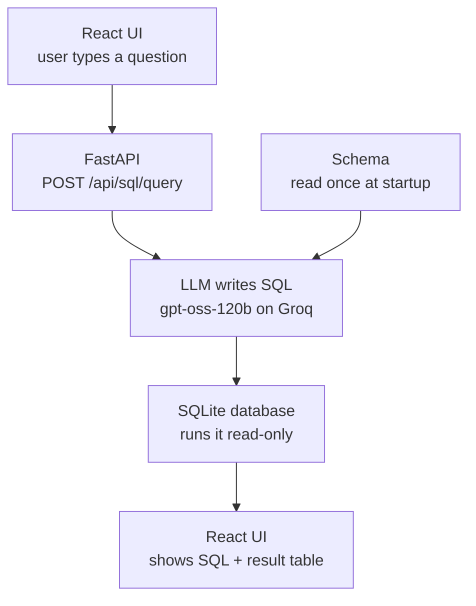
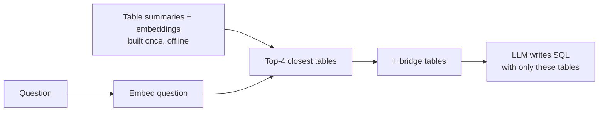

# Retrieval and Reasoning Engine

LLM-powered systems that answer questions **only from our own data**, built in versions. One app, two tabs:

| Version | System | Answers from | Status |
|---|---|---|---|
| **Version-1** | RAG (Retrieval-Augmented Generation) | Text documents | Complete |
| **Version-2** | Text-to-SQL | SQLite databases | In progress |

## Contents

- [Goal](#goal)
- [Project Structure](#project-structure)
- [Getting Started](#getting-started)
- [Version-1: RAG over Text Documents](#version-1-target)
- [Version-2: LLM-Powered Text-to-SQL System](#version-2-llm-powered-text-to-sql-system)
- [Version-3: Scaling to Large Databases](#version-3-scaling-to-large-databases)
- [Models](#models)

## Goal

Build a personal, ChatGPT-like assistant that answers questions **only from the data we give it**: it finds the most relevant pieces of our data, reasons over them with an LLM, and shows what it used, so answers stay grounded instead of made up.

- **Version-1** does this over text documents: it retrieves passages and cites them.
- **Version-2** does this over databases: it writes SQL, runs it, and shows the query and the result table.

---

## Project Structure

```
multimodal-retrieval-engine/
├── backend/
│   ├── main.py              # one FastAPI server for both versions + serves the React app
│   ├── config.py            # all API keys (read from .env) and model names
│   ├── rag/                 # Version-1: RAG
│   │   ├── api.py           #   /api/rag/query, /api/rag/feedback
│   │   ├── pipeline.py      #   encode → search → re-rank → answer
│   │   ├── encoders/        #   text embeddings (all-mpnet-base-v2)
│   │   ├── retrieval/       #   vector index + re-ranker
│   │   ├── reasoning/       #   LLM answer with citations
│   │   └── feedback/        #   thumbs up/down logger
│   └── text_to_sql/         # Version-2: Text-to-SQL
│       ├── api.py           #   /api/sql/query
│       ├── pipeline.py      #   question → SQL → result
│       ├── sql_generator.py #   LLM writes the SQL
│       ├── database.py      #   loads .sqlite files, runs SQL read-only
│       ├── descriptions.py  #   reads database descriptions, adds them to the schema
│       ├── schema_index.py  #   Version-3: finds relevant tables with embeddings
│       └── table_summaries.py # Version-3: LLM-written table summaries (offline)
├── frontend/                # React app (Vite) with two tabs
│   └── src/tabs/            #   RagTab.jsx, SqlTab.jsx
├── data/
│   ├── rag/                 # Version-1: raw docs, built index, eval set
│   └── text_to_sql/         # Version-2: one folder per database
│       └── retail_store/    #   practice DB, descriptions, 20 questions + answers
├── scripts/
│   ├── rag/                 # build the index, retrieval eval, RAGAS metrics
│   └── text_to_sql/         # evaluate.py: execution accuracy on question sets
├── .env.example             # template for API keys (copy to .env)
└── requirements.txt
```

---

## Getting Started

### 1. Python environment (first time only)

```bash
python3 -m venv .venv
source .venv/bin/activate
pip install -r requirements.txt
```

In every new terminal after that, just run `source .venv/bin/activate`.

### 2. API keys

All keys live in one file. Copy the template and fill it in:

```bash
cp .env.example .env
```

| Key | Used by | Required? |
|---|---|---|
| `GROQ_API_KEY` | Version-1 answers and Version-2 SQL generation | Yes ([get one](https://console.groq.com/keys)) |
| `HF_TOKEN` | Version-1 RAGAS evaluation scripts | Optional |

`.env` is git-ignored, so keys never reach GitHub.

### 3. Build the UI (first time, and after UI changes)

```bash
cd frontend && npm install && npm run build && cd ..
```

### 4. Run

```bash
uvicorn backend.main:app --reload
```

Open **http://localhost:8000** and pick a tab: **RAG (Version-1)** or **Text-to-SQL (Version-2)**.

> **Editing the UI?** Run `npm run dev` inside `frontend/` and open http://localhost:5173 for instant reload (the backend must also be running).

### Useful commands

| Task | Command |
|---|---|
| Rebuild the RAG index after changing docs | `python -m scripts.rag.build_index` |
| Score Text-to-SQL on the practice questions | `python -m scripts.text_to_sql.evaluate` |
| Check table picking only (no LLM calls) | `python -m scripts.text_to_sql.evaluate --retrieval-only` |
| Compare with sending every table | `python -m scripts.text_to_sql.evaluate --full-schema` |
| Summarize new/changed tables (LLM), then embed | `python -m scripts.text_to_sql.build_schema_index` |
| Re-embed only, no LLM calls | `python -m scripts.text_to_sql.build_schema_index --skip-summaries` |
| API docs (auto-generated) | http://localhost:8000/docs |

---

## Version-1 Target

Build a complete, working end-to-end RAG (Retrieval-Augmented Generation) pipeline, from raw documents to a cited answer in a web UI, and measure how well it performs so later versions have a baseline to improve on.

---

## Version-1: What We Built

### Version-1.1: Basic Text Semantic Search + Bullet Summary

We built the basic architecture.

- **Frontend:** takes text as input (like a search bar) and shows the relevant output.
- **Backend:**
  1. Reads the data sources we provide, breaks them into chunks, creates a vector embedding for each chunk and stores them.
  2. Takes the query and compares it with the stored chunks to find the nearest ones.
  3. Computes cosine similarity, sorts by similarity and normalizes scores between 0 and 1.
  4. Keeps the ones above a threshold.
  5. Returns them as bullet points.

### Version-1.2: LLM-Powered Answering (True RAG)

The pipeline so far only returned the top-k chunks. Now we use an actual LLM to reason over them and write a proper answer.

- Tried `microsoft/Phi-3-mini-4k-instruct` locally: decent reasoning, but very slow.
- For now, we keep showing the relevant top-k chunks alongside the answer.

### Version-1.3: Smarter Chunking (Token-based + Overlap)

We used to store one line of a paragraph as one chunk. Now we split text into words using a **sliding window**: a chunk length of 80 with an overlap of 40.

- **Chunk length:** too big captures more context but creates fewer, heavier chunks that mix topics; too small is more precise but can miss context.
- **Overlap:** keeps ideas from being cut at chunk boundaries, at the cost of some redundancy.
- **Result:** chunk length 80 with overlap 40 worked best.

### Version-1.4: Two-Stage Retrieval (Re-Ranking)

- **Stage 1:** embed the query, compute similarity scores and take the top-k chunks.
- **Stage 2:** re-rank those candidates with a more precise matching step.

Options considered for stage 2:

1. **Common-word count (in use now):** store each query word in a map, then check each word of the chunk against it. Time complexity O(n), simple but not very precise.
2. **Word-by-word similarity:** compare every query word with every chunk word. For n chunks of k words and a query of m words, O(n × k × m), which is expensive.
3. **Cross-encoders:** transformer models that read the query and chunk together with self-attention and output a relevance score. Pre-trained ones such as `cross-encoder/ms-marco-MiniLM-L-12-v2` can be plugged in.

### Version-1.5: Metadata-Aware Search (Filters & Scopes)

Chunk metadata was only:

```json
{"id": "doc1_chunk0", "path": "...", "text": "..."}
```

That isn't enough to filter by document type, group by source, or search only a subset.

Improvements:

1. Added a `source` field to the metadata, so we know where each chunk came from.
2. Added a source filter, which limits the input space the answer can come from.
3. Let the user pick sources in the UI, and show source information with each returned chunk.

### Version-1.6: Evaluation & Metrics (Text-Only Bench)

The workflow produced results, but we had no metrics to judge them. Added checks for:

1. Whether the correct source was used.
2. Whether the correct snippet is part of the output.

### Version-1.7: Relevance Feedback Loop (Thumbs-Up/Down)

Current steps to get context chunks:

1. Take the top 10 chunks.
2. Re-rank and keep the top 5.
3. Filter by score threshold.

Questions feedback should answer:

1. Is the threshold too high or too low?
2. Do users want fewer chunks?
3. Are we often retrieving irrelevant items, and how do we improve?

Feedback is collected to help:

1. Tune the threshold.
2. Tune re-ranking and choose the right logic.
3. Understand and fix chunking issues.
4. Provide live performance metrics.
5. Build real training data for future LLM integration.
6. Move toward production readiness.

### Version-1.8: Multi-Collection / Namespace Support

All sources used to sit in one data dump. As the data grows, we need separate buckets of related files.

- Added **collections**: the user picks a collection first, then the sources inside it, for finer control over the context the model answers from.

### Version-1.9: Polished UX (Rich Text UI + Citation Viewer)

Improved the UI layout and how answers and citations are displayed.

---

## Version-1 Summary

**Built a text RAG engine: notes are chunked with overlapping windows and embedded with all-mpnet-base-v2 (768 dimensions); a search (top 20 by cosine similarity, filtered by source and collection) is narrowed to the top 5 by word-overlap re-ranking; Llama-3.1-8B on Groq answers with cited sources; a FastAPI web UI and thumbs up/down feedback logging sit on top; RAGAS evaluation scored 0.57 overall (faithfulness 0.53, relevancy 0.87, context precision 0.44), which makes improving those scores the goal of Version 2.**

### Complete Life-cycle

1. A UI that answers user questions from pre-stored data.
2. Users choose which sources the answer should come from.
3. Each output includes the answer, its reasoning and citations from the sources.

### Concepts Used

1. Sliding-window chunking (length + overlap), with chunks stored as 768-dimension vectors.
2. Query encoding and cosine similarity, `a @ b / (‖a‖ · ‖b‖)`, to get the top 20 chunks.
3. Term-based re-ranking of those candidates to get the final top 5.
4. Reasoning through an online Groq-hosted model.

### Models Used

| Role | Model |
|---|---|
| Embeddings | `all-mpnet-base-v2` (sentence-transformers) |
| Reasoning | `llama-3.1-8b-instant` (Groq) |

> **Later update:** Groq retired its Llama models, so Version-1 now answers with `openai/gpt-oss-20b`. The index was also rebuilt with `all-mpnet-base-v2`: the saved one had been built with the older MiniLM model (384 dimensions vs 768), which made every query fail.

### Evaluation Metrics

Measured with RAGAS on 3 test questions:

| Metric | Score |
|---|---|
| Faithfulness | 0.5333 |
| Relevancy | 0.8713 |
| Context Precision | 0.4444 |
| **Overall RAGAS Score** | **0.5689** |

**Insight:** low faithfulness suggests hallucinations, so the context chunks need checking.

### Conclusion

The RAG engine works end to end, but its performance needs improving, which is the goal of Version-2.

---

## Version-2: LLM-Powered Text-to-SQL System

### Goal

Shift from answering over text documents to answering over **structured data**: build an LLM-powered system that takes a question in plain English, writes the right SQL query against our `.sqlite` databases, runs it, and returns the result.

### Version-2 Target

Make the system as **accurate and efficient** as possible, and verify it on the **BIRD benchmark**, which tests text-to-SQL on large, real-world SQLite databases. BIRD scores:

- **Execution Accuracy (EX):** whether our query returns the same result as the correct query.
- **Valid Efficiency Score (VES):** how fast our correct queries run compared with the reference queries.

### How It Works



1. **Startup (once):** every `.sqlite` file under `data/text_to_sql/` is attached **read-only**, and its schema is loaded from the best source available: the **database descriptions** (see Version-2.2), else a `schema.sql`, else the plain table definitions.
2. **Question:** the user types a question in the Text-to-SQL tab.
3. **SQL generation:** the LLM gets the schema + the question and writes **one `SELECT` query**.
4. **Execution:** the query runs on the database (only `SELECT`/`WITH` allowed, at most 500 rows).
5. **Output:** the UI shows the SQL that was run and the answer table, or a clear error.

### Version-2.1: Baseline Text-to-SQL (current)

The simplest system that works end to end, to get a starting score:

- **UI:** one question box; the output is the SQL and the answer table.
- **Model:** `openai/gpt-oss-120b` on Groq, temperature 0.
- **Prompt:** the full schema + the question; no examples, no sample values.
- **Safety:** databases are opened read-only, and only `SELECT` queries are allowed.

### Version-2.2: Database Descriptions

**The problem.** The same data can be read in more than one way, and the table definitions alone don't say which is right:

- Is `03/04/2026` March 4th or April 3rd?
- Is `39999` a price of $39,999 or $399.99 (cents)?
- Are `New York`, `NY` and `NYC` the same city?
- Do cancelled orders count as revenue?

Only the people who own the data know the answers, so the answers have to be **written down once** and given to the model with every question.

**Why BIRD does the same.** BIRD faces exactly this problem, so every BIRD database comes with a `database_description/` folder: one CSV per table that explains each column. Systems are expected to read it. We use the **same format**, so the same code will work on our practice database and on BIRD.

**The format** (one CSV per table, e.g. `orders.csv`):

| original_column_name | column_description | data_format | value_description |
|---|---|---|---|
| `order_date` | date the order was placed | text | stored as MM/DD/YYYY, e.g. '03/04/2026' means March 4, 2026 |
| `status` | current status of the order | text | 'cancelled' = … excluded from revenue |

**What we built:**

1. **Attach meanings to columns.** At startup, each description is placed right next to its column in the schema the model sees:
   ```sql
   order_date TEXT,  -- date the order was placed; stored as TEXT in MM/DD/YYYY format, e.g. '03/04/2026' means March 4, 2026
   ```
   The meaning sits exactly where the model is about to use the column.
2. **Check the descriptions against the data** (read-only) and print a warning if they disagree: a value missing from a "one of: …" list, a date not in the stated format, a described column that doesn't exist, or a table with no description.
3. **Fall back gracefully:** no descriptions → `schema.sql` → plain table definitions.

**What descriptions don't solve:** they explain the **data**, not the **question**. If a user types "Q2" or "NYC", the model still has to interpret it, and question-specific choices (does "top customers" mean 5 or 10?) need a per-question hint, which BIRD calls **evidence**.

### Practice Database: `retail_store`

Before BIRD, the system is tested on a small practice database in `data/text_to_sql/retail_store/`:

| File | What it is |
|---|---|
| `retail_store.sqlite` | 10 tables (stores, employees, customers, orders, payments, …), 50 rows each |
| `database_description/` | One CSV per table (BIRD format): what each column means, its format and values |
| `schema.sql` | `CREATE TABLE` statements with comments (used only if there are no descriptions) |
| `questions.json` / `.md` | 20 questions (6 easy, 8 medium, 6 hard) with the correct SQL and answers |

Traps built into the data:

- **Messy values:** New York City appears as `New York`, `NY`, `NYC` and `new york`.
- **Hidden date format:** `orders.order_date` is `MM/DD/YYYY`; every other date is `YYYY-MM-DD`.
- **Units:** prices and amounts are stored in **cents**.
- **Cancelled orders:** they must be excluded from revenue.

### Evaluation

```bash
python -m scripts.text_to_sql.evaluate
```

For each question, the model's SQL and the correct SQL both run on the database and their results are compared (Execution Accuracy, as in BIRD). Wrong answers print the model's SQL, the expected result and the trap it fell into, followed by a score per difficulty.

### Known Limitations (next steps)

| Limitation | Effect | Possible fix |
|---|---|---|
| Question phrasing isn't normalized | "Q2", "last spring", "NYC" in a question are left to the model | Rewrite dates and known short forms before the LLM sees them |
| No per-question hints | "Top customers": 5 or 10? | Add an `evidence` field per question, like BIRD |
| No sample values in the prompt | Messy values are only known if someone described them | Add a few distinct values per column |
| One attempt only | A failing query is not corrected | Retry with the error message |
| "List all tables" returns nothing | Tables live in attached databases, not `main` | Expose a table-list view to the model |
| Only data questions | "What do these tables mean?" can't be answered with SQL | Let the model answer in words from the schema |
| Full schema every time | Too large for BIRD's bigger databases | Solved in Version-3: send only relevant tables |
| No conversation memory | Follow-ups like "sort that by city" don't work | Pass previous question + SQL |

---

## Version-3: Scaling to Large Databases

Version-2 sends the **whole schema** with every question. Fine for 10 tables, not for real databases with hundreds.

### Open Questions

**1. What goes wrong if we paste all 500 tables into every prompt?**
The LLM confuses similar tables (`orders` vs `order_items`), the schema can overflow the context window, accuracy drops, and every query gets slower and more expensive.

**2. How do we send only the relevant tables?**
Index tables **once, offline**; then per question, **first pick the top-k tables, then write SQL** with only those.

**3. Can we pick tables without an LLM reading all 500 summaries?**
Yes, with **embeddings** (RAG applied to schemas, like Version-1): compare the question with each table's embedding in milliseconds. An LLM re-pick (20 → 5) can be added later if needed.

**4. Is a list of column names a real summary?**
No. It says what columns exist, not what the table **means**. People ask in business words ("revenue", "spent"), so an LLM writes a real summary per table.

**5. Won't summaries go stale if they mention other tables?**
Yes, so each summary describes **only its own table**. Links between tables come from the live foreign keys.

### How It Works



- **Offline (`build_schema_index`):** the LLM writes a summary of each table from its schema, descriptions and sample rows: what a row is, what it answers, the words people use. Summaries naming other tables are rejected and rewritten. Only new or changed tables are summarized again. Summaries are saved to an editable `table_summaries.json`, then embedded.
- **Per question:** pick the 4 closest tables, then add **bridge tables** (linked to 2+ picked tables, e.g. `orders` for "revenue by category"). Only those go to the LLM, and the UI shows which ones.

### Results (practice database, table picking only)

| Setting | Right tables picked | Tables sent |
|---|---|---|
| Top-3 | 19/20 | 3.3 of 10 |
| **Top-4 (default)** | **20/20** | **4.5 of 10** |
| Full schema (Version-2) | 20/20 | 10 of 10 |

LLM summaries vs column names: **same picks**, slightly better ranking (needed tables rank 1.74 vs 1.82 on average). 10 tables is too few to show a real difference; re-test on BIRD.

---

## Models

| Version | Role | Model | Where |
|---|---|---|---|
| Version-1 | Embeddings | `all-mpnet-base-v2` | Local (sentence-transformers) |
| Version-1 | Answer writing | `openai/gpt-oss-20b` | Groq |
| Version-2 | SQL generation | `openai/gpt-oss-120b` | Groq |
| Version-3 | Table search (embeddings) | `all-mpnet-base-v2` (shared with Version-1) | Local (sentence-transformers) |
| Version-3 | Table summaries (offline) | `openai/gpt-oss-120b` | Groq |

Model names are set in `backend/config.py`. To see which models your Groq key can use, check the [Groq models page](https://console.groq.com/docs/models).
